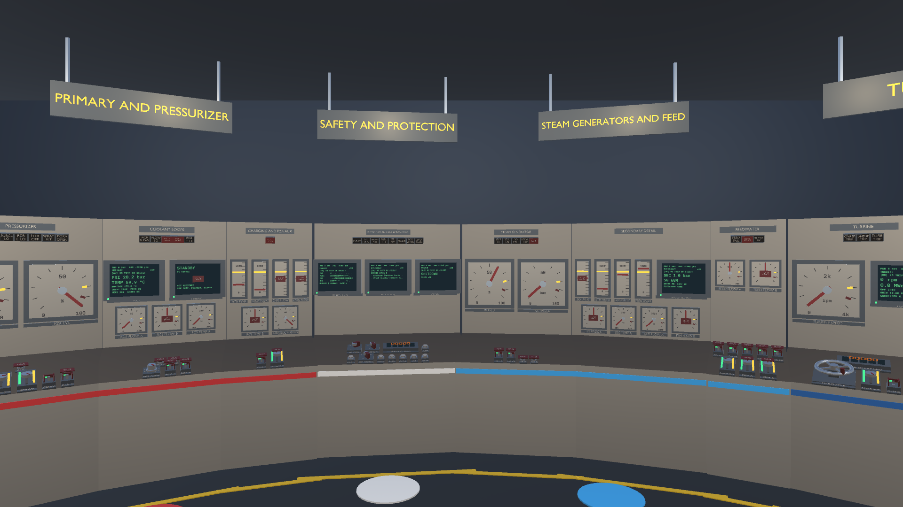
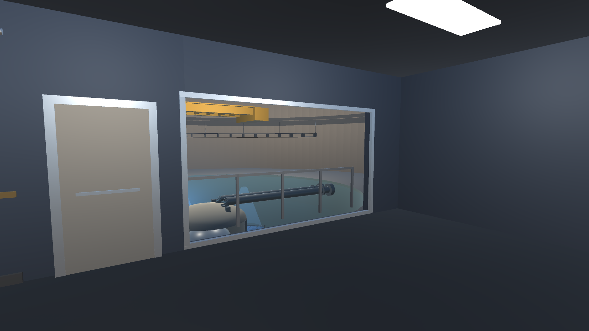
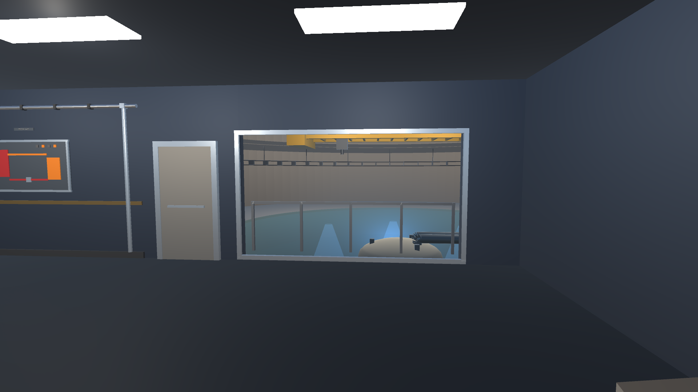
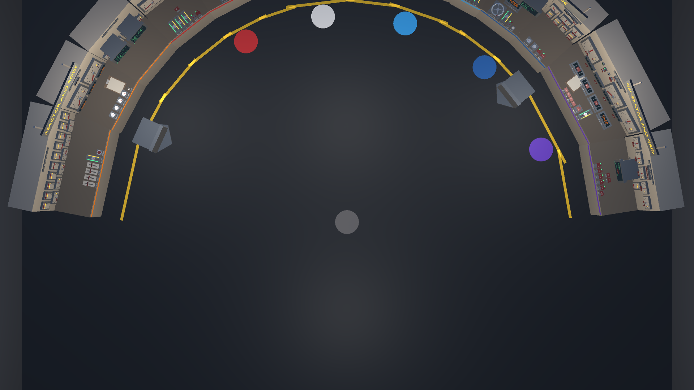

# Reactor Sim

An original, deterministic pressurized-water-reactor (PWR) plant simulator. A pure C# simulation core, a Unity
control room you can walk around in, and procedurally generated Blender assets. Educational entertainment: the
physics is built from published reactor engineering, but it is a game, not a licensed training simulator.



| Observation window, from the standing position | Observation window, from the seat position |
|---|---|
|  |  |



## What is in it

- **Point kinetics.** Six delayed-neutron groups (Keepin data), analytic sub-stepping so the long game tick stays
  converged.
- **Xenon and iodine.** I-135 / Xe-135 poison dynamics, including the post-shutdown xenon pit.
- **Decay heat.** Three-group exponential decay heat after SCRAM.
- **Reactivity ledger.** Rods (S-curve worth, absorber depletion), boron, Doppler, moderator, xenon.
- **Thermal-hydraulics.** Lumped, energy-conserving fuel, primary loop, steam generator and pressurizer, with an
  IAPWS-IF97 saturation fit.
- **Balance of plant.** Turbine and generator (auto-load governor or manual synchronisation), grid, condenser and
  vacuum, hotwell and feed, cooling tower, latched trips.
- **Guided startup.** A 13-step cold-shutdown-to-grid procedure with named done-conditions evaluated against live
  plant state ([docs/STARTUP.md](docs/STARTUP.md)).
- **Control room.** Diegetic switches, gauges, annunciators and CRT pages, with an observation window onto a
  true-scale small-modular-reactor module in a 22 m deep refuelling pool (its head is checked to show over the pool
  rim from both the standing and the seat position in `HallSightline`); procedural audio; LAN co-op over TCP.
- **Tooling.** JSON snapshots, an intent pipeline, an HTTP API, an stdio MCP bridge, JSONL logging and golden
  replay.

## Build, run, test

Requires the .NET SDK 8 or newer.

```bash
bash scripts/ci.sh                                   # the verification contract (see below)
dotnet run --project ReactorSim.Runner               # baseline startup transient with telemetry
dotnet run --project ReactorSim.Runner -- --list     # scenarios and checks
dotnet run --project ReactorSim.Runner -- --serve    # live HTTP API on :7770
```

`scripts/ci.sh` runs: Core DLL freshness, the clean-room scan, a Release build with warnings as errors, the xUnit
tests, the scripted scenario suite, and the determinism / numerics `--verify` checks. Set `UNITY_EXE` to also run
the Unity batchmode checks. See [docs/TESTING.md](docs/TESTING.md).

To use the Unity front-end, run `bash scripts/sync-core-to-unity.sh` (builds the Core and copies it into
`ReactorSim.Unity/Assets/Plugins/`), then open `ReactorSim.Unity` with Unity 6 (6000.6.7f1). The `Bootstrap` scene
holds the control room. Playing a Windows build: [docs/PLAYTEST.md](docs/PLAYTEST.md).

## Layout

```
ReactorSim.Core/        Engine-agnostic simulation library (netstandard2.1, Unity-ready)
ReactorSim.Core.Tests/  xUnit tests
ReactorSim.Runner/      Console harness: scenarios, --verify checks, replay, --serve
ReactorSim.McpBridge/   stdio MCP bridge over the HTTP API
ReactorSim.Unity/       Unity 6 front-end: 3D control room, CRT screens, missions, co-op
Blender/                Procedural .blend generators, FBX export, trim-sheet bake
design/                 Control inventory, layout and kit data that drive the room
docs/                   Architecture, testing contract, design, startup procedure
scripts/                ci.sh, run.sh, sync-core-to-unity.sh, clean_room_check.sh
```

Full map: [INDEX.md](INDEX.md).

## Procedural asset pipeline

Every 3D asset is generated from Python, so it stays regenerable and diffable.

1. `Blender/scripts/make_control_room.py`, `make_panel_kits.py` and `make_plant_equipment.py` build the `.blend`
   files, using data from `design/control-room/` (control inventory, panel kits, room layout).
2. `bake_trim_sheets.py` bakes the master materials to texture trim sheets; `export_unity.py` writes FBX files.
3. The sync script copies the FBX and textures into `ReactorSim.Unity/Assets/Blender/`, where an asset
   post-processor binds the textures to the imported materials.
4. Unity editor code assembles the room from those assets and binds each control to a Core intent or reading;
   batchmode checks verify the control map, instruments, layout (reach, view angle, occlusion) and a play-mode
   round trip of every bound control.

Details: [Blender/README.md](Blender/README.md), [docs/design/](docs/design).

## Clean-room statement

Original implementation; no code, assets or data from any other simulator. Every number in
`ReactorSim.Core/Physics.cs` and the code that uses it is either a published reactor-engineering or power-plant
value (the source is named in its comment) or a gameplay choice made here with a stated rationale. Plant ratings
and pacing were chosen independently from public ranges: a 160 MWt small-modular-reactor-scale plant, 12 ticks
(5 s) per game-minute, a 1 %/s rod drive (about twice real rod-control speed) and 4 banks of 12 rod clusters.
`scripts/clean_room_check.sh` runs in CI to keep the tree free of third-party simulator references; it scans
paths and content, including compressed and UTF-16 data, and ships a self-test (`--self-test`) with negative controls.

## License

MIT, see [LICENSE](LICENSE). Third-party components: [THIRD_PARTY_NOTICES.md](THIRD_PARTY_NOTICES.md).
