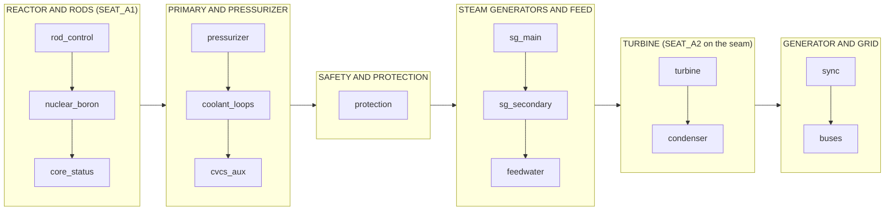

# Main control room: layout spec

Human-readable spec for the walkable main control room. The numbers live in
[`design/control-room/layout.json`](../../design/control-room/layout.json) (room, arc, sections, panels, operating
points, cameras, check thresholds). Every device sits in [`inventory.csv`](../../design/control-room/inventory.csv)
(`physical_type`, `kit`, `section`, `panel`, `slot`); the kit footprints are in
[`kits.json`](../../design/control-room/kits.json). `InventoryTests` keeps all four consistent. Counts per
section, panel and kit are in [`rollup.md`](../../design/control-room/rollup.md).

## Zone map

The board runs left to right in real PWR order (R4). The reactor operator's seat `SEAT_A1` is at the left end; the
turbine and electrical operator's seat `SEAT_A2` is on the turbine/electrical seam. `STAND_Center` is the arc centre,
from which the whole board and every annunciator band read.

Each panel has a vertical face (indicators, annunciator tiles on the top three rows, CRTs) above a sloped bench
(controls). The synchronising panel is the one exception: its generator breaker switch is on the vertical face.

## Sections and panels

| Section | Panel | What it holds |
|---|---|---|
| reactor | `rod_control` | Four rod bank levers, the all-rods slider, the SCRAM mushroom on the bench; rod position bars, rod integrity and speed, the decay-heat, total-heat and Xe/I inventory bars, the four reactivity component gauges, power % and the pH meter above |
| reactor | `nuclear_boron` | Boron, dilute, NaOH and ion-exchange knobs, excore and sector flux counters, critical lamp; the two large overview gauges (core power in MWt, total reactivity); boron-low and pH-drift tiles |
| reactor | `core_status` | Reactor core and chemistry CRTs; period, fuel temperature, Xe and I reactivity gauges |
| primary | `pressurizer` | Level, heater and spray sliders, PORV button and block switch; the large pressure and pressurizer-level gauges; seven pressure, level, heater, spray and PORV tiles |
| primary | `coolant_loops` | Flow knob, RCP A and B switches and lamps; primary and loop CRTs, flow and loop A temperature gauges; low-flow, RCP trip and temperature tiles |
| primary | `cvcs_aux` | Charging pump switch, letdown valve slider; heater and spray power, charging and letdown flow bars, loop B temperature and subcooling; charging-loss tile |
| safety | `protection` | Scram reset, mode selector, clock buttons, assistant tier and mission selectors, game clock; event log, assistant terminal and mimic status CRTs; the seven protection tiles and the paused lamp |
| steam | `sg_main` | MSIV A and B switches and position lamps; the large SG level and SG pressure gauges; SG pressure, level, relief, low-level-trip and MSIV tiles |
| steam | `sg_secondary` | SG B level, steam void, hotwell level and feed availability bars, the secondary CRT; SG B pressure, SG temperature and steam flow gauges |
| steam | `feedwater` | Feed flow and regulating-valve sliders, feed, auxiliary feed and condensate pump switches; feed flow gauges; feed-failure, feed-pump-trip and hotwell tiles |
| turbine | `turbine` | Steam demand handwheel, steam dump slider, auto-load switch, trip reset, mechanical-power counter; the large turbine-speed gauge and the turbine CRT; overspeed, underspeed and tripped tiles |
| turbine | `condenser` | Vacuum pump and cooling-water knobs, circulating pump switches; condenser pressure, tower rejection and delta-T gauges, throttle and dump position, cooling and circulating-water bars; vacuum and cooling tiles |
| electrical | `sync` | See below |
| electrical | `buses` | Unit and auxiliary transformer, bus tie, offsite and diesel breakers, diesel start, offsite and diesel lamps; bus, house-load, offsite and diesel voltage gauges, the grid CRT, grid output bar; bus, offsite and diesel tiles |

### Grid sync panel (R4)

At eye level on the vertical face, left to right: the synchroscope (large gauge), the green lamp, the generator
breaker switch, the red lamp and the sync-check lamp, then the generator MW and grid frequency overview gauges. Under
them, a row of four counters: incoming and running voltage, incoming and running frequency. The bench directly below
holds governor raise and lower, voltage raise and lower, the sync selector and the grid demand slider, with the MVAR,
generator voltage, field current and out-of-sync timer counters beside them. The synchroscope, the four meters and the
breaker switch are on `vert`; the four raise and lower switches are on `bench` (tests enforce both).

## Dimensions (KTD3)

| Item | Value |
|---|---|
| Shell | 12 x 10 m, ceiling 3.2 m |
| Board | arc of 175 degrees, radius 5.0 m, centre (6.0, 4.5), about 15.3 m of panel face |
| Bench | front edge 0.76 m, slope 15 degrees, 0.60 m deep along the slope (0.58 m in plan), back edge 0.92 m |
| Vertical face | usable 0.9 to 1.8 m; instrument band 0.9 to 1.6 m; annunciator band 1.6 to 1.8 m (three tile rows, tilted 10 degrees); title plate on the header at 1.82 m |
| Eye height | seated 1.2 m, standing 1.65 m |
| Interaction range | 2.0 m from the eye |
| Reach | 0.7 m from the bench edge |

The arc differs from the 120 degree, 4.5 m (9.4 m of board) in the plan. The 200 rows need 15.2 m of panel at kit
size. A panel's vertical face holds at most two rows of gauges (0.70 m of usable height), so board length is set by
gauge count, not by room: even a perfect packing of the kit areas needs about 10 m. The arc note in
`layout.json` records this. Two ways to shorten the board if the owner wants the original 120 degrees: share CRT
screens between pages (very roughly 2 m), or drop secondary-detail gauges (very roughly 1.5 m).

## Operating points

Each section has a standing point 0.6 m in front of the bench at the section's mid angle (radius 3.82 m).

| Point | Position (x, y) | Notes |
|---|---|---|
| `STAND_reactor` | 2.51, 6.06 | `SEAT_A1` and `SPAWN_A1` share it (seated, eye 1.2 m) |
| `STAND_primary` | 4.14, 7.84 | |
| `STAND_safety` | 5.56, 8.30 | |
| `STAND_steam` | 7.07, 8.17 | |
| `STAND_turbine` | 8.54, 7.36 | |
| `STAND_electrical` | 9.58, 5.84 | |
| `SEAT_A2` | 8.99, 6.87 | on the turbine/electrical seam |
| `STAND_Center` | 6.00, 4.50 | arc centre, overview |

Cameras: `CAM_Seat_A1` (seated at the reactor desk, 90 degrees), `CAM_Stand_Center` (three 70 degree images at
headings -58, 0 and 58, because the board is wider than one frame) and `CAM_Top` (orthographic, ceiling hidden).

KTD8 thresholds in `layout.json` `checks`: reach 0.7 m, at least 45 degrees to the display plane, at least 0.9
degrees of text height (14 mm at 0.9 m, 78 mm at 5 m). Each row is checked from its section's `STAND_` point;
`overview=y` rows are also checked from `STAND_Center` and use overview-capable kits (K01L gauges, K05 tiles, K04
counters). `InventoryTests` already checks the 45 degree rule per panel edge from the operating point, and that each
section's panels fit its arc.

## Physical types (KTD5)

| Function | Type, kit |
|---|---|
| Continuous setpoint | rotary knob K08, setpoint slider K12 |
| Discrete mode | stepped knob K09 |
| Momentary command | pushbutton K19 (SCRAM: K06) |
| Two-state equipment (pumps, breakers, valves, PORV, auto-load) | guarded toggle K11 |
| Rod bank | lever K07 |
| Turbine throttle | handwheel K10 |
| Process value | circular gauge K01, large K01L for `overview=y`; levels and positions edgewise K02 |
| Large number | counter K04 |
| Alarm | annunciator tile K05 |
| Status lamp | K20 |
| CRT page | K13 |

Exceptions are recorded in the row's `label` as `[type note: ...]`: the sync voltmeters and frequency meters, MVAR,
generator voltage, field current and the turbine mechanical-power meter are counters (K04) to fit the eye-level row,
and the PORV button is a K11 toggle although its binding is a momentary button.

## Signposting

- Section signs: one lit K21 sign per section hung at 2.75 m over the section's mid angle, text from the section title.
- Title plates: one K22 per panel on the panel header.
- Bench mimic stripe: a coloured stripe along the bench lip of each section. Reactor amber `#f2a900`, primary red
  `#d64545`, safety white `#e8e8e8`, steam light blue `#5bc0eb`, turbine blue `#2e86c1`, electrical violet `#8e5bd1`.
- Floor markings: a floor pad in the section colour under each `STAND_` point, and a yellow line 0.35 m in front of
  the bench edge.
- Out-of-service rows carry a K23 tag over their kit (KTD6); they are not extra rows.

## CRT page switching

Decision: a screen shows one fixed page. Each CRT page (`CRT_A1_Core` and the rest) is its own K13 screen and its
own inventory row, so `CrtScreenRenderer.screenName` and `CrtPages.KnownPages` stay as they are. Neither a page-select
knob beside each screen nor click-to-cycle is built: both would add per-screen state and an interaction path (a new
knob kind or a click handler on the screen) that `CrtScreenRenderer` and the binders do not have, and the inventory
would stop being one row per device. The cost is ten screens (about 4 m of vertical face). If the board has to
shrink, click-to-cycle on the reactor and safety screens is the cheaper change: it needs a `CrtScreenRenderer` click
handler and a page list per screen, and the pages become cycle entries on one K13 row.

## Mapping to plant-and-assets zones

| Zone in [plant-and-assets.md](plant-and-assets.md) | Where it sits |
|---|---|
| 1 Reactor / neutronics | `reactor` section |
| 2 Primary temperature, pressure, inventory | `primary` section |
| 3 SG, feedwater, steam | `steam` section |
| 4 Turbine and grid | `turbine` section and `electrical/sync` |
| 5 Power auxiliaries | `electrical/buses` |
| 6 Cooling and safety | `safety/protection`, `turbine/condenser` (cooling water) |
| 7 Alarm, event, trend | annunciator band on every panel, `safety/protection` tiles and event log CRT, read from `STAND_Center` |
| 8 Supervisor and missions | `safety/protection` (clock, assistant tier, missions, assistant terminal, mimic board) |

## Open item

NUREG-0700 Rev 3 was not fetched in this unit, so the ergonomic numbers above are still the background-knowledge
values of KTD3 (bench height, annunciator band, eye height, reach). They are all in `layout.json`; change them there.
