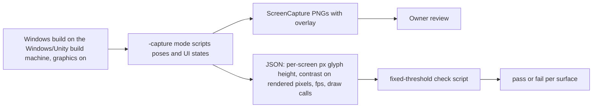

# Playtest 2 - Operable, Readable Control Room and SMR Pool Hall - Plan

## Goal Capsule

- **Target repo:** the public Reactor Sim repository once it exists (published from a clean-room snapshot after PR #18); this work will be migrated there. The plan holds no machine names, user names or home paths: the Windows build machine is `$REACTOR_SIM_WIN_HOST` and its user home is `%USERPROFILE%`.
- **Objective:** The owner plays the sandbox at the Windows build's real window size, turns every control with a deliberate click-hold-drag, reads every screen, label and menu without strain, walks the room without fighting it, and sees through the control-room window a believable small modular reactor in a deep pool.
- **Means:** An in-game capture and telemetry harness first, so each fix is judged on real in-engine screenshots and logged input (KTD1). Then a dial-interaction rework, a movement tune, a pixel-budgeted screen and typography pass, and last a true-scale SMR pool hall (KTD2, KTD4, KTD5, KTD6, KTD8).
- **Authority:** Product Contract wins on behavior, KTDs win on mechanism. The five Key Decisions are settled by the owner and are not reopened. This plan supersedes the hall geometry of R2 and R3 in `docs/plans/2026-11-08-2336-feat-startup-window-legibility-plan.md` and keeps its theme token layer.
- **Execution profile:**
  - Pure logic (drag maths, movement maths, readout formatting, contrast, pixel-budget maths) is UnityEngine-free, linked into `ReactorSim.Core.Tests`, and runs through `bash scripts/ci.sh` on any Linux box.
  - Scene regeneration, graphics-enabled capture runs, the Windows build and visual review run only on the Windows/Unity build machine (reached with `ssh $REACTOR_SIM_WIN_HOST`; Unity 6000.6.7f1, Blender 5.2, a POSIX shell) in a separate worktree. Never touch the owner's main checkout there, never kill processes, one Unity instance at a time. The machine is often offline, so these are owner-or-build-machine steps, never a hard CI dependency.
  - No `ReactorSim.Core` change is planned. If one becomes necessary, follow it with `bash scripts/sync-core-to-unity.sh` and commit the regenerated plugin files.
  - Rebase after PR #18 (`chore/public-snapshot-prep`) merges: it changes core constants (rated power, ticks per minute, rod speed, rod count) and scrubs provenance. Nothing here may hard-code those values, and nothing may name or reuse any third-party game, its data or its research.
- **Stop conditions:**
  - Stop and report if a capture run cannot produce a UI-overlay screenshot on the Windows/Unity build machine (U1). Every later legibility claim depends on it.
  - Stop and report if the hall cannot meet the frame-time budget in KTD9 without removing the pool depth the owner chose.
  - Stop and report if the corrected window breaks `LayoutCheck` reach or visibility checks.

---

## Product Contract

### Summary

The second Windows playtest (2026-11-10 UTC, builds `1.0+20261110.0235`) found four usability faults and one visual fault. Knobs are hard to turn, screens are nearly unreadable, movement is bad, text and menus read as raw text, and the reactor behind the window is too small. This plan makes the room operable and legible first, then rebuilds the hall as a real small modular reactor in a deep pool.

### Problem Frame

Playtest evidence from `out/playtest` logs fetched read-only from the Windows/Unity build machine (sessions `20261109-193550` and `20261109-194631`):

- **Frame rate is not the problem.** `InputProbe` reports 175 fps at 1600x900 windowed for both sessions. Only two start-up stalls appear (2.5 s and 40.9 s worst frame) before play.
- **Almost nothing was operated.** The first session recorded 0 intents in 296 ticks. The second recorded its first intent at tick 1018, then 435 in total (230 rod-bank, 69 dilution, 44 steam, 38 flow). Only 10 left or right clicks reached the legacy input in the whole second session.
- **Four clicks hit gauges, not knobs.** Player.log shows `[Input] press CTL_pzr_level (NO BINDER) (NO SPEC)` twice, plus `CTL_primary_pressure` and `CTL_cooling_water_flow`. These are read-only indicator rows (the operable knob is `pzr_level_ctl`, `cooling_water_ctl`). `DiegeticInteractable.OnMouseDown` swallows the click with a log line and no on-screen feedback, so a gauge that looks operable simply does nothing.
- **Drags work but are coarse and unconfined.** Click-hold vertical drag already exists (`DiegeticInteractable`, 320 px for the full range). Intent logs show a rod bank swept from 0.997 to 0 in 11 consecutive ticks, and `PrimaryFlow` from 0.016 to 0.81 in 22, so one drag moves a control by 1 / 320 of its range per pixel with no fine mode and no cancel. The cursor is not captured: the probe logged the cursor at `(1820, -53)` and `(2088, 114)` against a 1600x900 window, so a drag can run off the window and lose the control.
- **Movement has no telemetry.** Code review shows instant-on 1.6 m/s walking with no acceleration or sprint, look only while the right mouse button is held (each press locks and unlocks the cursor), a 0.1 m step offset on a 0.3 m capsule, and a separate seat key pair (`E`/`F`) that doubles as chair swivel. None of this can be confirmed as the cause of "bad" until position and snag data exist.
- **Screens fail on pixels, not on color tokens.** `CrtScreenRenderer` lays one auto-sized TextMeshPro block (font size floor 0.05) on each CRT quad, lit by the Standard pipeline with no post-processing package. A screen about 0.4 m wide seen from about 2 m at 70 degrees vertical field of view and 900 px height spans roughly 130 px, so a 40-column page gets about 3 to 4 px per character. Token contrast (green phosphor `0.45,1.0,0.6` on `0.03,0.07,0.09`) passes and cannot see this. This arithmetic is a hypothesis for U1 to measure, not a finding.
- **Type is raw.** The IMGUI hint, tooltip and HUD surfaces use the built-in `LegacyRuntime.ttf` (`RuntimeUi.DefaultFont`), one weight, ad-hoc sizes, no units on most readouts. TextMeshPro is in the project but used only by CRT text.
- **The reactor is not at scale.** `ReactorVesselMesh` builds a 1.0 m diameter vessel about 1.8 m tall in a 2.3 m square pool 0.8 m deep, in a 12 x 11 x 6 m hall seen through a 2.5 x 1.6 m window with a 0.6 m sill.

### Key Decisions

- **Dials are operated by click-hold-drag, vertical.** (session-settled: user-directed — chosen over the current click and scroll interaction: the owner said "the knobs are hard to turn, needs to be click hold and go up and down") Governs R3, R4, R5, R6, R7.
- **The reactor is a true-scale integral SMR module in a deep pool, with Cherenkov glow from spent-fuel racks in the same pool.** (session-settled: user-approved — chosen over a stylized open-pool core view: honest to the PWR physics the sim models) Governs R17, R18, R19, R20, R21, R22.
- **The condenser, secondary piping, cooling towers and rest of the balance of plant are planned only, with a runtime budget.** (session-settled: user-directed — chosen over building them now: "not ready to compile so much with not as much runtime") Governs R23.
- **Screens, fonts, readings, menus and labels get a real readability and typography pass judged in-engine.** (session-settled: user-directed — chosen over further token-only color tweaks: the owner reports screens still nearly unreadable after the token fix) Governs R11, R12, R13, R14, R15, R16.
- **Direction: make the playtest feel good to operate and read, then make the hall look real.** (session-settled: user-directed — chosen over starting with the hall: the owner listed operating and reading faults first) Governs the unit order, the PR split in KTD10, and the movement work R8, R9, R10 that follows the operate-first direction.

### Requirements

**Evidence and verification**

- R1. A graphics-enabled capture run produces real PNG screenshots of the running game including the UI overlay (HUD, tooltips, checklist, menus, tablet), from named scripted poses, at 1600x900 and 1920x1080.
- R2. Session logs record dial hover, press, rejected press (with reason), drag start, drag end, committed value and cancel, plus movement samples (position, speed, intended versus achieved displacement) and per-run frame-time percentiles.

**Controls**

- R3. A dial changes only through press, hold, vertical drag past a small dead zone, and release. A press with no drag changes nothing. Dragging up raises the value and down lowers it.
- R4. While dragging, the pointer is captured so the drag cannot leave the window, a persistent readout shows label, current value with unit, and the change since the press, and the knob mesh turns live.
- R5. A modifier key slows the drag for fine adjustment. Escape or right-click during a drag restores the pre-drag value. Release commits once.
- R6. A click on an indicator, an out-of-service row or an out-of-range control gives visible feedback saying what it is and what to do, never silence. Hover highlights operable controls and is distinct from indicators.
- R7. Small knobs are easy to hit: the effective hit area has a minimum screen-space size at default field of view.

**Movement**

- R8. Walking uses a short acceleration and deceleration ramp, a sprint modifier, and reachable speeds tuned by the owner. Starting values live in `OperatorMath` constants as shipped defaults, and `tuning.json` overrides them so the owner can tune without a rebuild.
- R9. Mouse look has no snapping when the cursor locks or unlocks, and offers an invert-Y setting and a sensitivity range that covers both extremes the owner tries.
- R10. Walking between every quick-travel stand anchor never snags on room geometry, proven by an editor probe, and standing from the seat and sitting down use one consistent key with an on-screen prompt.

**Screens and typography**

- R11. Every CRT and instrument screen meets a pixel budget at default field of view and window size from the seated and standing poses: body glyphs at least 10 px tall and key readouts at least 18 px tall in captures, or the screen offers a click-to-focus view that meets it.
- R12. Screen pages are redesigned for the budget: fewer and larger lines, big numerics for key readings, a header band, labelled values with units, status shown by glyph and label as well as color.
- R13. One type scale and one spacing scale are tokens. A real font pair replaces `LegacyRuntime.ttf` for UI text and monospace readouts, rendered through TextMeshPro, with both fonts under open licenses shipped with their license files.
- R14. Every numeric readout in CRT pages, tablet, tooltips, clipboard and HUD goes through one formatter that attaches the unit and fixed decimals.
- R15. The startup checklist HUD, tooltip, seat and controls hint, pause menu, main menu, operator tablet and procedure clipboard are redesigned as panels with headers, dividers, consistent padding and focus states, drawn with uGUI and TextMeshPro. No new `OnGUI` text surfaces remain in migrated files.
- R16. Legibility is accepted only on in-engine captures: automated pixel measurements pass fixed thresholds and the owner signs off on the captured images.

**Reactor hall**

- R17. The hall shows one integral SMR module at true scale: reactor vessel about 2.7 m in diameter and 18 to 20 m tall, inside a containment vessel about 4.5 m in diameter, mostly submerged in a deep pool.
- R18. The control-room window becomes a gallery view looking down into the pool hall, with the water, vessel and containment readable at the default pose and from the standing pose.
- R19. The module has purposeful connections: coolant-system, safety-injection and instrument penetrations, short steam and feedwater stubs leaving the containment head and ending at the hall wall (the full secondary runs stay in the Appendix), power cable trays, and a polar crane over the pool.
- R20. Spent-fuel racks sit in the same pool and glow Cherenkov blue. The glow scales with plant power through the existing glow mapping, with a dim floor at zero power, and is labelled in `docs/PLAYTEST.md` as a visual cue.
- R21. The hall meets a runtime budget (KTD9) measured by the capture run on the Windows/Unity build machine, including frame-time percentiles with the hall in view and out of view.
- R22. Hall geometry is original procedural or Blender-generated work. No third-party game names, data or assets appear in code, scene objects, docs or logs.

**Planned only**

- R23. The plan records how the balance of plant would be built in 3D within a runtime budget (Appendix). No unit builds it.

**Cross-cutting**

- R24. Physics constants stay in `ReactorSim.Core/Physics.cs`. Movement, drag and layout constants live in pure UI-side files and `StreamingAssets/tuning.json` where the owner needs to tune them without a rebuild.

### Success Criteria

- On the owner's next playtest the session log shows the first dial intent within the first few minutes, no `NO BINDER` presses, and drag-start to commit pairs for every control change.
- Capture PNGs of every CRT, the checklist HUD, a tooltip, the tablet and both menus are legible at 1600x900 to the owner and meet the thresholds in U4's Verification.
- The window shows a module recognizable as a small modular reactor in a deep pool with racks glowing and tracking power, at 120 fps or better at 1080p on the Windows/Unity build machine.
- `bash scripts/ci.sh` is green, including the new pure-logic tests and the extended theme literal scan.

### Scope Boundaries

**Deferred to Follow-Up Work**

- The balance of plant in 3D (Appendix), built only after U7's budget gate passes.
- A Blender-authored hero model for the vessel internals if the procedural module reads poorly in captures.
- Gamepad support and rebindable keys.
- Post-processing (bloom) via a render-pipeline migration. The legibility fix must not depend on it.

**Considered and not built**

- Scroll-wheel adjustment of dials. The owner rejected click and scroll, and the wheel already zooms.
- A literal open-pool core view with visible fuel assemblies. Rejected by the owner for the true-scale module.
- Replacing the sim's pumped-circulation controls with a natural-circulation model. See KTD7.

---

## Planning Contract

### Context and Research

- Interaction: `ReactorSim.Unity/Assets/Scripts/View3D/DiegeticInteractable.cs` (mouse events, `pixelsPerFullRange` 320, `DragActive`, guard), `ControlRoom3DBinder.cs` (`StartFraction`, `DragTo`, throttled `SubmitIntent`, pending display), `ControlMapping.cs` (`DragMapper`, pure, tested in `OperatorMathTests` and `ControlRoomLogicTests`), `ControlTooltip.cs` and `ControlTooltipModel.cs`.
- Movement: `OperatorController.cs` (CharacterController radius 0.3, height 1.75, step 0.1, `SimpleMove`, right-mouse look, `Mouse X`/`Mouse Y` axes), `OperatorMath.cs` (`WalkSpeed` 1.6, `EyeHeight`, `SeatedYawRange`, sensitivity 0.4 to 2.5), `UserSettings.cs` (sensitivity, FOV, text scale), `Editor/LayoutCheck.cs` (reach and visibility).
- Screens: `CrtScreenRenderer.cs` (one auto-sized TMP block per CRT, phosphor token), `CrtPages.cs` (page text), `Theme.cs`/`ThemeColors.cs` (tokens, WCAG maths, `FontCaption`/`FontBody`), `ThemeContrastTests.cs`, `ThemeLiteralScanTests.cs`.
- UI: `RuntimeUi.cs` (IMGUI/uGUI helpers, `DefaultFont`), `StartupChecklistHud.cs`, `PauseMenu.cs`, `MainMenu.cs`, `OperatorTablet.cs` (869 lines), `TabletPages.cs`, `ProcedureClipboard.cs`, `ClipboardView.cs` (pure view model). `Editor/TmpBootstrap.cs` imports TMP essentials and holds the font asset in `Assets/TextMesh Pro/`.
- Hall: `Editor/ControlRoomSceneBuilder.cs` `BuildReactorWindow`/`BuildReactorHall` (2.5 x 1.6 m window on the south wall, hall layer 9, `CoreGlow_Mesh` and `CoreGlow_Light` driven by `PlantEquipmentBinder` through `GlowMapping.cs`), `Editor/ReactorVesselMesh.cs` (1 m class procedural vessel, `MeshBuilder`), `RoomRender.cs` (3D-only camera renders, no UI).
- Rendering: built-in Standard shader pipeline, no URP and no post-processing package in `Packages/manifest.json`. Materials are created by `MakeMaterial` with Standard.
- Existing capture hooks: `SceneProbe` calls `ScreenCapture.CaptureScreenshot` already; `MainMenu` parses `-smoke <seconds>`; `scripts/ci.sh` has `unity`, `unity_gfx`, `unity_play` helpers and `ROOM_RENDER=1`.
- Playtest tooling: `scripts/fetch-playtest-logs.sh` supports `--host`, `--latest N`, `--dest`. `docs/PLAYTEST.md` describes the checklist the owner follows.
- Learnings and external research: no `docs/solutions/` entries. External research not run; the repo has strong precedent for every unit. Real-world integral SMR dimensions come from the owner's brief.

### Key Technical Decisions

- KTD1. **A capture mode inside the player, not the editor, produces legibility evidence.** A `-capture <dir>` command-line mode in a graphics-enabled Windows build or play-mode run drives named camera poses and UI states, waits for end of frame, and saves `ScreenCapture.CaptureScreenshotAsTexture` PNGs (which include the IMGUI and uGUI overlay), plus a JSON of per-screen pixel measurements. `RoomRender` stays as the 3D-only check. Rejected alternative: extending `RoomRender`'s camera render, which excludes overlay UI.
- KTD2. **Dial drag keeps the existing mouse-event path and adds a pure state machine.** A pure `DialDrag` type (dead zone, sensitivity, fine modifier, cancel, accumulated locked-pointer delta) sits beside `DragMapper` and is unit tested. `DiegeticInteractable` feeds it raw deltas while the cursor is locked, and the binder keeps throttled submits and release-commit. (session-settled: user-directed — chosen over click and scroll interaction: the owner asked for click-hold up and down.) Cites R3, R4, R5. Note the mechanism already exists in code; this decision changes feel and feedback, not the gesture.
- KTD3. **Sensitivity is per control and derived, with a tunable global.** Pixels per full range come from the control's range and step count (discrete controls get a pixel step per detent) times a global gain in `tuning.json`, so a rod bank and a boron dial feel different without hand-tuning each of dozens of rows. Starting values are an implementation decision settled with the owner in the first playtest after U2.
- KTD4. **Screens are budgeted in pixels and fall back to a focused view.** A pure `PixelBudget` computes projected on-screen glyph height from screen size, distance, field of view and resolution. Pages are laid out in fixed columns sized to the budget, dropping lower-priority lines instead of shrinking. Where a screen cannot meet the budget from the seat, clicking it enters a focused view (camera eases to a fixed readable pose and narrower field of view, Escape returns). Rejected alternatives: enlarging the Blender screen meshes (rework of the control-room asset and layout) and relying on scroll zoom (already present, still unreadable).
- KTD5. **Fonts are TMP SDF assets built by an editor script from open-licensed font files.** One proportional face for UI and one monospace for numerics, generated into `Assets/TextMesh Pro/` by `Editor/TmpBootstrap.cs` (extended). Exact families are an implementation choice checked against the license list (SIL OFL or Apache); candidates are Inter and IBM Plex Mono. Both license files ship in the repo. Screens and UI draw with the same assets so type is consistent.
- KTD6. **UI migrates from IMGUI to one uGUI canvas with TMP, in priority order, behind the existing pure view models.** `ClipboardView` and `ControlTooltipModel` stay as the pure sources of text so tests keep working. New panel prefabs are built in code by `RuntimeUi` helpers (no hand-authored prefab assets). Order: checklist HUD, tooltip and hint, drag readout, pause menu, main menu, tablet, clipboard.
- KTD7. **The module is a pumped integral PWR variant.** Steam generators and the pressurizer are inside the vessel and the reactor coolant pumps are canned motors on the vessel. This keeps the sim's `PrimaryFlow` (pump) control honest. There is no external primary loop, so "primary piping" is rendered as the coolant-system connections that exist on an integral design: chemical and volume control, safety injection and venting penetrations, and the pump motor housings. Short steam and feedwater stubs leave through the containment head and end at the hall wall; the secondary runs beyond are planned only. (session-settled: user-approved for the integral SMR depiction — chosen over a loop-type or stylized view: honest to the modelled physics.) Conflict call-out: the owner's phrase "primary piping" does not map to a loop on an integral module; the plan renders the connections above and records this instead of drawing a loop that would contradict the chosen design. Cites R17, R19.
- KTD8. **The containment is shown as a cutaway.** A real containment vessel is an opaque steel shell around the reactor vessel. The hall renders it with a vertical cutaway slot and a translucent upper skin so the reactor vessel and pump housings stay visible from the gallery, and labels it as a cutaway in `docs/PLAYTEST.md`. Conflict call-out: this is a depiction choice, not a claim about the real structure. Rejected alternative: opaque containment, which would hide the vessel the owner asked to see. Cites R17, R18.
- KTD9. **The runtime budget is relative to a measured baseline.** U1 records the baseline frame-time percentiles and draw-call count at 1920x1080 on the Windows/Unity build machine with the current hall. The new hall may cost at most 4 ms of frame time at p95 and at most 120 draw calls, hold at least 120 fps (p99 no worse than 12 ms) in the gallery pose, and cost no more than 1 ms when out of view. Tools: static batching, GPU instancing for racks and bolts, single-pass lit materials, at most 6 real-time lights, LOD groups on the module, crane and racks, and a visibility component that switches the hall root and its lights off when the window is not in the camera frustum. Limits are fixed before the unit starts and are revisited only with the owner. Cites R21.
- KTD10. **Two PRs, controls and UI first.** PR 1 is U1 to U5 (harness, dials, movement, screens, typography and menus) and touches no `ReactorSim.Core` file, so it does not conflict with PR #18. PR 2 is U6 to U7 (hall); U7 rebases on PR #18 because rated power feeds the glow mapping fraction, while U6 geometry needs nothing from it. (session-settled: user-directed ordering — chosen over hall first.)
- KTD11. **Cherenkov glow reuses `GlowMapping`.** Rack glow takes the same power-to-intensity mapping and dim floor as the current core disc through `PlantEquipmentBinder`, driven as an instanced emissive property per rack plus a few capped point lights and additive cone sprites for the water haze. No volumetric lighting. Decay-heat physics does not drive spent-fuel glow in reality, so the scaling with plant power is a labelled cue. (session-settled: user-approved — owner chose glow from spent-fuel racks that follows power as a cue.) Cites R20.

### High-Level Technical Design

Directional sketch of the capture and verification loop. It guides the harness; it is not an implementation spec.



Hall layout intent (metres, directional). The gallery sits above the pool. The window looks down at about 35 degrees onto a circular hall.

```text
 control room floor ───────────────┐ window (wide, low sill, rail)
                                   ▼ gallery, eye about 9 m over water
   hall deck ─┐        ┌ polar crane ring on hall wall
              │  water surface
              │  ┌─────────┐   containment cutaway (4.5 m)
              │  │ ┌─────┐ │   reactor vessel (2.7 m, 18-20 m tall)
 pool floor ──┴──┴─┴─────┴─┴── spent-fuel racks glow along the pool wall
```

### Implementation Constraints

- Plain English identifiers, original code, no third-party game names or data (R22).
- Every new pure-logic file is UnityEngine-free and linked into `ReactorSim.Core.Tests` the way `OperatorMath.cs` and `Theme.cs` are.
- `ControlRoomSceneBuilder` is idempotent through find-by-name guards. A rebuilt hall must delete the previous `ReactorHall` root first.
- Scene work runs in a separate the Windows/Unity build machine worktree, never the owner's checkout.

### Assumptions

- The sandbox continues to run on the Standard pipeline. No pipeline migration is planned.
- The owner's playtest window stays near 1600x900 and the capture sizes cover that and 1920x1080.
- Rod speed, rod count and rated power change under PR #18. This plan reads them only through existing snapshot fields and `GlowMapping`.
- The CRT screens keep their Blender meshes and positions.

---

## Implementation Units

| U-ID | Title | Key files | Depends on |
|---|---|---|---|
| U1 | Capture mode and input telemetry | `Scripts/Diagnostics/*`, `scripts/capture-playtest.sh` | none |
| U2 | Dial interaction rework | `DiegeticInteractable.cs`, `ControlMapping.cs`, `ControlRoom3DBinder.cs` | U1 |
| U3 | Movement tune and snag probe | `OperatorController.cs`, `OperatorMath.cs`, `Editor/LayoutCheck.cs` | U1 |
| U4 | Fonts, screen pixel budget and page redesign | `Editor/TmpBootstrap.cs`, `CrtScreenRenderer.cs`, `CrtPages.cs`, `PixelBudget.cs` | U1 |
| U5 | Type system, formatter and UI panels | `Theme.cs`, `RuntimeUi.cs`, HUD and menu scripts | U1, U4 (fonts) |
| U6 | SMR pool hall build | `Editor/ControlRoomSceneBuilder.cs`, new `Editor/Hall*.cs` | U1, PR 1 merged |
| U7 | Hall glow binding, budget gate and docs | `PlantEquipmentBinder.cs`, `GlowMapping.cs`, `docs/PLAYTEST.md` | U6, PR #18 merged (rebase) |

### U1. Capture mode and input telemetry

- **Goal:** Real overlay screenshots and the data to diagnose controls and movement.
- **Requirements:** R1, R2, R16, KTD1, KTD9 baseline.
- **Dependencies:** none.
- **Files:**
  - Create `ReactorSim.Unity/Assets/Scripts/Diagnostics/CaptureMode.cs` (argument parsing, pose list, UI states, end-of-frame capture, JSON writer).
  - Create `ReactorSim.Unity/Assets/Scripts/Diagnostics/CaptureMath.cs` (pure: pixel-height projection, rendered-pixel contrast, pose table parsing).
  - Modify `ReactorSim.Unity/Assets/Scripts/Diagnostics/InputProbe.cs` and `SessionLog.cs` (drag lifecycle, rejected presses, movement samples, frame-time percentiles from `FrameTimingManager` with a `Time.unscaledDeltaTime` fallback, draw calls from a `ProfilerRecorder` on the render statistics counters). Draw-call counters only report in a development build, so the baseline and the U7 gate runs use the same development-build capture configuration.
  - Create `scripts/capture-playtest.sh` (starts the player inside the logged-in interactive desktop session on the build machine, for example through a scheduled task with interactive logon, because a process started from an ssh service session has no desktop or GPU; polls for output over ssh in a separate worktree and fetches PNGs and JSON with the existing fetch pattern; the same `-capture` flag run locally by the owner is the documented fallback) and `scripts/check-captures.sh` (fixed thresholds, exit codes).
  - Test: `ReactorSim.Core.Tests/CaptureMathTests.cs`.
- **Approach:** The mode reads `-capture <dir> -size WxH`, loads the sandbox, then walks a fixed list: seat pose, standing pose, each CRT focused view, each tooltip target, checklist expanded, pause menu, main menu, tablet pages, and the gallery view once U6 exists. Each step waits a few frames after the pose settles. Rejected presses log the row id and the reason (indicator, out of service, out of range, no spec). The project uses the legacy Input Manager and cannot inject real input, so capture poses call the interaction and tooltip code directly; captures therefore prove rendering and layout, and the owner's playtest logs prove the real input path. The mode never runs unless the argument is present. A unit-local note: thresholds live in the check script, not in the build, so the build cannot grade itself.
- **Execution note:** Prove capture first with the current build to produce the baseline set before any change.
- **Test scenarios:**
  - `CaptureMath` projected glyph height for a 0.4 m screen, 2 m away, 70 degrees, 900 px, 40 columns equals the hand-computed value within a pixel.
  - Contrast on a synthetic two-color pixel crop equals the WCAG value; an all-one-color crop reports ratio 1.
  - Pose table parser rejects an unknown pose name and a malformed size with a clear error.
  - Drag lifecycle log lines round-trip through the session log reader (start, move, commit, cancel, rejected with reason).
- **Verification:** `bash scripts/ci.sh` green. On the Windows/Unity build machine a capture run produces PNGs that visibly contain the HUD and tooltip, and a JSON with the baseline frame percentiles and draw calls.

### U2. Dial interaction rework

- **Goal:** Deliberate, feedback-rich click-hold-drag that cannot misfire or run away.
- **Requirements:** R3, R4, R5, R6, R7, KTD2, KTD3.
- **Dependencies:** U1.
- **Files:**
  - Modify `ReactorSim.Unity/Assets/Scripts/View3D/ControlMapping.cs` (add `DialDrag`), `DiegeticInteractable.cs`, `ControlRoom3DBinder.cs`, `ControlTooltip.cs`, `ControlTooltipModel.cs`, `Editor/ControlRoomSceneBuilder.cs` (`FitCollider` minimum size).
  - Modify `ReactorSim.Unity/Assets/StreamingAssets/tuning.json` (drag gain, dead zone, fine factor).
  - Test: `ReactorSim.Core.Tests/OperatorMathTests.cs` and a new `DialDragTests.cs`.
- **Approach:** On press the cursor locks and the interactable accumulates `Mouse Y` deltas into `DialDrag`; drags start only after the dead zone. The fine modifier scales the gain. While `DiegeticInteractable.DragActive` is true the drag consumes Escape and right-click: `PauseMenu`, `StartupChecklistHud`, `ProcedureClipboard`, mouse-look and the right-click pin ignore them for that frame, and a right-click cancel suppresses mouse-look until the right button is released. Either key cancels and restores the pre-drag pending value. On release or cancel the cursor returns to the press position. Focus loss, the pause menu opening and the row becoming unavailable cancel the drag exactly like Escape (restore, submit nothing, release the lock) and log a reasoned cancel. `docs/PLAYTEST.md` carries one input table (Escape, right mouse, fine modifier, sprint modifier, seat key) giving each key's behavior while walking, seated, dragging and in a menu. A drag readout (label, value with unit, delta) draws at a fixed screen anchor until U5 replaces it with the panel. The knob mesh rotates with the pending value, and hover highlights operable controls only, never indicators. Clicks on indicators, out-of-service and out-of-range rows show a one-line note through the tooltip model (for gauges: "Indicator. Right-click to pin. Operate it with the <control label> knob"). Hit areas grow to a minimum projected size by padding the collider, capped so neighbors do not overlap (checked by the existing layout check).
- **Test scenarios:**
  - Press and release with no motion: no value change, no intent.
  - Upward 100 px at gain G raises by exactly the derived fraction; downward lowers by the same.
  - Movement under the dead zone then past it: the dead-zone distance is not applied as a jump.
  - Fine modifier held mid-drag scales only subsequent deltas.
  - Cancel restores the exact pre-drag value and submits nothing.
  - Discrete control snaps to detents and reports each detent crossing once.
  - Clamp at both ends holds under a very large delta; NaN delta is ignored.
  - Indicator and out-of-range presses return the expected hover note strings.
  - Escape during a drag cancels the drag and does not open the pause menu; focus loss mid-drag cancels like Escape and releases the cursor lock.
- **Verification:** `bash scripts/ci.sh`. A capture run shows the drag readout and a rejected-press note. The owner's next session shows drag start and commit lines and no `NO BINDER` log.

### U3. Movement tune and snag probe

- **Goal:** Walking and looking feel good, and the room has no snag points between stand anchors.
- **Requirements:** R8, R9, R10, KTD3 (tuning in data).
- **Dependencies:** U1 (telemetry).
- **Files:**
  - Modify `OperatorController.cs`, `OperatorMath.cs` (ramp, sprint, constants), `UserSettings.cs` (invert-Y), `PauseMenu.cs` (setting row), `Editor/LayoutCheck.cs` (walk-path probe).
  - Test: `ReactorSim.Core.Tests/OperatorMathTests.cs`.
- **Approach:** Start from U1's telemetry of a scripted walk and the owner's first-person logs; tune with the owner, not by guess. Likely changes, each tied to code evidence: accelerate and decelerate over about 0.15 s, add a sprint modifier, keep cursor-lock without a visible jump by restoring the pointer to its pre-lock position, widen `stepOffset`, merge sit and stand onto one key with the prompt shown near the chair, and keep quick-travel. The layout check sweeps the capsule between every pair of stand anchors and the chair anchors and fails on any stall or detour above a threshold. Starting values are deferred to implementation and set with the owner.
- **Test scenarios:**
  - Ramp: speed after 0.075 s is half the target within tolerance; after release it reaches zero in the configured time and never goes negative.
  - Sprint multiplies the target only while a movement key is held and not while seated or dragging.
  - Invert-Y flips pitch delta sign and nothing else; sensitivity clamp holds at both limits.
  - Single seat key toggles sit and stand; ignored while a drag is active.
  - Editor probe: every anchor pair completes within 1.3 times the straight-line time; the probe fails on a fixture where a box is added to the path.
- **Verification:** `bash scripts/ci.sh`; Unity layout check on the Windows/Unity build machine passes with the probe; the owner confirms feel in the next playtest.

### U4. Screen pixel budget and page redesign

- **Goal:** Every screen is readable at the real window size, judged on captures.
- **Requirements:** R11, R12, R16, KTD4.
- **Dependencies:** U1.
- **Files:**
  - Create `ReactorSim.Unity/Assets/Scripts/View3D/PixelBudget.cs` (pure) and `ScreenFocus.cs` (focused view).
  - Modify `Editor/TmpBootstrap.cs` (generate the two SDF font assets and ship their license files here, so U4 measures with the final fonts), `CrtScreenRenderer.cs` (fixed-size monospace TMP, no auto-size below the budget floor, emissive unlit screen material), `CrtPages.cs` (page redesign), `Editor/ControlRoomSceneBuilder.cs` (screen material and focus anchors).
  - Test: `ReactorSim.Core.Tests/PixelBudgetTests.cs`, `CrtPagesTests.cs` if absent.
- **Approach:** First measure with U1 captures which screens fail and by how much. Redesign pages as a header band (screen title, game clock), 5 to 8 body lines with big numerics for key readings, and a status row with glyph plus label. `CrtPages` stays pure so line counts and widths are unit tested against the column budget. Line priority per screen is alarm and status first, then the primary controlled variable, then supporting values; each dropped reading stays visible on a named tablet page. Where the budget fails from the seat even after redesign, enable `ScreenFocus` for that screen: a click on the screen enters it and Escape or a second click exits, Escape leaves focus before it can open the pause menu, walking and dial presses are ignored while focused, a one-line `Esc: back` prompt shows, and the capture mode enters and exits it by screen name. The screen material is unlit or emissive so room lights and shadows do not dim it, and the TMP shader is the plain SDF one with outline off.
- **Test scenarios:**
  - `PixelBudget`: solves the minimum characters per line and lines per page for a given size and pose; returns zero rows when nothing fits.
  - Every page builds within its column and line budget for a snapshot at idle, at power and in alarm.
  - Page text never exceeds the budget for the longest value (maximum digits, long unit).
  - Alarm state adds a glyph and a word, not only color.
- **Verification:** `bash scripts/ci.sh`; `scripts/check-captures.sh` on the Windows/Unity build machine captures: measured body glyph height at least 10 px and key readout at least 18 px for every screen at 1600x900 from the default pose or from its focused view, and rendered-pixel contrast at least 4.5 for body text. The owner views the PNGs and signs off.

### U5. Type system, formatter and UI panels

- **Goal:** Replace raw IMGUI text with designed panels, a real type scale and labelled readouts with units.
- **Requirements:** R13, R14, R15, R16, KTD5, KTD6.
- **Dependencies:** U1, U4 (shared fonts).
- **Files:**
  - Modify `ReactorSim.Unity/Assets/Scripts/UI/Theme.cs` (type scale, spacing scale tokens), `ThemeColors.cs`, `RuntimeUi.cs`, `StartupChecklistHud.cs`, `PauseMenu.cs`, `MainMenu.cs`, `OperatorTablet.cs`, `TabletPages.cs`, `ProcedureClipboard.cs`, `ControlTooltip.cs`, `OperatorController.cs` (hint).
  - Create `ReactorSim.Unity/Assets/Scripts/UI/ReadoutFormat.cs` (pure).
  - Test: `ReactorSim.Core.Tests/ReadoutFormatTests.cs`, extend `ThemeContrastTests.cs` and `ThemeLiteralScanTests.cs`.
- **Approach:** Add tokens for the type ramp (display, title, heading, body, caption, numeric) and a 4-8-12-16-24 spacing scale; extend the contrast pair table for new surfaces. Route UI text through TMP with the fonts U4 generated, and migrate surfaces in KTD6 order, one panel at a time, each re-captured in U1. The U2 drag readout and rejected-press note migrate right after the tooltip and take their text from `ReadoutFormat`. The single uGUI canvas scales with screen height from a stated reference resolution, the `UserSettings` text scale multiplies the type ramp on every migrated panel with a clamp that keeps panels on screen, and each surface is captured at 1600x900 and 1920x1080 and at minimum and maximum text scale. `ReadoutFormat` replaces ad-hoc `ToString("F1")` calls with value, unit and decimals from the inventory metadata. The literal scan fails on new `GUI.Label`/`OnGUI` use and raw font sizes in migrated files.
- **Test scenarios:**
  - Formatter: bar, percent, degrees, ppm, rpm, MW with fixed decimals; NaN and infinity render as a dash and a note; negative values keep sign and unit.
  - Every contrast pair for new surfaces meets its bar; a deliberately low-contrast pair added in a test fixture fails.
  - Literal scan flags a color literal, a raw font size and an `OnGUI` in a migrated file fixture and passes the real tree.
  - Pure view models (`ClipboardView`, `ControlTooltipModel`) keep their existing tests unchanged.
- **Verification:** `bash scripts/ci.sh`; captures of each migrated surface pass U4's pixel thresholds; the owner confirms the menus and labels no longer read as raw text.

### U6. SMR pool hall build

- **Goal:** A true-scale integral SMR module in a deep pool seen from a gallery window.
- **Requirements:** R17, R18, R19, R22, KTD7, KTD8, KTD9.
- **Dependencies:** U1 baseline, PR 1 merged. Geometry reads no core constant, so U6 does not wait on PR #18.
- **Files:**
  - Modify `ReactorSim.Unity/Assets/Editor/ControlRoomSceneBuilder.cs` (widen window, lower sill, rail, gallery eye height, remove old hall).
  - Create `Editor/HallBuilder.cs`, `Editor/SmrModuleMesh.cs` (replaces `ReactorVesselMesh`), `Editor/ContainmentMesh.cs`, `Editor/PipeSweep.cs` (polyline tubes with elbows, reuses `MeshBuilder`), `Editor/PolarCrane.cs`, `Editor/CableTray.cs`.
  - Create `Scripts/View3D/HallVisibility.cs` (frustum gate for hall root and lights).
  - Modify `Editor/LayoutCheck.cs` if the window opening changes reach or visibility results.
- **Approach:** Move the hall deck down so the control-room window looks down into a circular hall about 9 m above the water. Build the pool as a deep basin with a tinted water volume (depth-based color through layered planes or one custom absorption shader), the module with vessel, pump housings, penetrations and head, the cutaway containment, short steam and feedwater stubs leaving the head and ending at a hall wall penetration, cable trays, and the polar crane on a rail ring. Use static batching and LOD groups from the start. Racks are built in U7 with the glow. Everything is original procedural geometry; a Blender model is allowed only through `Blender/` scripts and the existing sync, per `Blender/README.md`.
- **Test scenarios:**
  - Editor check: module vessel measures 2.7 m by 18 to 20 m, containment 4.5 m, within tolerance, read from the built objects.
  - Editor check: hall objects have no colliders and sit on layer 9; room reach and visibility checks still pass.
  - Rebuilding the scene twice yields one `ReactorHall` root and identical object counts.
  - Counts: triangles and draw calls from the build log stay inside KTD9 allowances.
  - `HallVisibility`: root and lights are off with the window outside the frustum and on when inside (pure frustum test fixture).
- **Verification:** Unity batchmode scene build and `LayoutCheck` on the Windows/Unity build machine; RoomRender stand and seat views and U1 gallery capture show vessel, containment, water, crane and lines; the owner reviews captures.

### U7. Hall glow binding, budget gate and docs

- **Goal:** Racks glow with power, the runtime budget is proven, and the playtest docs match.
- **Requirements:** R20, R21, KTD9, KTD11.
- **Dependencies:** U6; rebase on PR #18 once it merges, because the glow reads a power fraction against rated power.
- **Files:**
  - Create `Editor/FuelRackMesh.cs` (instanced rack cells); modify `Scripts/View3D/PlantEquipmentBinder.cs` and `GlowMapping.cs` (rack glow property, capped lights, haze sprites), `docs/PLAYTEST.md`, `docs/STARTUP.md` only if the window pose changed.
  - Test: `ReactorSim.Core.Tests/GlowMappingTests.cs`.
- **Approach:** Racks are two or three arrays of simple cells in the pool, one instanced material, with an emissive property set per frame from `GlowMapping` by power fraction (never a literal rated-power number, so PR #18's values flow through). Capture runs at idle, 30 percent and full power show the cue changing. The budget gate compares U1's baseline with the gallery capture.
- **Test scenarios:**
  - Glow at zero power equals the dim floor and is nonzero; it rises monotonically with power fraction and saturates at 1.
  - Glow input is a power fraction, so a different rated power gives the same output for the same fraction.
  - Capture check: rack glow brightness at full power is at least a set multiple of the floor in the rendered pixels.
  - Budget gate: p95 frame-time delta at most 4 ms, draw calls at most 120 over baseline, gallery p99 at most 12 ms, out-of-view cost at most 1 ms; a deliberately over-budget run fails the check script.
- **Verification:** `bash scripts/ci.sh`; `scripts/check-captures.sh` budget section passes on the Windows/Unity build machine; `docs/PLAYTEST.md` names the cutaway, the cue labels and the new controls.

---

## Verification Contract

| Check | Command | Where |
|---|---|---|
| Full verification | `bash scripts/ci.sh` | any Linux box |
| New pure tests | `dotnet test ReactorSim.Core.Tests` | any Linux box |
| Scenarios | `dotnet run --project ReactorSim.Runner -- --scenario all` and `-- --verify` | any Linux box (must stay green, Core untouched) |
| Unity checks | `UNITY_EXE="$UNITY_EXE" bash scripts/ci.sh` | the Windows/Unity build machine, separate worktree |
| Room render | `ROOM_RENDER=1 UNITY_EXE=... bash scripts/ci.sh` | the Windows/Unity build machine |
| Capture run and thresholds | `bash scripts/capture-playtest.sh` then `bash scripts/check-captures.sh` | the Windows/Unity build machine |
| Playtest logs | `bash scripts/fetch-playtest-logs.sh --host $REACTOR_SIM_WIN_HOST --latest 2 --dest <dir>` | any box, read-only |

Rules: check each command's own exit code, never pipe a gate through `tail`. The capture thresholds (glyph pixel heights, contrast, frame budget) are fixed in `scripts/check-captures.sh` before the unit that uses them starts, live outside the code they grade, and change only with the owner. A validator that dies by signal gets one rerun, then halt and report an environment problem.

## Definition of Done

- All R-IDs above are met or listed as deferred in Scope Boundaries.
- `bash scripts/ci.sh` is green on Linux. The Unity checks, capture thresholds and budget gate pass on the Windows/Unity build machine.
- The owner has seen the captures for U4, U5 and U6 and accepted them.
- No third-party game name, data or path appears in the diff. No `ReactorSim.Core` change, or if one was needed, the plugin sync is committed.
- Abandoned experiments (rejected fonts, discarded hall layouts, dead debug overlays) are removed from the diff.
- Both PRs state what changed, why, how tested, known risks, and that PR 2 rebased after PR #18.

## Risks and Dependencies

- **Sequencing dependency:** PR #18 changes core constants and public-snapshot provenance. PR 1 touches no Core file and can merge first. PR 2 rebases after #18 merges and uses only power fraction and snapshot fields.
- **Capture mode may not work headless.** It needs a GPU session on the Windows/Unity build machine. Mitigation: stop condition in the Goal Capsule, and the owner can run the same flag locally.
- **Pixel budget may force fewer lines than the owner likes.** Mitigation: the focused view and a per-screen page list agreed in U4 review.
- **Deep-pool visibility.** A pool 20 m deep seen from a gallery shows only the upper few metres unless the water is clear and lit. Mitigation: the gallery height, water tint ramp and the rack and module lighting are tuned against captures; if it still reads poorly the fallback is a taller viewing window, reopening the window geometry with the owner.
- **Procedural module may read as toy-like.** Mitigation: Blender hero model is listed as follow-up.
- **Font licensing.** Only OFL or Apache fonts with license files are accepted.
- **Windows-only run.** Linux CI proves pure logic only; everything visual relies on the Windows/Unity build machine availability.
- **Start-up stalls (2.5 s and 40.9 s worst frames)** appear in Player-prev.log before play. Not scoped here; U1's frame-time percentiles will show whether they recur.

## Open Questions

**Deferred to implementation**

- Exact font families (candidates Inter and IBM Plex Mono), subject to license check.
- Starting drag gain, dead zone, fine factor, ramp time, sprint multiplier and walk speed.
- Hall layout details: gallery height, window width and sill, hall radius, rack count and positions, crane animation.
- Exact LOD distances and light counts inside the KTD9 limits.
- Whether the water uses layered planes or one absorption shader.

---

## Appendix

### Stretch plan: balance of plant in 3D (not scheduled)

Recorded because the owner is "not ready to compile so much with not as much runtime". No unit builds it. Start only after U7's budget gate passes and the owner picks a first zone.

**Zones and rough content**

| Zone | Content | Likely view |
|---|---|---|
| Turbine hall | turbine, generator, steam chest, condenser below | second window or gallery |
| Secondary piping | main steam, feedwater, extraction and drain lines as polyline sweeps | visible in both halls |
| Cooling towers | two or three towers, plume particles | exterior view only |
| Switchyard | transformers, lines | exterior view only |

**Runtime budget rules (all relative to the baseline measured in U1)**

| Rule | Limit |
|---|---|
| Added frame time at p95, 1080p, the Windows/Unity build machine | at most 25 percent of the post-U7 frame time |
| Draw calls added | at most 200, via static batching, GPU instancing for pipe segments and bolts, shared atlas |
| Real-time lights added | at most 4 per view; everything else baked or emissive |
| LOD tiers | LOD0 under 15 m, LOD1 15 to 40 m, billboard or cull beyond 40 m |
| Occlusion | zone visibility components like `HallVisibility`, plus baked occlusion culling if zones share a view |
| Particles | at most 3 systems, 500 particles each, plume as a few animated billboards |
| Textures | one shared trim atlas per zone, no unique per-object textures |

**Process:** build one zone, run U1's capture and budget check, keep or cut. Each zone's pipes come from the existing `PipeSweep` and zone data from sim snapshot fields already shown on the control-room panels, so no Core change is required.
