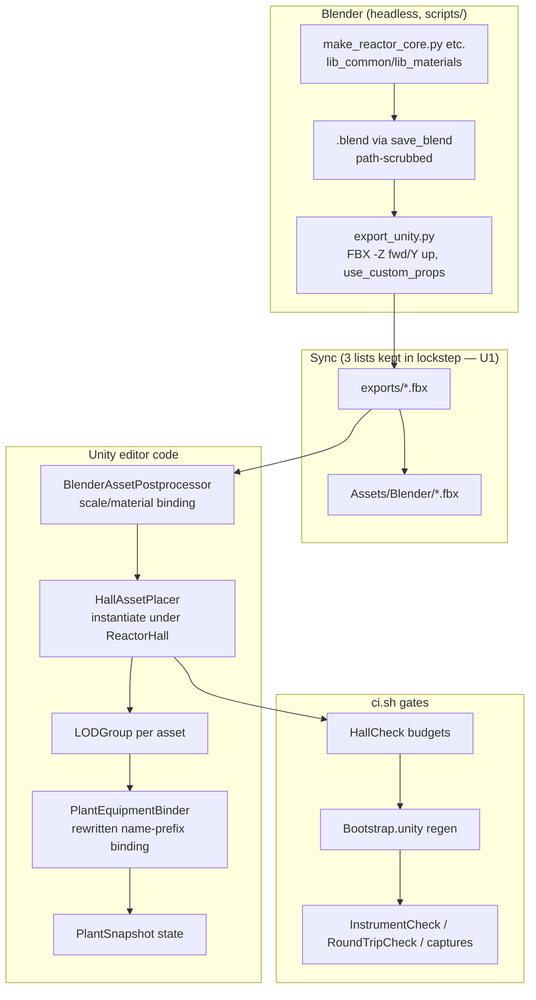

# Living Reactor Core Assets (Blender → FBX → Unity) - Plan

## Goal Capsule

- **Objective:** The reactor seen through the pool window and containment cutaway reads as a real PWR core — fuel assemblies, control rods, and drive mechanisms with convincing close-up detail — and visibly responds to live sim state (power glow, rod insertion, relief events), all within the hall's triangle, draw-call, and light budgets.
- **Means:** Procedural Blender Python generators → FBX → synced into `Assets/Blender/` → instanced under the `ReactorHall` root by editor code → bound by name-prefix contract (KTD1, KTD2).
- **Authority:** `docs/design/plant-and-assets.md` owns asset naming/pivot/LOD/metadata rules; `docs/plans/2026-11-11-blender-reactor-assets-brief.md` owns phase scope; repo `AGENTS.md` owns the clean-room rule; this plan's KTDs own mechanism choices.
- **Execution profile:** One implementation branch and one reviewable change, built in A-D milestones with a render checkpoint after each. Leave changes uncommitted for user review as the brief requests; this plan does not authorize publication.
- **Stop conditions:** `scripts/ci.sh` green with `UNITY_EXE` set; `HallCheck` budgets pass; binder resolves every bound name in-scene; no orphan meshes (every exported FBX is instanced or explicitly unbound).
- **Who finishes:** `ce-work` or an external agent run per phase; the user reviews renders and merges.

---

## Product Contract

### Summary

Replace the 89-line primitive plant blockout with accurate, "living" PWR reactor assets built procedurally in Blender, exported to FBX, and bound to live `PlantSnapshot` state. Phases follow the brief: A) fuel assembly + control rod + CRDM drive, B) vessel internals, C) rotating equipment, D) Unity integration hardening.

### Problem Frame

The only reactor geometry in-game is procedural Unity code (`HallBuilder`/`SmrModuleMesh`) plus an orphaned `PlantEquipment.fbx` that no scene instances. The visible core is a smooth SMR-style vessel with rack glow — there are no fuel assemblies, no rod banks, no drive mechanisms, and the binder names it searches for resolve to nothing. The design doc `plant-and-assets.md` already specifies the target asset system; the brief `docs/plans/2026-11-11-blender-reactor-assets-brief.md` scopes the upgrade into four phases.

### Key Decisions

- **Session-settled: Blender→FBX pipeline** (user-directed — chosen over Unity procedural meshes and glTF: existing pipeline, zero new dependencies per `plant-and-assets.md` §5).
- **Session-settled: Windows execution host** (user-directed — chosen over omarchy-max flatpak install: Blender 5.2.2 already installed and headless-verified at `C:\Program Files\Blender Foundation\Blender 5.2\blender.exe`).
- **Session-settled: full A–D program** (user-approved — chosen over Phase-A-only scoping: "the reactor full 3d sim" confirmed at scoping synthesis).

### Requirements

**Asset fidelity**

- R1. Fuel assembly: PWR-style lattice with grid spacers, ~100 rodlets as instanced/linked duplicates (not unique meshes), top/bottom nozzles; convincing detail at 0.5–3 m per the brief's accuracy bar.
- R2. Control rod and CRDM drive: absorber section + drive shaft + tip, and drive housing with latch tube and position scale, sized to sit over the assembly with visible travel.
- R3. Vessel internals (Phase B): core barrel, fuel-assembly array visible through the cutaway, thermal shield — inside the existing 2.7 m vessel / 4.5 m containment envelope.
- R4. Rotating equipment (Phase C): pump casing/impeller detail, flywheel, SG tube-sheet cutaway, turbine rotor stub; available actual flow/RPM state drives motion, while unmodelled mechanisms remain decorative.
- R5. All assets follow `plant-and-assets.md`: `RS_<CAT>_*` names, Z-up/−Y-forward, 1 unit = 1 m, applied transforms, pivots on functional axes, LOD tiers, shared `M_*` materials, no lights or cameras in exported FBX.

**Living behavior**

- R6. Core glow scales with `Core.Power` via `GlowMapping` and tints with `FuelTempC`; rod banks translate with `BankInsertion[i]` on the authored travel axis with authored stroke, not a hardcoded 0–1 m Z-lerp.
- R7. Bound names resolve in-scene: the binder finds every rod bank, the flywheel, VFX anchors, and rack glow inside `ReactorHall`; an editor check fails when a bound name is missing (no silent dead assets).
- R8. New hall assets use a hall-specific rod naming contract; control-room gauge names and existing rack-glow bindings remain unchanged.

**Pipeline integrity**

- R9. Every new `.blend` is regenerable from a committed script, exports through `export_unity.py`, syncs through both sync scripts, and instances into the scene in the same change — the three hardcoded asset lists cannot drift.
- R10. `clean_room_check.sh` passes: `.blend` files use `save_blend` path scrubbing; no user-profile paths or prohibited reference terms enter tracked content.
- R11. `assets/manifest.csv` exists and is the metadata source of truth; a CI/editor check validates that every bound asset's `rs_id`/`rs_bind` resolves.

**Budgets**

- R12. Hall totals stay within `HallDimensions` budgets (`MaxHallTriangles = 120000`, `MaxRealtimeLights = 4`) as enforced by `HallCheck`; new geometry adds bounded draw calls within the capture-budget headroom.
- R13. No z-fighting or doubled geometry: procedural `Smr_*` shell and Blender internals occupy distinct volumes.

### Scope Boundaries

- **Deferred to Follow-Up Work:** bubble/turbulence effects, per-component relief jets, `RS_MAT_*` material atlas extension, glTF migration, control-room/panel-kit upgrades.
- **Not in this change:** Core physics, save formats, networking, real engineering procedures, or an expanded plant layout.
- **Outside this product's identity:** real facility layouts, security-sensitive detail, training-accurate procedures — the design doc's game-scale fiction rule stands.
- **Considered and not built:** GPU instancing / draw-call merging infrastructure beyond what the hall budget requires; a general-purpose asset browser; LOD meshes exported inside FBX (LODGroups are created in editor code instead, KTD8).

### Sources

- `docs/plans/2026-11-11-blender-reactor-assets-brief.md` — phase scope, agent prompt, model bake-off note.
- `docs/design/plant-and-assets.md` — asset spec (naming, pivots, LOD, metadata, export checklist).
- `ReactorSim.Unity/Assets/Editor/ControlRoomSceneBuilder.cs`, `HallBuilder.cs`, `SmrModuleMesh.cs`, and `HallCheck.cs` establish the actual scene path and geometry checks.
- `ReactorSim.Unity/Assets/Scripts/View3D/PlantEquipmentBinder.cs` establishes current runtime bindings; `Blender/scripts/export_unity.py` establishes export settings.
- Use public engineering references for original geometry; optional machine-local prose is not an implementation dependency and must never be copied into tracked assets or documentation.
- Blender FBX export API: https://docs.blender.org/api/5.1/bpy.ops.export_scene.html (adjacent-version guidance, not proof of installed 5.2 behavior).

---

## Planning Contract

### Key Technical Decisions

- KTD1. **Hall-specific binding namespace.** New assets use `RS_<CAT>_*` names with hall-local binding prefixes (`ROD_BANK_{A..D}_*` for rods); `PlantEquipmentBinder` is rewritten to parse the bank index from the name and drive the authored travel axis (Y in hall space) preserving each rod's rest pose and authored stroke. Chosen over keeping `BIND_BAR_BankInsertion_*`: that grammar is shared with control-room gauges, `InstrumentCheck` treats `BIND_BAR_*` as gauges, and the current binder writes `localPosition.z` unconditionally — real CRDM pivots would teleport on first Update.
- KTD2. **Minimal instancing path lands in Phase A, not D.** A `HallAssetPlacer` editor hook instances the new FBX under `ReactorHall` before `HallBuilder.FinishHall` (which assigns layer 9, `BatchingStatic`, and counts tris/lights). Chosen over deferring all instancing to Phase D: the repo rule forbids orphan meshes, and "renders in-scene" is the only meaningful per-phase verification. Phase D hardens it (manifest, metadata check, LOD polish).
- KTD3. **Preserve the integral-SMR envelope and expose internals through a deliberate cutaway.** Keep the 2.7 m vessel / 4.5 m containment envelope and sightline constants. The vessel is currently opaque, so placing assets inside it alone would hide the work: Phase A adds an aligned vessel viewing opening, and Phase B refines that opening with the internal shell. Update affected module checks rather than bypassing them; never overlay a second complete vessel. Phase C retains integral steam-generator placement rather than restoring the obsolete external primary-loop blockout.
- KTD4. **`assets/manifest.csv` is the metadata source of truth; FBX `rs_*` props are best-effort.** Unity's FBX importer does not surface custom properties as GameObject fields, so the spec's "fail import on missing `rs_bind`" check has no FBX data source. `export_unity.py` sets `use_custom_props=True` so props land in the file as documentation, and the real check validates names + manifest in editor code. Chosen over a sidecar-JSON-per-asset or naming-convention-only approach: the design doc already names `manifest.csv`.
- KTD5. **Reuse existing materials and explicitly configure Unity emission.** Keep the eight atlas-backed `M_*` masters. Palette materials outside that list do not gain texture/emission support merely by passing through FBX: configure the Unity glow material's shader, emission keyword and color explicitly using the existing hall material pattern. Drive core-only properties without recoloring all shared steel or rack materials. Treat thermal tint as a labelled gameplay cue, not blackbody incandescence at normal coolant temperatures.
- KTD6. **Keep the existing budget accounting and cap.** `HallBuilder.Stats` counts all resident LOD mesh triangles, including repeated instances; retain that conservative definition and the 120k cap. Allocate at most the smaller of 40k resident triangles or the measured remaining hall headroom to the entire new core array and internals, including all LODs. A standalone close-up assembly may use up to 6k LOD0 triangles; do not multiply that asset blindly into the hall. Use simplified repeated assemblies and a few foreground detail assemblies, merged by material where appropriate, while rods remain independently movable. Budget foreground and array assets jointly, reduce invisible detail first, and do not raise the cap to make checks pass.
- KTD7. **Use actual state for supported motion only.** Phase A changes rod bindings only and preserves existing rack/relief behavior. Phase C drives the flywheel from `PrimaryFlowFrac` and the turbine stub from available `TurbineRpm`, with authored axes and a documented visual speed mapping. Unmodelled latch internals remain scenery; no autonomous fake rod-drop or pump loop. Multi-anchor relief behavior remains follow-up work.
- KTD8. **LODGroups are created by instancing code, not exported.** Following the `SmrModuleMesh` runtime-`LODGroup` pattern with per-asset screen heights tuned for hall viewing distances; FBX carries LOD0/LOD1/LOD2 as sibling meshes named per spec.
- KTD9. **Serialize scene rebuilds on one branch.** Each scene-affecting milestone regenerates `Bootstrap.unity` using the existing builder; two rebuilds must not accumulate duplicate roots. Retain unrelated working-tree edits and never commit generated scene changes without user authorization.
- KTD10. **Generator-enforced binding identity.** Assign explicit indexed names to repeated parts and reject duplicate asset IDs or ambiguous bank pivots. One moving root per bank owns its rod children; endpoint markers under that root's stationary parent define withdrawn and inserted positions in the same coordinate frame. Parse the bank index rather than relying on hierarchy enumeration, map insertion 0 to withdrawn and 1 to inserted, and do not mark moving renderers batching-static.

### High-Level Technical Design

### Assumptions

- Use one executor for the first build, with a maximum of two render-and-critique iterations before user review. Medium effort is the default; escalate only a targeted visual critique if needed. Do not pay for a full model bake-off up front; model names alone are not evidence of 3D quality.
- The user reviews each milestone's renders before further polish; no automatic merge or publication.
- Phase A may alternatively be executed by an external agent (sol/astra bake-off per the brief §8); this plan is executor-agnostic — units name files and contracts, not a specific model.
- `Blender/previews/` and `*.blend1` are added to `.gitignore` in U1; only small review renders are committed if wanted.
- Assembly count and foreground detail allocation are determined together under KTD6; the array remains a fictional game-scale representation.

### Risks & Dependencies

- **RISK:** Linked meshes save storage but not triangle submissions. Apply KTD6 before multiplying assemblies; record resident triangle and renderer deltas for each milestone.
- **RISK:** Binder rewrite regresses the (currently orphaned) `PlantEquipment.fbx` names. Mitigation: that FBX is uninstanced today; legacy names are migrated deliberately, and `InstrumentCheck`/`RoundTripCheck` gate the hall root.
- **RISK:** Blender 5.2 Python API drift (5.x renamed some ops). Mitigation: headless verify loop per asset; `bpy.ops.export_scene.fbx` signature confirmed for 5.x.
- **DEP:** Unity 6000.6.7f1 is installed; successful batchmode execution and licensing remain execution-time checks. If Unity currently has the project open, coordinate closing it before a second process imports or rebuilds the same project.
- **DEP:** The upstream brief already contains machine-local paths and prohibited reference terms. It is preserved as user-supplied input, not silently rewritten. If the clean-room gate fails on that existing file, report the exact pre-existing blocker and resolve its tracked-document wording with the user; do not weaken the scanner.

---

## Implementation Units

### U1. Export support and a reusable asset preview

**Goal:** Add the new asset outputs to the existing export/sync path with failing missing-file checks, ignored previews, a generic renderer and a structural validator.

**Requirements:** R9, R10

**Dependencies:** none

**Files:**
- `Blender/scripts/export_unity.py` — add the three new asset names, explicitly export custom properties and triangulated meshes
- `Blender/scripts/sync-blender-to-unity.sh` and `sync-blender-to-unity.ps1` — extend their existing lists to match the exporter and fail when a required FBX is absent
- `Blender/scripts/render_turntable.py` — new generic Workbench turntable renderer (generalize `render_room.py`'s camera approach; not ControlRoom-specific)
- `.gitignore` — add `Blender/previews/` and `*.blend1`
- `Blender/scripts/check_reactor_assets.py` — proposed headless structural check for generated asset names, metadata, mesh counts and export inventory
- `Blender/README.md` — document the new asset names and render/check scripts

**Approach:**
1. Keep the existing pipeline rather than introducing a general asset framework. Extend all three lists together and have the structural check detect disagreement. Export new assets with custom properties and triangulation enabled without adding preview lights/cameras to their FBX.
2. Turntable script takes a `.blend` path + output dir, frames the scene bounds, renders N Workbench frames to `Blender/previews/`.
3. Verify semantic structure and source/output coverage, not binary equality: saved Blender/FBX files may carry nonsemantic changes. Full automatic asset-regeneration infrastructure is not part of this change.

**Patterns to follow:** `lib_common.py` conventions and `render_room.py` camera/framing approach.

**Test scenarios:**
- Sync `.sh` with a deliberately missing listed FBX exits nonzero and names the file.
- `export_unity.py` exports every configured entry and preserves `-- <name>` filtering; a missing requested output fails instead of silently succeeding.
- Turntable script on `PlantEquipment.blend` produces ≥ 4 PNGs under `Blender/previews/` without error.
- The structural check detects a name present in the exporter but absent in either sync list.
- `clean_room_check.sh` still passes on the new/changed files.

**Verification:** Export/sync lists agree, custom properties and triangulation are explicit, and previews are untracked. This check catches packaging drift, not visual quality.

### U2. Phase A Blender assets: fuel assembly, control rod, CRDM drive

**Goal:** `Blender/scripts/make_reactor_core.py` generates `Blender/ReactorCore.blend` containing a PWR-style fuel assembly, a control rod, and a CRDM drive mechanism with binding-ready pivots and spec naming.

**Requirements:** R1, R2, R5, R10

**Dependencies:** U1 (export support and turntable verification)

**Files:**
- `Blender/scripts/make_reactor_core.py` — new generator
- `Blender/scripts/lib_core_parts.py` — optional shared helpers if assembly/rod/CRDM builders get large (follow `lib_kits.py` precedent)
- `Blender/ReactorCore.blend` — generated output (via `save_blend`)
- `Blender/exports/ReactorCore.fbx` — via `export_unity.py`
- `Blender/previews/` — turntable renders for review
- `Blender/scripts/check_reactor_assets.py` — generator structure and metadata scenarios

**Approach:**
1. Fuel assembly approximately 4 m: open-lattice PWR-style construction with bottom/top nozzles, approximately 100 rodlets sharing base meshes, and spacer-grid detail. Do not add a solid BWR-style channel box. Use existing raw-metal materials with restrained roughness variation, bevel highlights and baked normal detail where geometry would not read.
2. Control rod: absorber section + drive shaft + tip on a travel-axis pivot; CRDM housing above with latch tube and position scale.
3. Naming per KTD1/KTD10: `RS_ROD_FuelAssembly_01`, `RS_ROD_ControlRod_01_PIV` (travel axis), `RS_ROD_CRDM_01`, bank-ready structure `ROD_BANK_{A..D}` parents so Phase B can instance the array. Emit `rs_id`/`rs_bind`/`rs_status`/`rs_lod` custom props via `obj["rs_id"]=...` (lands in FBX via `use_custom_props`).
4. No `LIGHT`/`CAMERA` objects; unique names asserted before save.
5. Iterate against turntable renders at game distances (0.5 m detail check, 5–15 m silhouette check).

**Patterns to follow:** `make_plant_equipment.py` structure, `lib_common.add_pivot_empty`, and `lib_kits.py` parametric builders; original public PWR engineering references for geometry.

**Test scenarios:**
- Script runs headless clean and prints `REACTORCORE_SAVED`/`REACTORCORE_OBJECTS` markers; `.blend` reopens without errors.
- Rodlet count ≥ 100 while unique mesh datablocks ≤ 3 (instancing discipline).
- Every object name matches `RS_*`/`ROD_BANK_*` patterns; no `.00N` suffixed names; `rs_*` props present on bound objects.
- Turntable renders show readable assembly lattice, spacer grids, and CRDM latch detail at both close and game distance.
- Export produces `ReactorCore.fbx` with `-Z` forward/`Y` up and custom props embedded.

**Verification:** A reviewer can open the turntable PNGs and confirm the assembly reads as a fuel assembly, not a cylinder stack; the rod pivot sits on the travel axis with visible stroke room.

**Visual acceptance:** Inspect a neutral-lit close-up and an actual pool-window capture, not only an emissive beauty render. Grid spacers and nozzle silhouettes must read without blown-out glow; metal roughness must distinguish surfaces, and repeating rodlets must not flicker or alias badly at distance. Stop after the bounded critique loop and ask for user judgment if the visual bar is still missed.

### U3. Phase A Unity integration: instancing path + binder rewrite

**Goal:** `ReactorCore.fbx` instances under `ReactorHall`, the rewritten binder resolves rod banks/flywheel/VFX by the new contract, LODGroups exist, budgets pass, and the scene regenerates clean.

**Requirements:** R6, R7, R8, R12, R13

**Dependencies:** U1, U2

**Files:**
- `ReactorSim.Unity/Assets/Editor/HallAssetPlacer.cs` — new: instances only ReactorCore, VesselInternals and RotatingEquipment under `ReactorHall`; never ControlRoom, PanelKits or legacy PlantEquipment
- `ReactorSim.Unity/Assets/Scripts/View3D/PlantEquipmentBinder.cs` — index-parsed rod banks and authored endpoints; preserve flywheel, rack glow and relief behavior
- `ReactorSim.Unity/Assets/Editor/HallCheck.cs` — extend with required-name, rod-endpoint and duplicate-placement assertions
- `ReactorSim.Unity/Assets/Editor/HallBuilder.cs`, `SmrModuleMesh.cs` — placement, vessel viewing opening and exclusion of moving geometry from static batching; preserve budget counting
- `ReactorSim.Unity/Assets/Editor/ReactorAssetCheck.cs` — proposed editor checks including play-mode endpoint behavior
- `ReactorSim.Unity/Assets/Scenes/Bootstrap.unity` — regenerated via batchmode
- `ReactorSim.Core.Tests/` — xUnit coverage if binder-side pure logic (e.g. name parsing, stroke mapping) is extracted to a testable helper

**Approach:**
1. `HallAssetPlacer` runs inside `HallBuilder.Build` before `FinishHall`, instances only the new hall asset names, and parents all instances under `ReactorHall` for deterministic cleanup. The first milestone places one demonstration assembly with four bank pivots in the vessel viewing opening.
2. Binder changes follow KTD1/KTD10: parse bank identities, resolve stationary endpoint markers, and move rod roots from actual insertion. Preserve existing flywheel, rack glow and relief behavior; core glow is introduced by U4, not preserved from nonexistent handling.
3. LODGroups per KTD8 with screen heights tuned like `SmrModuleMesh`.
4. Regenerate `Bootstrap.unity`; run batchmode checks.

**Patterns to follow:** `HallBuilder`/`FinishHall` ordering; `SmrModuleMesh` LODGroup creation; `ControlRoomSceneBuilder` FBX instantiation; `BlenderAssetPostprocessor` import conventions.

**Test scenarios:**
- `HallCheck` fails when a `ROD_BANK_*` name is missing or duplicated (dead-asset detection).
- Rod bank A at `Insertion=0` sits at authored rest pose; at `1.0` it travels the authored stroke on the correct axis — no teleport to z∈[0,1].
- Existing rack glow and relief behavior remain unchanged after rod integration; independent per-anchor relief is not added here.
- Hall tri count and light count within `HallDimensions` budgets after instancing; `HallCheck` rebuild determinism passes.
- `InstrumentCheck`/`RoundTripCheck` unaffected (no `BIND_*` names inside hall roots).
- Scene-drift guard passes after `Bootstrap.unity` regen.

**Verification:** Play-mode checks prove insertion endpoints, shuffled hierarchy order, safe missing-state fallback, and actual SCRAM progression; through-window captures show the rods unobscured. Existing rack glow remains power-driven. Capture-budget checks require actual before/after captures, not only the shell checker's self-test.

### U4. Phase B vessel internals: core barrel, assembly array, thermal shield

**Goal:** The cutaway shows a real core: barrel, array of Phase-A assemblies (instanced), thermal shield, inside the existing `Smr_*` shell, with power glow and temperature tint.

**Requirements:** R3, R5, R6, R7, R12, R13

**Dependencies:** U2, U3

**Files:**
- `Blender/scripts/make_vessel_internals.py` — new generator: `RS_VES_*` barrel, shield, array frame; reuses `make_reactor_core.py` assembly builder for N instances
- `Blender/VesselInternals.blend`, `Blender/exports/VesselInternals.fbx`
- `ReactorSim.Unity/Assets/Scripts/View3D/GlowMapping.cs` — add `FuelTempCTint` pure function (temperature→tint curve with floor, mirroring `Glow`'s shape)
- `ReactorSim.Core.Tests/GlowMappingTests.cs` — extend for the tint curve
- `Blender/scripts/check_reactor_assets.py`, `ReactorSim.Unity/Assets/Editor/ReactorAssetCheck.cs` — array geometry and imported glow checks
- `ReactorSim.Unity/Assets/Scripts/View3D/PlantEquipmentBinder.cs` — core-glow emissive/tint channel ∝ `Power`/`FuelTempC`
- `HallAssetPlacer.cs` — register the new FBX; assembly array instancing with per-bank grouping
- `Bootstrap.unity` — regenerated

**Approach:**
1. Array: size simplified assembly instances against KTD6. Keep fuel and fixed grids stationary; only control-rod children belong to the four moving bank roots. Place the array once, not both inside the FBX and again through Unity duplication.
2. Glow: emissive ∝ `GlowMapping.Glow(Power)` on `RS_VES_CoreGlow_*`; tint ∝ new `GlowMapping.FuelTempCTint(FuelTempC)` — pure function, xUnit-tested like existing glow tests.
3. Follow KTD3's viewing opening and envelope; verify the internal array is visible through both vessel and containment openings without overlapping opaque shell faces.
4. Bubbles/turbulence over hot bays: evaluate as emissive/particle anchors only if they fit existing VFX patterns; otherwise defer (KTD7).

**Patterns to follow:** `FuelRackMesh` glow naming (`RackGlow_*` precedent); `GlowMapping` pure-function + test pattern; `SmrModuleMesh` instancing/LOD approach.

**Test scenarios:**
- Assembly array instances share mesh datablocks (no per-instance unique geometry in FBX).
- `GlowMapping.FuelTempCTint`: cold shutdown (~60 °C) → floor tint; full power (~605 °C) → hot tint; monotonic between; out-of-range clamped. xUnit cases mirror `GlowMappingTests` style.
- Core glow emission scales with `Power` including `PowerOverride`/`GlowOff` capture poses.
- `HallCheck` budgets still pass with the full array; triangle delta from the Phase A scene recorded.
- No geometry intersects `Smr_Vessel_LOD1`/`Smr_Containment_LOD1` envelopes (check or visual verify).

**Verification:** Through-window view shows assembly lattice + glow responding to power; `ci.sh` green.

### U5. Phase C rotating equipment: pumps, SG detail, turbine stub

**Goal:** `make_rotating_equipment.py` produces detailed pump/SG/turbine assets that replace or augment the procedural hall versions, with decorative rotor naming ready for future binding.

**Requirements:** R4, R5, R7, R12

**Dependencies:** U3 (instancing path), U4 (pattern established)

**Files:**
- `Blender/scripts/make_rotating_equipment.py` — new generator: `RS_PRI_Pump_*`, `RS_SGN_*`, `RS_TUR_*` families
- `Blender/RotatingEquipment.blend`, `Blender/exports/RotatingEquipment.fbx`
- `Blender/scripts/check_reactor_assets.py` — equipment names, pivots and export coverage
- `ReactorSim.Unity/Assets/Scripts/View3D/PlantEquipmentBinder.cs` — authored rotor pivots driven by actual flow/RPM per KTD7
- `ReactorSim.Unity/Assets/Editor/ReactorAssetCheck.cs` — rotor behavior and replacement-geometry checks
- `HallAssetPlacer.cs` — placement coordinates for new equipment (must not collide with `Smr_Pumps`/`Smr_Pipes` — replace-or-offset decision per item, documented)
- `Bootstrap.unity` — regenerated

**Approach:**
1. Per equipment item decide replace-vs-augment against the procedural `Smr_*` counterpart: where Blender detail wins, the procedural piece is removed from `SmrModuleMesh` output in the same change (no doubled geometry, R13); where procedural suffices, Blender adds detail only.
2. Keep `Flywheel_PrimaryFlow` name on the pump flywheel (existing binder contract); new rotors get `ROTOR_<name>_PIV` empties.
3. SG tube-sheet cutaway and pump volute are the detail heroes; turbine stays a stub (turbine hall is P2/later per design doc).

**Test scenarios:**
- Each new FBX instances exactly once; removed `Smr_*` parts no longer generate (HallCheck module assertions updated in same change).
- Flywheel still rotates ∝ `PrimaryFlowFrac`; `ROTOR_*` pivots exist and are found by the registry.
- Budgets hold; no new realtime lights.
- Turntable renders show volute/tube-sheet detail at game distance.

**Verification:** Equipment reads as worked machinery in-scene; `ci.sh` green.

### U6. Phase D integration hardening: manifest, metadata check, docs

**Goal:** The asset system is self-describing and self-checking: `assets/manifest.csv` generated and CI-verified, an editor check enforcing naming/metadata, and docs updated to match reality.

**Requirements:** R7, R9, R11

**Dependencies:** U5 (all assets exist to enumerate)

**Files:**
- `assets/manifest.csv` — generated metadata for the new assets, at the design spec's fixed location
- `Blender/scripts/check_reactor_assets.py` — generate and validate manifest rows directly from authored Blender metadata
- `ReactorSim.Unity/Assets/Editor/AssetManifestCheck.cs`, `ReactorAssetCheck.cs` — verify manifest identities, accepted mesh/binding/endpoint naming, known binding IDs and scene coverage
- `docs/design/plant-and-assets.md` — update status: which families now exist, naming conventions actually in use (KTD1 namespace vs legacy), deferred items
- `Blender/README.md` — final pipeline doc
- `.github/workflows/` or `scripts/ci.sh` — manifest freshness check if CI is the right gate

**Approach:**
1. Generator emits the spec's manifest columns from the same authored object properties it validates, recording stable object paths, bank IDs, endpoints and actual triangulated counts. Sync the generated manifest into Unity as a TextAsset and map it to instantiated relative transform paths; do not assume FBX custom properties automatically become runtime fields. Keep licensing/author metadata accurate and machine-independent.
2. Editor check fails batchmode when: an instanced asset lacks required metadata, a `rs_bind` doesn't resolve, a name violates the pattern, or manifest and scene disagree.
3. Docs updated to reflect the *actual* conventions chosen (KTD1–KTD10), resolving the spec-vs-reality gaps the research found.

**Test scenarios:**
- Manifest generator is deterministic (run twice → identical output).
- Editor check fails on a deliberately renamed/broken asset (negative test).
- Manifest covers 100% of instanced FBX objects; `S`-status decorative items are explicitly marked.
- `ci.sh` full run with `UNITY_EXE` green end-to-end.

**Verification:** A fresh checkout can run the documented Blender regeneration/export/sync path followed by Unity scene rebuilding and required checks; ordinary `ci.sh` alone does not regenerate Blender assets.

---

## Verification Contract

| Gate | Command | Applies to |
|---|---|---|
| Clean-room scan | `bash scripts/clean_room_check.sh` (inside `ci.sh`) | all units |
| Core build + tests | `dotnet build`, `dotnet test ReactorSim.Core.Tests` | U3 (if helper extracted), U4 (GlowMapping tests) |
| Blender headless | Installed Blender 5.2 executable, `-b --python-exit-code 1 --python Blender/scripts/<script>.py` | U1–U5 |
| Turntable review | renders inspected at 0.5 m and 5–15 m | U2, U4, U5 |
| Export + sync | `export_unity.py` → `sync-blender-to-unity.sh/.ps1` → `Assets/Blender/` | all asset units |
| Unity batchmode | Set `UNITY_EXE` to installed Unity 6000.6.7f1 and run `bash scripts/ci.sh` | U3–U6 |
| Hall budgets | `HallCheck.Run` via ci.sh | U3–U6 |
| Scene drift | Regenerate `Bootstrap.unity`; verify deterministic output, leave uncommitted for review | U3–U6 |
| Capture budgets | `check-captures.sh` / `test-check-captures.sh` | U3–U6 |
| Binding resolution | `HallCheck` bound-name assertions (new in U3) | U3–U6 |

Per-phase "done" = turntable renders reviewed + in-scene batchmode verification + `ci.sh` green. No phase is done on FBX export alone.

---

## Definition of Done

- Every unit's verification outcomes met; `ci.sh` green with `UNITY_EXE` set on the final PR.
- All bound names resolve in-scene; no orphan FBX (every synced asset is instanced or explicitly decorative/unbound with a named reason).
- Hall budgets hold; capture budgets hold; no z-fighting/double geometry.
- `assets/manifest.csv` exists, is generated, and is CI-checked.
- Docs (`plant-and-assets.md`, `Blender/README.md`) describe the conventions actually shipped.
- No abandoned-attempt code left in diffs; `.blend1`/preview artifacts untracked.
- Deferred implementation details below are resolved by their owning milestone; publication remains gated on required checks, including any pre-existing brief-document scan issue.

### Open Questions

- Deferred implementation detail: choose array count and detail allocation jointly under KTD6 in U4.
- Whether bubble/turbulence cues over hot bays fit Phase B scope or defer to follow-up (KTD7) — decide at U4 with render evidence.
- Whether `PlantEquipment.fbx` (orphaned legacy) is retired, kept for reference, or migrated — decide at U3; default is keep-but-clearly-unbound until U6 docs pass.
