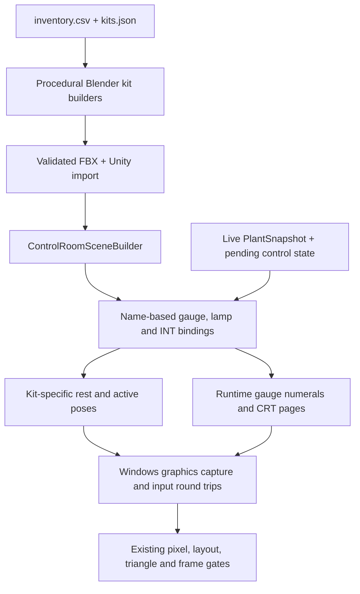

# Control Instruments - Detailed Assets and Usable Feedback - Plan

## Goal Capsule

- **Target repo:** this repository. Windows Blender/Unity work follows `Blender/README.md` and `docs/TESTING.md`; no machine-specific paths are needed for this plan.
- **Objective:** A player recognizes each dial, switch and button, operates it deliberately, sees how its displayed state changes, and reads gauge faces and CRT pages from the control room or a focused screen view.
- **Means:** Upgrade the existing procedural Blender kits, their existing runtime bindings and readable displays; prove the result with in-engine captures and input/state round trips (KTD1-KTD5).
- **Authority:** The Product Contract defines user-visible behavior; KTDs define implementation mechanisms. The linked original plan remains the source of its existing R/KTD identities and product constraints.
- **Execution profile:**
  - Blender generators/export/sync and their shape checks run on the Windows box with Blender 5.2.2 and headless Python tests where applicable.
  - Unity scene generation, import, batchmode checks, play-mode interaction and graphics captures run one Unity instance at a time on the Windows/Unity machine. Development captures require an interactive desktop session.
  - New pure display/state logic belongs in the linked pure test assembly; no Core physics edit is expected. If one becomes necessary, follow `AGENTS.md` and `docs/TESTING.md` for plugin synchronization.
  - Existing assets, bindings, layout, theme and font licensing must survive regeneration and rebuilds.
- **Stop conditions:**
  - Stop if required Blender kit validation cannot run or exported meshes fail metadata/placement checks.
  - Stop if a new capture cannot include the HUD and UI overlay, or graphics-enabled interaction checks cannot run on the available machine.
  - Stop if an upgrade requires changing the established panel grid, layout.json dimensions, plant physics, or stable `CTL_`/`INT_`/`BIND_`/`CRT_` names; return the specific conflict for review.
  - Stop and report if the instrument upgrade exceeds the existing room triangle, light, draw-call or frame-time budget without removing the approved reactor hall or changing readability thresholds silently.

---

## Product Contract

### Summary

The current control room has functional, deliberately manipulated controls, but its kits are mostly primitive slabs and cylinders. Buttons and guarded toggles share much of their visual grammar, several controls have weak visual association with their paired indicators, and instrument states are represented by limited needle, bar and emissive updates. This upgrade makes those devices physically distinct, keeps their motion tied to the actual sim state, and proves the result at the Windows build's real window size.

### Problem Frame

The source is the owner's request to "tackle dials, switches buttons gauges screens and plan the upgrade there as well" after the detailed reactor assets shipped. The full-upgrade choice was confirmed against visual-only and original-plan-extension alternatives.

Current code establishes the baseline and its limits:

- Kit primitives live in `Blender/scripts/lib_kits.py`; its catalog dimensions are in `design/control-room/kits.json`. The inventory in `design/control-room/inventory.csv` records the physical device, label, kit, binding and readiness. `needs_core_model` rows remain visibly out of service, not simulated controls.
- `Blender/scripts/make_control_room.py` places the kit catalog; `Blender/scripts/export_unity.py` and `Blender/scripts/sync-blender-to-unity.sh` or `.ps1` deliver FBX to Unity. `PanelKits.blend` is a gallery, not the room asset.
- `ReactorSim.Unity/Assets/Editor/ControlRoomSceneBuilder.cs` imports `ControlRoom.fbx`, attaches `CrtScreenRenderer` to `CRT_` screen meshes, and supplies hover-only indicator interactables. It currently selects collider sizes for controls rather than measuring the enlarged authored moving parts.
- `ReactorSim.Unity/Assets/Scripts/View3D/ControlRoom3DBinder.cs` animates gauge needles, edgewise bars, counters, lamps and controls. Gauge sources are in `GaugeSources.cs`; geometry in `GaugeGeometry`; face numerals in `GaugeScale.cs` and `GaugeNumerals.cs`.
- `ReactorSim.Unity/Assets/Scripts/View3D/DiegeticInteractable.cs` owns click/drag/cancel/focus loss and guarded first clicks. `ControlMapping.cs` owns drag-value mapping and hosts the `ControlSounds` class that selects existing procedural detent, clunk and breaker sounds. `ProceduralPlantAudio.cs` plays them.
- `CrtScreenRenderer.cs` and `CrtPages.cs` render live pages as TextMeshPro on a CRT face, with `PixelBudget.cs` sizing the grid. `ScreenFocus.cs`, `RoomInputGate.cs`, `ControlTooltip.cs` and inventory runtime metadata own focused reading, input suspension and hover details. `ThemeColors.cs`, `Theme.cs` and UiFonts own appearance and the existing font system.
- The upstream product contract remains `docs/plans/2026-11-09-2010-feat-playtest2-controls-readability-hall-plan.md`. Its R1-R16 readability/control requirements and KTD1-KTD6 typography/interaction decisions remain applicable. Its hall units are already implemented in `docs/plans/2026-11-11-1950-feat-living-reactor-core-assets-plan.md`; this plan does not replan that hall work.
- Existing checks are `InstrumentCheck.cs`, `ControlMapCheck.cs`, `LayoutCheck.cs`, `RoundTripCheck.cs`, inventory/label/theme/CRT/gauge tests, Blender checks and `scripts/check-captures.sh`. Current scene generation already includes updated reactor placement; do not revert it to regenerate an old fixture.

### Key Decisions

- **Detailed instruments and feedback ship together.** (session-settled: user-approved — chosen over visual-only or updating only the earlier plan: the owner selected the recommended full upgrade after being offered those alternatives.) Governs R4-R6, R9-R12, R14-R16 and KTD1-KTD4.
- **Preserve existing interaction and display contracts.** (session-settled: user-approved — chosen over a layout or physics redesign: the approved scope keeps panel placement, simulator behavior and working bindings intact.) Governs R1-R3, R7-R8, R13, R17-R18 and KTD2-KTD5.

### Requirements

**Physical instruments and live state**

- R1. Every inventory-placed control and indicator retains its `CTL_<id>` root, expected pivot grammar, kit footprint, mount, label and out-of-service behavior through regeneration, import and scene rebuild.
- R2. Dials, levers, sliders, knobs, guarded toggles, momentary buttons, gauges, counters, lamps and CRT monitors have distinguishable authored silhouettes and states; small controls remain recognizable at the seated and standing operating poses.
- R3. Continuous controls retain press-hold-vertical-drag, dead zone, fine adjustment, release-once, cancel/restore and focus-loss behavior from the upstream plan. Buttons retain one deliberate action and the existing two-stage SCRAM cover.
- R4. Every interactive moving part has an unambiguous rest pose and live authored motion for pending values, button presses, toggles and SCRAM cover feedback; visible motion corresponds to the value/state submitted or displayed by the plant, not an unrelated demo sequence.
- R5. Guarded controls make their armed/guard-lifted state visible before activation. A rejected, disabled or out-of-service control has a visible reason consistent with the existing tooltip/log feedback; no silent no-op remains for a supported operable control.
- R6. Gauge needles, edgewise bars, counters, lamps, paired indicators and annunciate tiles continue to use their existing live sources and lamp predicates. Upgrade face markings and geometry without replacing live values with static artwork.
- R7. Numeric gauge and bar scales, units, needle endpoints, label text and screen-grid fitting retain the existing readability rules, including upstream R11/R12 and `PixelBudget.BodyGlyphMinPx = 10.0`, `KeyGlyphMinPx = 18.0` at 1600x900.
- R8. CRT pages, focused-screen entry/exit, screen-face picking, phosphor theme and UiFonts typography continue to work with every upgraded bezel, glass and housing; physical detail must not occlude the active display face or change its page/grid layout.

**Interaction feedback and usability**

- R9. A dial's visible pointer follows its live or pending fraction through the full range, including intermediate values, detents, clamp ends and cancellation back to the original value.
- R10. Button and guarded-toggle motion clearly distinguishes rest, pressed, armed and latched-on states. Held visual motion ends on release/focus loss, while state-dependent motion persists only when the underlying toggle state is on. A rejected press produces no persistent motion — at most transient travel that returns to rest on release — with the rejection reason shown through the existing tooltip/log path, matching the audio constraint in R11.
- R11. Control audio follows actual interaction and state transitions, respects existing mute/audio settings, and does not imply a plant state change that the sim did not accept. Existing detent, clunk, breaker and horn behavior is preserved or deliberately extended only where a new physical state needs it.
- R12. Hover and drag feedback remains understandable on the authored meshes, with the effective hit region covering the movable control without swallowing neighboring devices. Dragging cannot be lost by pointer movement or application focus loss.
- R13. Out-of-service rows remain marked and non-operable. `needs_mapping`/backend controls do not gain invented plant state merely to animate them; the plan may improve their inert appearance and explanation only.

**Assets, performance and proof**

- R14. Blender remains the source of ControlRoom kit geometry. New detail is procedural and regenerable, uses shared original materials/textures, applies transforms, uses metres, preserves pivots/axes, triangulates on export and respects existing LOD conventions where needed.
- R15. The instrument upgrade is integrated into the existing hall/room budgets. It must not add real-time lights, change the existing maximum light count, or materially regress the established triangle/draw-call/frame-time limits; the gate is a measured delta against the U1 ControlRoom baseline for room metrics while the unchanged hall caps still apply, and that gate decides acceptance before changes are retained.
- R16. Automated Blender and Unity checks verify catalog dimensions, mesh bounds, pivot prefixes, parent/local transforms, static/moving-part separation, manifest/sidecar consistency where applicable, and stable names across a rebuild.
- R17. In-engine captures and input/state round trips prove operating every affected kit family from the real poses, including dial commit/cancel, button press/release, guarded first/second click, toggle persistence, SCRAM cover, gauge/bar/counter updates, lamp/annunciation state and every CRT page/focus cycle.
- R18. All new or changed assets and scripts obey the repository clean-room constraint and `AGENTS.md`. No third-party simulator names, data, code or artwork are introduced; original license/author metadata remains accurate.

**Traceability**

| Requirement | Existing source or constraint | Verification owner |
|---|---|---|
| R1-R2 | `design/control-room/kits.json`, `inventory.csv`, `Blender/scripts/lib_kits.py` | Blender checks; `InventoryTests`, `ControlMapCheck` |
| R3 | Upstream R3-R7, `DiegeticInteractable.cs`, `ControlMapping.cs` | `DialDragTests`, `ControlRoomLogicTests`, `RoundTripCheck` |
| R4-R6, R9-R13 | `ControlRoom3DBinder.cs`, `ControlSounds` (in `ControlMapping.cs`), `ProceduralPlantAudio.cs`, `LampPredicates.cs`, `ControlTooltip.cs` | New pure state/pose tests; Unity play-mode and capture checks |
| R7-R8 | Upstream R11-R16; `PixelBudget.cs`, `CrtPages.cs`, `CrtScreenRenderer.cs`, `ScreenFocus.cs` | `PixelBudgetTests`, CRT layout tests, `InstrumentCheck`, captures |
| R14-R18 | `AGENTS.md`, `Blender/README.md`, `docs/design/plant-and-assets.md`, `docs/TESTING.md`, clean-room scanner | Blender/export checks, Unity checks, `scripts/ci.sh` |

### Success Criteria

- The owner can distinguish a continuous dial, lever, slider, stepped selector, guarded toggle, momentary button, circular gauge, edgewise meter, counter, lamp tile and CRT monitor in a seated or standing capture without relying on labels alone.
- Every supported bound control accepts its established input contract and produces a visible rest-to-active and active-to-rest transition tied to its live or pending value. No fake out-of-service plant movement is introduced.
- Gauge and counter readings track changed simulation values; paired lamps/annunciators still reflect their predicates; all CRT pages remain within existing pixel/readability budgets and focused view works.
- The room remains deterministic across repeated scene generation, within the pre-change triangle/light/frame budget, and clean-room checks pass.
- The Windows player built after verification opens for owner playtesting. This plan does not authorize that launch or any commit/push by itself.

### Scope Boundaries

**In scope**

- Detail and state feedback for instruments already placed from `inventory.csv`, including their Blender kits, import metadata, Unity visual bindings, interaction/audio feedback, labels/markings and validation.
- Existing CRT bezel/housing/glass details that affect screen visibility and inspection, plus capture/check coverage needed to prove them.

**Deferred for later**

- Repositioning or resizing panels, adding inventory devices, redesigning room architecture, adding gamepad/rebindable controls, or changing simulation physics.
- Adding new simulator equipment states to satisfy `needs_core_model`/`needs_mapping` rows.
- A wholesale replacement of TextMeshPro, UiFonts, theme tokens, screen pages, CRT grid geometry, or the existing procedural audio synthesis system.
- New post-processing, volumetric effects, or an unrelated hall/reactor rebuild. Hall/rods/inspection changes already shipped in `ee957f7` are regression surfaces, not targets for this upgrade.

**Considered and not built**

- The upstream balance-of-plant appendix and any geometry not required to make the named instruments credible or usable.
- Third-party instrument models or reference-simulator assets, which conflict with the clean-room requirement.

---

## Planning Contract

### Key Technical Decisions

- KTD1. **Keep one Blender ControlRoom asset as the room source.** Extend `lib_kits.py` builders and `kits.json` only for genuinely new kit variants or dimension-compatible shared detail. Update `make_control_room.py` only if catalog metadata requires it; never edit an imported FBX by hand. Rejected alternative: a second panel-kit asset assembled in Unity, which would create two placement and export authorities. Cites R1, R2, R14.
- KTD2. **Preserve the existing name-based binding grammar and scene-builder authority.** The kit's functional pivot keeps its current prefix and local axes; decorative meshes stay non-bindable children or use the existing auxiliary metadata. The builder attaches components and hit regions from the final imported hierarchy. Rejected alternative: renaming pivots to describe visual parts, which would break the established contract. Cites R1, R3-R6, R12, R16.
- KTD3. **Use one explicit instrument visual-state contract.** A small Unity-side pure representation describes rest/active/armed/pressed pose fractions for each kit family and how those fractions map to local transforms/material properties. The Blender generator and `ControlRoom3DBinder` consume the same documented rest values; no Blender animation clips or hard-coded per-inventory-row animation tracks are required. Existing `DialDrag`, `ControlIntentFactory`, `ControlValues`, `ButtonOn`, lamp predicates and audio selection remain authoritative. Rejected alternative: authoring independent keyframes per device, which duplicates state and can drift from the sim. Cites R4-R6, R9-R13.
- KTD4. **Keep readable display text generated at runtime from existing data sources.** Gauge numerals and CRT pages stay TextMeshPro with IBM Plex Mono/UiFonts and existing `GaugeScale`/`CrtPages`/`PixelBudget` logic. Blender may supply scale ticks, legends, bezels and non-numeric markings, but it must not bake live values or duplicate numerals that the runtime already owns. Rejected alternative: baking gauge numbers into textures, which would freeze values and bypass the pixel-budget tests. Cites R6-R8, R14.
- KTD5. **Gate on measured before/after evidence.** Capture the existing Windows build/player at the standard poses before changing assets; compare the rebuilt room at the same poses and sizes after. Keep the existing `scripts/check-captures.sh` readability thresholds and `LayoutCheck`/`ControlMapCheck`/`RoundTripCheck` behavior. The room-scope gate is a measured delta against the U1 ControlRoom baseline — root triangle/renderer/light counts plus frame-time and draw-call metrics on the control-room poses — while `HallDimensions.MaxHallTriangles` and the light caps stay unchanged. Add instrument-specific measurements without lowering old gates. The previous reactor verification is a regression baseline, not proof that the new controls are acceptable. Cites R7-R8, R15, R17.
- KTD6. **One implementation PR, with sequential internal units.** Blender catalog/geometry changes must land before Unity import checks; interaction binding changes must land before play-mode and capture proof. Keep each unit independently verifiable and avoid unrelated pre-existing dirty files. This is a delivery recommendation, not authorization to commit or push. Cites R16-R18.

### High-Level Technical Design

The design has two data paths that must remain synchronized: Blender authors static geometry and rest transforms; Unity owns live state and moving-part transforms. The catalog is the contract between them. No plant physics is on this path.

### Assumptions

- Blender 5.2.2 and Unity 6000.6.7f1 are available on the Windows/Unity execution machine. The reactor run confirmed both; paths and installation status must be checked again at execution time.
- `out/build/ReactorSim.exe` is the post-reactor Windows build (`ReactorSim_Data` refreshed 2026-11-11; build log `out/reactor-player-build.log` reports `result=Succeeded errors=0`). It is the correct pre-instrument-change baseline; a new player must still be built after implementation.
- Existing `inventory.csv`, `kits.json`, layout dimensions and runtime binding names are authoritative unless a specific catalog conflict is found. No product scope question remains from the approved full-upgrade choice.
- The previous reactor push (`ee957f7`) intentionally includes its generated scene and TMP/font artifacts. Those are now the committed starting point; unrelated untracked audio/recovery/asset files are outside this plan.

### System-Wide Impact

- `Blender/ControlRoom.blend`, `Blender/PanelKits.blend`, `Blender/exports/ControlRoom.fbx`, `PanelKits.fbx` and their Unity copies may change together.
- `ControlRoomSceneBuilder` must account for new mesh names, pivots, collider extents and screen-face bounds without changing inventory row identity.
- `ControlRoom3DBinder`, `DiegeticInteractable`, `ControlSounds`, gauge numeral/bar attachments and screen focus consume the imported transforms/material properties.
- `InstrumentCheck`, `ControlMapCheck`, `LayoutCheck`, `RoundTripCheck`, `ReactorAssetPlayCheck` and capture scripts must continue to pass against the same scene and live plant.
- The hall, reactor assets, inspection view and existing CRT page/grid/font systems are regression surfaces. An instrument change that breaks one of those contracts must be corrected or reported, not hidden by disabling the check.

---

## Implementation Units

### U1. Establish instrument baseline and catalog contract

- **Goal:** Capture the existing control room and record which kit families, states and readability gates are actually present before geometry changes.
- **Requirements:** R1, R3, R7-R8, R15-R17; KTD2, KTD4, KTD5.
- **Dependencies:** none.
- **Files:**
  - Read/verify `design/control-room/inventory.csv`, `design/control-room/kits.json`, `design/control-room/layout.json`, `Blender/scripts/lib_kits.py`, `make_panel_kits.py`, `make_control_room.py`, `room_layout.py`.
  - Read/verify `ReactorSim.Unity/Assets/Scripts/Diagnostics/CaptureMode.cs`, `CaptureMath.cs`, `InputProbe.cs`, `SessionRecorder.cs`, `SessionLog.cs`; `scripts/capture-playtest.sh`, `scripts/check-captures.sh`, `scripts/test-check-captures.sh`.
  - Read/verify `ReactorSim.Core.Tests/InventoryTests.cs`, `InventoryLabelTests.cs`, `CrtPagesTests.cs`, `CrtPageLayoutTests.cs`, `PixelBudgetTests.cs`, `GaugeScaleTests.cs`, `ControlTooltipTests.cs`, `ControlRoomLogicTests.cs`, `DialDragTests.cs`, `ThemeLiteralScanTests.cs`, `ThemeContrastTests.cs`.
  - Create/update only the plan's evidence notes or test fixture paths required by a discovered gap; do not change product code in this unit.
- **Patterns to follow:** `docs/planning/execution/verification-before-completion.md` if present in the execution checkout; otherwise `docs/TESTING.md` and the existing check scripts. Use the current capture mode's named poses and overlay measurements.
- **Approach:** Inventory every kit/physical type and its live binding readiness, including K13 screen placement and K17 alarm hardware if present. Run the pure tests and Blender catalog/layout checks first. On Windows, run the current player or editor capture at 1600x900 and 1920x1080, with seated/standing, all CRT pages and focus, tooltips, rejected press, drag, menu and hall poses that apply. Preserve raw PNGs, captures.json and session/input logs under `out/` (git-ignored) for comparison; record the exact binary/scene revision and any skipped pose with a reason. Record the ControlRoom root's triangle/renderer/light counts and the seat/stand/gallery frame-time and draw-call metrics from captures.json as the budget baseline for U5. If a required capture is unavailable, mark the corresponding acceptance as unverified and stop before claiming the visual gate passed.
- **Test scenarios:**
  - Catalog consistency: every inventory row's kit exists, physical type maps to an allowed kit, pivot grammar matches the row binding, and `needs_core_model`/out-of-service rows have no live `INT_`, `BIND_` or `CRT_` pivot.
  - Capture contract: a known-good screen page reports body/key glyph measurements and contrast; a deliberately blank/failed capture is rejected by `scripts/check-captures.sh`.
  - Input lifecycle: an existing dial drag logs start, move, commit/cancel and a rejected indicator press with its reason; no `NO BINDER` press appears for a supported control.
  - Regression baseline: the current reactor inspection view, hall budget capture and room checks remain green before instrument edits.
- **Verification:** `bash scripts/ci.sh`; Blender kit/catalog checks; Windows `ReactorSim.exe -capture <dir> -size 1600x900` (and 1920x1080 if supported by the run), followed by `bash scripts/check-captures.sh <dir>` with any pose intentionally skipped named. Save the command output and artifact paths in the implementation verification record.

### U2. Author detailed kit geometry and authored-state metadata

- **Goal:** Replace primitive-looking instrument bodies with original procedural geometry that remains dimensionally compatible with the existing room and readable at operating distance.
- **Requirements:** R1-R2, R14, R16; KTD1-KTD2, KTD4.
- **Dependencies:** U1.
- **Files:**
  - Modify `Blender/scripts/lib_kits.py`, `Blender/scripts/lib_materials.py` if a shared material is needed, `Blender/scripts/make_panel_kits.py`.
  - Modify `Blender/scripts/make_control_room.py` and `Blender/scripts/room_layout.py` only when catalog dimensions, labels or placement metadata require it.
  - Modify `design/control-room/kits.json` only for a documented new kit variant or shared detail contract; regenerate `design/control-room/rollup.md` and `ReactorSim.Unity/Assets/StreamingAssets/inventory-runtime.json` with `python3 scripts/inventory-rollup.py` if `inventory.csv` changes.
  - Create/modify Blender-side tests or checks under `Blender/scripts/` (for example a kit-state/geometry check) and `ReactorSim.Core.Tests/` for any new pure pose/metadata helper.
  - Generated outputs: `Blender/ControlRoom.blend`, `Blender/PanelKits.blend`, `Blender/exports/ControlRoom.fbx`, `PanelKits.fbx` and synced Unity assets only after checks pass.
- **Patterns to follow:** Existing `Ctx`, `_register`, `build_kit`, `check_footprint`, `local_bbox`, material naming and `make_text` conventions in `lib_kits.py`; the existing FBX exporter and sync scripts.
- **Approach:** For each affected family, define the visual grammar before adding detail: rotary knobs have a visible pointer/index and detent ring; stepped selectors have discrete positions; levers have a pivoting handle and slot; sliders have a traveling thumb and guide; guarded toggles have a guard and clearly separate state indicator; buttons have caps, bezels and travel stops; gauges have bezels, ticks, legends, glass/reflective treatment and needle/hub detail; counters and lamps have lenses/digit windows; CRTs have a recessed emissive face, bezel, vents or fasteners where they fit the kit footprint. Use shared materials and modest segment counts; keep moving meshes parented to the existing pivot and static detail outside it. Add machine-readable rest-pose data whenever a kit family's pose contract is defined under KTD3, using stable object metadata rather than per-row animation; active/armed/pressed fractions stay Unity-side per KTD3. Preserve label plate sizes and engraving limits; do not hide text behind new geometry.
- **Test scenarios:**
  - Each modified kit's actual mesh bounds fit `kits.json` footprint/depth and the existing panel slot; `check_footprint` and gallery overlap checks pass.
  - Pivot names still satisfy `_PIVOT_GRAMMAR`; out-of-service kits have no live `INT_`/`BIND_`/`CRT_` mover name and retain the K23 tag.
  - Rest transforms and any authored pose metadata are finite, within the authored envelope, and do not change the root or label plate transform; mirror/negative-scale cases are rejected. Active/armed/pressed pose mapping is verified in U3 against these rest values.
  - K13 keeps its thinnest display face aligned with `CrtScreenRenderer` face discovery; new bezel/glass meshes do not become the screen-face target or cover its active area.
  - A texture/material bake is deterministic and re-running the generator produces equivalent object names, bounds and triangle counts within the declared tolerance.
- **Verification:** Run the Blender generator(s), `blender -b --python-exit-code 1 --python ...`, Blender catalog/geometry checks, `python3 -B Blender/scripts/room_layout.py`, and inspect Workbench close-ups plus Unity-facing orientation. Do not claim visual acceptance until U5 captures.

### U3. Align Unity scene construction, hit regions and runtime bindings

- **Goal:** Make the upgraded meshes interactable and state-driven without changing the control inventory or sim contract.
- **Requirements:** R1, R3-R6, R9-R13, R15-R17; KTD2-KTD3, KTD5.
- **Dependencies:** U2 exported assets.
- **Files:**
  - Modify `ReactorSim.Unity/Assets/Editor/ControlRoomSceneBuilder.cs`, possibly `InstrumentCheck.cs`, `ControlMapCheck.cs`, `LayoutCheck.cs` for new metadata or bounds checks.
  - Modify `ReactorSim.Unity/Assets/Scripts/View3D/ControlRoom3DBinder.cs`, `DiegeticInteractable.cs`, `ControlMapping.cs` (including the `ControlSounds` class it hosts), `GaugeSources.cs` (including the `GaugeGeometry` class it hosts), `GaugeScale.cs`, `GaugeNumerals.cs` only where the new authored hierarchy or state contract requires it.
  - Create pure helpers/tests under the existing linked source/test locations for any new state mapping, pose interpolation, hit-region or display-fit logic.
  - Preserve `CrtScreenRenderer.cs`, `CrtPages.cs`, `PixelBudget.cs`, `ScreenFocus.cs`, `RoomInputGate.cs`, `ControlTooltip.cs`, `ThemeColors.cs`, `Theme.cs` and font assets unless a concrete integration defect is found.
- **Patterns to follow:** Existing `BindGauges`, `BindLamps`, `UpdateControlVisuals`, `PressButton`, `UpdateCounters`, `SetLamp`, `FitCollider`, `MakeCollisionProxy`, `ApplyScreenMaterial` and `ReactorAssetMotion` name-based lookup patterns.
- **Approach:** Rebuild the scene from the new FBX and inspect the actual imported hierarchy before coding around names. Keep `CTL_`, `INT_`, `BIND_` and `CRT_` identity unchanged. Attach interaction colliders to the movable control's visible bounds or a deliberate proxy, not a neighboring label/guard; indicator rows remain hover/pin-only. Map each kit family's rest and active fractions to local transforms using the established kit axes. Keep the existing gauge interpolation and counter formatting; if the new needle pivot or bar travel changes, centralize the conversion in the pure geometry helper and test it. Distinguish momentary press, latched toggle, armed guard and SCRAM cover without inventing state for out-of-service devices. Keep audio selection tied to actual accepted transitions and detents.
- **Test scenarios:**
  - Every bound `INT_` pivot has one interactable/collider, parses to a supported intent, and maps to the same inventory row after rebuild; `ControlMapCheck` passes.
  - Gauge/bar/counter pivots resolve to live sources, display finite values at min/mid/max, and retain existing numeral/bar collision-free layouts for representative ranges.
  - Dial rest -> drag -> commit and drag -> Escape/right-click cancel restore the exact pending value; focus loss and disabled component cancel safely. Fine modifier, dead zone, detents, clamps and NaN handling remain covered by existing tests.
  - Each kit family's rest/active/armed/pressed fractions map onto the authored envelope without moving the root or label plate transform.
  - Button click submits once; guarded toggle first click arms without submitting, second click submits; held visual release returns to rest unless the state is latched on. SCRAM first press lifts the cover and second press within the cover window trips; a rejected press reports a reason and produces no persistent motion — at most transient travel returning to rest on release.
  - Lamps/annunciators reflect changed snapshot predicates; out-of-service rows show their tag and reject clicks with the existing explanation. No control writes a plant value when its intent is unsupported or out of range.
  - Rebuilding the scene twice yields identical control/gauge/screen counts and no duplicate interactables or numeral objects.
- **Verification:** `bash scripts/ci.sh`; Unity `InstrumentCheck.Run`, `ControlMapCheck.Run`, `LayoutCheck.Run`, `RoundTripCheck.Run` and relevant play-mode checks in a separate worktree. Run negative fixtures only through their documented methods; do not leave a deliberately broken scene as the deliverable.

### U4. Upgrade CRT housing, display face and readability proof

- **Goal:** Make screens physically convincing while preserving every live page, focus flow and readability threshold.
- **Requirements:** R2, R7-R8, R12-R13, R17; KTD3-KTD5.
- **Dependencies:** U2 geometry and U3 scene/binding alignment.
- **Files:**
  - Modify K13-related parts of `Blender/scripts/lib_kits.py`, `make_panel_kits.py`, `make_control_room.py` and any shared screen material/texture path.
  - Modify `ReactorSim.Unity/Assets/Editor/ControlRoomSceneBuilder.cs`, `CrtScreenRenderer.cs`, `CrtPages.cs`, `PixelBudget.cs`, `ScreenFocus.cs`, `RoomInputGate.cs` only for measured integration issues.
  - Modify/create `ReactorSim.Core.Tests/CrtPagesTests.cs`, `CrtPageLayoutTests.cs`, `PixelBudgetTests.cs`, `ThemeContrastTests.cs`, `ThemeLiteralScanTests.cs` as needed.
  - Generated outputs: `Blender/ControlRoom.blend`, `Blender/PanelKits.blend`, `Blender/exports/ControlRoom.fbx`, `PanelKits.fbx` and synced Unity assets regenerated after the K13 changes pass checks.
  - Update `design/control-room/README.md`, `docs/design/main-control-room.md` and `docs/PLAYTEST.md` only where the physical screen contract or player-facing controls changed.
- **Patterns to follow:** Existing `CrtScreenRenderer.Place`, `FitFontToGrid`, `RayHitsFace`, `CrtPages.Build`, `PixelBudget` and `ScreenFocus` contracts; existing theme and font resources.
- **Approach:** Improve bezel depth, glass edge, vents, fasteners, power/controls and housing materials without changing the active display rectangle. Keep the screen mesh identifiable and the runtime text parented/aligned to the true face. Preserve IBM Plex Mono and theme phosphor; add physical detail through geometry/materials rather than baking text. Verify all known pages at idle, power and alarm states, plus standby/OOS displays. Ensure focus entry/exit, Escape precedence, cursor ownership and input suspension still work when the camera is close to the new bezel. If a page no longer meets the pixel budget because of a changed face, fix the face/fit or page priority; do not lower thresholds or silently shrink text.
- **Test scenarios:**
  - Every `CRT_*` active mesh has exactly one `CrtScreenRenderer`, known page, correct emissive material and a valid face rectangle; standby/OOS displays remain dark/labelled as designed.
  - Face picking ignores bezel/glass trim and hits only the display rectangle; focus distance/FOV keeps body >=10 px and key readouts >=18 px at 1600x900.
  - Page rebuilds at snapshot changes preserve fixed columns/rows and long-value wrapping; alarm glyph+label remains present; Escape exits focus before pause and restores room input.
  - CRT contrast measured on rendered pixels meets the existing threshold; theme/font literal scans remain clean.
  - A rebuilt room contains no duplicate screen text objects or stale screen-face transforms after domain reload.
- **Verification:** `bash scripts/ci.sh`, Unity `InstrumentCheck.Run`, CRT/page/layout tests, Blender generator/catalog/geometry checks for the changed K13 kit, and Windows captures for every screen/page/focus pose at both supported sizes. Compare the U1 baseline captures with this unit's capture result; owner reviews the images before acceptance.

### U5. Measure interaction, budget and integrated acceptance

- **Goal:** Prove the finished instruments are usable, live, readable and within the existing room budget; package a new Windows player only after verification.
- **Requirements:** R3-R13, R15-R18; KTD3, KTD5-KTD6.
- **Dependencies:** U1-U4.
- **Files:**
  - Modify `ReactorSim.Unity/Assets/Scripts/Diagnostics/CaptureMode.cs`, `CaptureMath.cs`, `InputProbe.cs`, `SessionRecorder.cs`, `SessionLog.cs` and `scripts/check-captures.sh` only for missing instrument-specific capture/measurement needs.
  - Modify `ReactorSim.Unity/Assets/Editor/HallCheck.cs`, `HallAssetPlacer.cs`, `ReactorAssetCheck.cs`, `ReactorAssetPlayCheck.cs`, `AssetManifestCheck.cs` only if the instrument change affects their existing scene/budget contracts.
  - Modify `docs/PLAYTEST.md`, `docs/design/reactor-core-assets.md` or `docs/design/main-control-room.md` to reflect verified controls and any changed capture poses.
  - Create test files only for new pure behavior; no new Core physics file is expected.
- **Patterns to follow:** Existing capture pose expansion, `InputLogFormat`, frame-time percentiles, draw-call counters, `HallCheck` budget reporting and `ReactorAssetPlayCheck` input restoration.
- **Approach:** Add a compact instrument pose/measurement matrix rather than duplicating the whole capture framework: close-up dial/lever/knob, guarded toggle armed/active, button pressed/rest, gauge min/mid/max, counter change, lamp/alarm change, CRT page/focus and an overview board view. Drive actual public interaction/state paths where possible; record input events and before/after snapshot values. Measure added triangles/draw calls and frame percentiles against the U1 ControlRoom baseline, using the same development-build/capture configuration, and extend the `check-captures.sh --baseline` budget grading to the seated/standing control-room poses so the instrument detail is actually measured (the existing gallery-pose grading alone does not see the room). Keep `HallDimensions.MaxHallTriangles` as the unchanged hall-only cap, the established light cap, and no new real-time lights; if a limit is threatened, reduce authored segment/detail or use LOD/instancing before changing any threshold. Re-run deterministic scene generation and clean-room scans.
- **Test scenarios:**
  - Instrument close-ups show distinct rest and active silhouettes; every supported control family has a captured before/after state and a corresponding input/session-log event.
  - A scripted live-state change moves gauge needles/bars/counters and lamps/annunciators; a return to baseline restores the expected visual state without manual scene edits.
  - Dial commit, cancel, fine drag, button release, guarded arm, toggle latch, SCRAM cover and focus-loss cases all restore input/camera state correctly.
  - All CRT pages and focus captures meet existing glyph/contrast thresholds; overview and seated/standing views remain legible.
  - ControlRoom triangle/draw-call deltas and room-pose frame percentiles stay within the U1 baseline gate; the unchanged hall triangle cap and light limits still pass; over-budget fixtures fail the check.
  - Reactor F8 inspection, rod motion, glow, hall window and pause/Escape behavior still pass after the instrument rebuild.
- **Verification:** Run the full `bash scripts/ci.sh` with `UNITY_EXE` and `ROOM_RENDER=1` as applicable, Blender checks, clean-room scan, `bash scripts/test-check-captures.sh`, Windows captures and `bash scripts/check-captures.sh <new-dir> --baseline <U1-dir>` (with the budget grading extended to the control-room poses); build with `BuildScript.BuildWindows` only after checks pass. Launch the new `out/build/ReactorSim.exe` for owner playtesting only when the user asks or execution authority covers it.

---

## Verification Contract

| Check | Command / entry point | Applies to |
|---|---|---|
| Pure logic and scenarios | `bash scripts/ci.sh`; `dotnet test ReactorSim.Core.Tests -c Release --nologo` | U1-U5 |
| Blender catalog and geometry | `python3 -B Blender/scripts/room_layout.py`; `python3 scripts/inventory-rollup.py`; Blender `--python-exit-code 1` generator/check commands | U1-U2, U4 |
| Unity scene and bindings | `UNITY_EXE=... bash scripts/ci.sh`; `InstrumentCheck.Run`, `ControlMapCheck.Run`, `LayoutCheck.Run`, `RoundTripCheck.Run` | U1-U5 |
| Live reactor regression | `ReactorAssetCheck.Run`, `ReactorAssetPlayCheck.Run`, hall/asset checks with `ROOM_RENDER=1` | U3-U5 |
| Windows captures | `ReactorSim.exe -capture <dir> -size 1600x900` / `scripts/capture-playtest.sh`; `scripts/check-captures.sh <dir>` for the baseline run and `scripts/check-captures.sh <new-dir> --baseline <U1-dir>` for the post-change run, with budget grading extended to the control-room poses | U1, U4-U5 |
| Windows build | Unity `-executeMethod BuildScript.BuildWindows -buildTarget StandaloneWindows64` | U5 |
| Clean-room | `bash scripts/clean_room_check.sh` and scanner self-test via `scripts/ci.sh` | U1-U5 |

Verification rules: check each command's own exit code and retain the log/output path. A capture run is not complete until `captures.json` and the expected PNGs exist; an unavailable pose is reported as skipped/unverified, not counted as passed. The existing capture thresholds in `scripts/check-captures.sh` are authoritative and may not be changed to fit a result.

## Definition of Done

- U1-U5 are complete or explicitly blocked with evidence; every R-ID is either verified by the named check or listed as deferred with a reason.
- The catalog, generated Blender sources, exported FBX, Unity scene and runtime bindings agree on names, dimensions, pivots and state semantics.
- All affected controls have demonstrated live motion and interaction feedback; gauges, counters, lamps, annunciators and CRT pages remain live and readable.
- Full non-Unity CI and all applicable Unity/Blender checks pass; Windows captures meet existing thresholds; the budget gate passes against the U1 baseline.
- The diff contains only intentional instrument-upgrade files plus necessary generated/import artifacts and documentation. Pre-existing unrelated user files remain untouched.
- No commit, push, PR or player launch is implied by this plan; those actions require their own user authorization.

## Risks and Dependencies

- **Visual acceptance is not proven by geometry checks.** Blender close-ups can look correct while the seated view is unreadable; U1/U4/U5 captures and owner review are mandatory.
- **Axis and hierarchy mistakes are likely across Blender/FBX/Unity.** Preserve the current kit axes and verify imported local transforms before writing motion code. The Unity binder comment documents the kit frame; do not assume a Blender-local rotation maps unchanged.
- **Collider or screen-face regression can make controls unusable.** Measure actual imported bounds and run hit/round-trip checks after each geometry batch, not only after all kits are finished.
- **Budget creep from detailed meshes.** Shared materials, modest segment counts, LOD where justified and measured triangle/draw/frame gates keep the room within existing limits.
- **Generated artifacts can drift.** The catalog, `.blend`, FBX, Unity import and scene must be regenerated/synced together; never patch FBX or scene YAML as the source of truth.
- **Existing dirty worktree and generated TMP/font files.** The reactor commit now includes its intentional changes; unrelated untracked audio/recovery/settings files must not be absorbed into the instrument diff.
- **Windows/Unity availability.** Graphics captures, play-mode checks and the final player build are machine-dependent. If the editor is open or no interactive desktop is available, stop at the affected verification gate and report it.
- **Scope drift into simulator behavior.** Out-of-service rows and missing core models are not opportunities to invent controls; any request to do so is a separate plan.

## Open Questions

**Deferred to implementation**

- Exact number of bevels, fasteners, vents and material layers per kit, chosen from silhouette and capture evidence while preserving footprint and triangle budget.
- Exact pose interpolation curve/duration for each kit family, tuned against existing control-feel telemetry and captures.
- Whether a new pure metadata helper is needed for KTD3 after inspecting the imported hierarchy; do not add a framework before a concrete consumer exists.

**Resolved during planning**

- Full upgrade versus visual-only: user approved the full upgrade.
- Preserve versus extend the old plan: enrich the same product lineage with a new implementation-ready plan; stable upstream R/KTD IDs remain unchanged.
- Screen/font system: preserve existing TextMeshPro/UiFonts/theme/grid contracts.
- Plant physics and layout: preserve existing behavior and dimensions.
