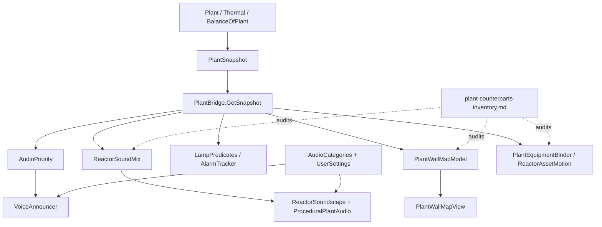

# Phase 1: Trustworthy Plant, Controls and Audio - Plan

## Goal Capsule

- **Objective:** one operator can start, run, trip and recover the plant and read the same story from the desk, the status wall, the reactor hall and the sound.
- **Means:** an audited state-to-presentation inventory (U1) drives every binding; presentation is built from pure, tested models linked into `ReactorSim.Core.Tests` (KTD1).
- **Authority:** Requirements own product behavior; KTDs own mechanism; units own files and sequencing. `ROADMAP.md` Phase 1 gate is the outer contract.
- **Stop conditions:** stop and report if a binding needs a Core signal that does not exist (record it as unavailable instead of inventing it), if a change needs a snapshot field without a safe default, or if a budget in R11 would be exceeded.
- **Execution profile:** Linux for Core, tests and Runner; Unity batchmode on the Windows box, one job at a time; owner-run listening and visual passes are reported, never claimed.
- **Finishing:** the owner merges PRs and runs the listening pass; agents implement, verify and open PRs.

---

## Product Contract

### Summary

Finish the presentation layer of the existing plant so every visible or audible cue comes from an authoritative snapshot value, and add the missing audio controls. Unit 4 (simulation defects `DOM-01`, `SCR-02`, `EDGE-08`) is delivered separately in PR #13 and is a dependency here, not work.

### Problem Frame

The plant model is ahead of its presentation. Relief, bypass and trip states exist in Core and in `PlantSnapshot`, but the sound merges primary and secondary relief, bypass steam has no cue, relief anchors are not placed in the real hall, the wall shows a grouped readout but never the per-component one, and audio has a single unsaved master volume with no category control or alarm priority. A player cannot trust what they hear or see.

### Key Decisions

- **Keep the underwater observation window and improve the view from below** (session-settled: user-directed — chosen over returning to the above-water gallery: the owner wants the fuel and glow up close). Governs R9.
- **Keep the `-dev` loopback control API in release builds when launched with `-dev`** (session-settled: user-directed — chosen over gating it to editor/development builds: the owner uses it for live play support). Governs R12.
- **Darker, gloomier, cooler lighting with readability gates kept** (session-settled: user-directed — chosen over the current brighter, warmer lighting: owner's mood preference). Implemented on branch `chore/organize-and-mood`; Phase 1 polish stays consistent with it. Governs R10.
- **Walking around the reactor and plant buildings is Phase 2** (session-settled: user-directed — chosen over adding walkable field areas now: roadmap order). Governs the Scope Boundaries.

### Requirements

**State and inventory**
- R1. Every shown node, route, indicator and audio layer is listed in `docs/design/plant-counterparts-inventory.md` with its authoritative snapshot field, unit, actual-versus-command meaning and available states; a cue with no authoritative source is shown as unavailable, never approximated.
- R2. A demanded rate is never labeled as delivered flow, and thermal power is never labeled as steam mass flow.

**Wall and controls**
- R3. The wall shows per-component detail (`PlantWallMapModel.ComponentReadout`) in a readable view that does not hide the door-side map or the mounted summary.
- R4. Route direction cues appear only where the model supports direction and activity.
- R5. Buttons, detents, rejection feedback, labels and the checklist read correctly from the standing and seated poses.

**Hall, effects and audio**
- R6. Primary relief (`ReliefOpen`) and secondary relief (`SecondaryReliefOpen`) each have their own hall anchor, visual and sound, and neither triggers the other.
- R7. Turbine steam cues follow delivered turbine steam (`TurbineSteamKW`); a tripped turbine has no turbine-steam cue while bypass steam (`DumpSteamKW`) can still be seen and heard.
- R8. Audio has master and category volumes (plant, alarms, voice) that persist between sessions, positioned hall sources, and an alarm/voice priority so simultaneous alarms stay intelligible and acknowledgement silences what it should on every surface.

**Polish and budgets**
- R9. The underwater window keeps the fuel array and glow readable from the stand and seat poses.
- R10. Lighting, water and texture changes keep every readability gate passing at its current threshold.
- R11. No new real-time lights beyond the existing caps; hall triangles stay under `HallDimensions.MaxHallTriangles`; control-room renderers do not grow without a measured reason.
- R12. The `-dev` API keeps its current contract: off unless launched with `-dev`, loopback only, token-gated.

**Scenario parity**
- R13. Cold startup to grid, steady load, flow loss, high pressure, SCRAM, turbine trip, feed starvation and bypass produce matching desk, wall, hall and audio states.

### Acceptance Examples

- AE1. Covers R6. **Given** the plant at power, **when** only the secondary relief lifts above 75 bar, **then** the secondary anchor vents and the secondary relief sound plays, and the primary anchor and primary sound stay quiet.
- AE2. Covers R7. **Given** a turbine trip with bypass steam flowing, **then** turbine steam audio and visuals are silent and the bypass steam cue is active.
- AE3. Covers R8. **Given** two horn alarms and a voice line at once, **when** the operator acknowledges, **then** the horn stops on all surfaces and the highest-priority voice line is the one heard.
- AE4. Covers R1. **Given** a reading with no authoritative source (first-out, per-SG flow), **then** the wall shows it as unavailable.

### Scope Boundaries

- Walkable field equipment, new failure models and radiation are later phases (Phase 2 onward).
- Changing plant physics for visual effect is out of scope.

### Dependencies

- PR #13 (`fix/phase1-sim-defects`) delivers unit 4. U5 scenarios use its trip setpoints and must not assume pre-fix `EDGE-08` behavior.
- Branch `chore/organize-and-mood` delivers the lighting mood; U5 polish rebases on it once merged.

---

## Planning Contract

### Key Technical Decisions

- KTD1. **Pure models carry presentation logic.** New decision logic goes into UnityEngine-free classes under `ReactorSim.Unity/Assets/Scripts` and is linked into `ReactorSim.Core.Tests/ReactorSim.Core.Tests.csproj` with a `<Compile Include ... Link=...>` line, following `PlantWallMapModel`, `ReactorSoundMix` and `AlarmTracker`. MonoBehaviours only apply what the model returns. This makes R1-R8 testable on Linux.
- KTD2. **Split relief in the sound mix, not in Core.** Core already separates `ReliefOpen` and `SecondaryReliefOpen` (`Thermal.cs:65`, `Thermal.cs:121-128`, `Snapshot.cs:70-73`). `ReactorSoundMix` replaces its single `Relief` with `PrimaryRelief` and `SecondaryRelief`, and adds a bypass-steam level (`DumpSteam`) from `DumpSteamKW`; `ReactorSoundscape` gets one source per relief. Serves R6, R7.
- KTD3. **Audio settings live in `UserSettings` (PlayerPrefs), not in saves.** Category volumes and the master volume get new `reactorsim.*` keys that read clamped defaults when absent (settings are independent per-key PlayerPrefs entries; `UserSettings.Version` is only an in-memory change counter), so snapshot and save compatibility are untouched. Clamping and defaults live in the pure `AudioCategories` model, following `OperatorMath`. The existing alarm mute stays and overrides the alarms category. Category routing uses per-source volume multipliers from a pure `AudioCategories` model rather than an AudioMixer asset, keeping it testable and asset-free. Serves R8.
- KTD4. **Alarm and voice priority is a pure queue.** A new `AudioPriority` model ranks horn alarms and voice keys (SCRAM highest) and decides which voice line plays when several fire in one tick; `VoiceAnnouncer` consumes it. Acknowledgement keeps using `AlarmTracker` and `s.AlarmAckSeq`. Serves R8.
- KTD5. **Relief anchors are authored into the hall itself, not imported from PlantEquipment.** The legacy `PlantEquipment` asset is a separate whole plant that is never placed in the hall (`docs/design/reactor-core-assets.md`), so the hall builder creates `VFX_PORV_SteamJet_Anchor` and `VFX_SGRelief_SteamJet_Anchor_*` empties at hall-appropriate positions on the module's relief lines. `PlantEquipmentBinder.BindTransforms` already matches those name prefixes under the hall root, so the binder needs no change; the play check stops using its temporary fixture. Serves R6.
- KTD6. **Parity is proven by feeding Runner-generated snapshots through every presentation model.** One test drives the R13 scenarios and asserts `PlantWallMapModel`, `ReactorSoundMix`, `LampPredicates` and `AudioPriority` agree per state. Serves R13.

### High-Level Technical Design

The pure models (KTD1) sit between the snapshot and each MonoBehaviour; the parity test (KTD6) exercises them together.

### Sequencing

U1 first (it defines the binding list). U6 and U2 can then run in parallel (U6 is audio-only, U2 is wall/controls). U3 follows U6 for sounds and needs Blender work for anchors. U5 runs last, after U2, U3 and U6, and after PR #13 and `chore/organize-and-mood` merge. U4 is PR #13.

### Assumptions

- The owner's listening pass happens on their own machine; automated runs stay silent.
- The Windows box's frame pacing is currently broken (about 257 ms per frame in every pose), so frame-time budgets are graded only once a healthy capture session exists; static counts are graded now.

---

## Implementation Units

### U1. State and presentation audit

- **Goal:** complete the inventory so every cue has an audited source (R1, R2).
- **Requirements:** R1, R2, AE4.
- **Files:** `docs/design/plant-counterparts-inventory.md`; `ReactorSim.Unity/Assets/Scripts/View3D/PlantWallMapModel.cs` (only to mark unavailable readings); `ReactorSim.Core.Tests/PlantWallMapModelTests.cs`.
- **Approach:** one row per node, route, indicator and audio layer with snapshot field, unit, actual/command meaning, states and the unit that will bind it. Record known gaps as unavailable: surge/safety route flow, first-out, per-SG and per-pump readings, chemistry route, steam mass flow, bypass steam cue, relief anchors. Per-reading unavailable rendering is one rule on every surface: the text token `--` with no unit, and the existing `Status.Unavailable` colour on lamps and nodes.
- **Test scenarios:**
  - A first-out or per-SG reading renders as `--` with no unit and `Status.Unavailable`, never a number.
  - A component fed a demanded rate is labeled as demand, not flow.
  - Heat-rate output never carries a mass-flow unit.
- **Verification:** `bash scripts/ci.sh` passes; every inventory row names a field that exists in `Snapshot.cs` or says unavailable.

### U2. Wall detail view and control feedback

- **Goal:** show per-component detail on the wall and verify control feedback (R3, R4, R5).
- **Requirements:** R3, R4, R5.
- **Files:** `ReactorSim.Unity/Assets/Scripts/View3D/PlantWallMapModel.cs` (`ComponentReadout`, `RouteActivity` direction), `ReactorSim.Unity/Assets/Scripts/View3D/PlantWallMapView.cs` (`ApplySnapshot`, LiveDetail plate), `ControlTooltipModel.cs`, `ControlRoom3DBinder.cs`; tests `ReactorSim.Core.Tests/PlantWallMapModelTests.cs`, `ControlTooltipTests.cs`, `LampPredicatesTests.cs`; Unity `Editor/PlantFeedbackPlayCapture.cs`, `Editor/LayoutCheck.cs`; `scripts/check-captures.sh` and `scripts/test-check-captures.sh` (new wall pose).
- **Approach:** the operator clicks a component on the wall (existing `DiegeticInteractable` click path) to select it; the selected component is highlighted and its `ComponentReadout` text fills the LiveDetail plate within its existing bounds. Clicking it again clears the selection; clicking another component moves it. With nothing selected the plate shows a prompt to select a component. `RouteActivity` gains a direction only for routes whose flow sign the model knows.
- **Test scenarios:**
  - `ComponentReadout` for each component returns its audited fields and units; NaN input returns the unavailable token.
  - No selection: the plate model returns the select-a-component prompt; selecting a component returns its readout; selecting it again clears to the prompt.
  - A route with zero activity has no direction; a route with known positive flow has forward direction.
  - Detail text stays inside its plate at both capture sizes (play capture assertion).
  - A rejected press shows rejection feedback and does not change the snapshot (RoundTripCheck).
- **Verification:** CI passes; `PlantFeedbackPlayCapture` passes; the new wall pose is in `REQUIRED_POSES` and passes the absolute thresholds.

### U3. Relief anchors and hall effects

- **Goal:** real, independent relief anchors and visuals in the hall (R6, R7 visuals).
- **Requirements:** R6, R7, AE1, AE2.
- **Files:** `ReactorSim.Unity/Assets/Editor/HallBuilder.cs` (relief anchor empties), `Editor/ReactorAssetCheck.cs`, `Editor/PlantFeedbackPlayCapture.cs` (drop the temporary relief fixture); `ReactorSim.Unity/Assets/Scripts/View3D/PlantEquipmentBinder.cs` (bypass steam visual); `docs/design/plant-counterparts-inventory.md` (relief-anchor and bypass rows move from unavailable to their snapshot source).
- **Approach:** author the anchors per KTD5; add a bypass steam visual bound to `DumpSteamKW`; keep within R11.
- **Test scenarios:**
  - The built hall contains both relief anchors under the hall root and stays under `HallDimensions.MaxHallTriangles` (ReactorAssetCheck fails if either anchor is missing).
  - Primary open, secondary closed: only the PORV jet is active; and the reverse.
  - Turbine tripped with bypass steam flowing: turbine steam visual off, bypass steam visual on.
- **Verification:** Unity CI passes on the box; hall triangles and lights within caps; renders of both relief states and the trip-with-bypass state are viewed.

### U4. Simulation defects

- **Goal:** fix `DOM-01`, `SCR-02`, `EDGE-08`.
- **Status:** delivered in PR #13; no work in this plan.

### U5. Scenario parity, playability and polish

- **Goal:** prove every surface agrees across the scenario matrix and finish polish (R9, R10, R13).
- **Requirements:** R9, R10, R11, R13.
- **Dependencies:** U2, U3, U6, PR #13, `chore/organize-and-mood`.
- **Files:** new `ReactorSim.Core.Tests/PresentationParityTests.cs`; `ReactorSim.Runner/Program.cs`, `ReactorSim.Runner/BopScenarios.cs`, `ReactorSim.Runner/StartupScenarios.cs` (scenario snapshots); `docs/PLAYTEST.md`; `ROADMAP.md` status.
- **Approach:** KTD6. Add flow-loss, high-pressure, feed-starvation and bypass-while-tripped scenarios where missing. Fix readability issues the captures show, within R10 and R11.
- **Test scenarios:**
  - For each R13 scenario, the wall, sound mix, lamps and priority model agree on relief, trip, alarm and steam states.
  - Turbine trip with bypass steam: `ReactorSoundMix.TurbineSteam` is 0 and `DumpSteam` is positive.
  - SCRAM: horn alarm active until acknowledged, then silent on every model.
  - Underwater window (R9): gallery, stand and seat captures of the fuel array pass the existing `check-captures.sh` absolute readability thresholds at power and at shutdown.
  - Controls (R5): seat and stand captures of button, detent, rejection and checklist labels pass the same thresholds, and `RoundTripCheck` passes.
- **Verification:** CI and Unity CI pass; captures at both sizes pass absolute thresholds; the owner's visual and listening pass is recorded in `docs/PLAYTEST.md`.

### U6. Audio categories, positioning and priority

- **Goal:** separate relief and bypass sounds, persisted category volumes, positioned sources and alarm/voice priority (R6-R8 audio).
- **Requirements:** R6, R7, R8, AE1, AE2, AE3.
- **Files:** `ReactorSim.Unity/Assets/Scripts/Audio/ReactorSoundMix.cs`, `ReactorSoundscape.cs`, `ProceduralPlantAudio.cs`, `VoiceAnnouncer.cs`; new `Audio/AudioCategories.cs`, `Audio/AudioPriority.cs`; `ReactorSim.Unity/Assets/Scripts/UI/UserSettings.cs`, `UI/PauseMenu.cs`; `ReactorSim.Unity/Assets/Scripts/View3D/AlarmFeedback.cs` (secondary relief sting); `docs/design/plant-counterparts-inventory.md` (audio rows for both reliefs and bypass steam); tests `ReactorSim.Core.Tests/ReactorSoundMixTests.cs`, new `AudioCategoryTests.cs`, new `AudioPriorityTests.cs`, new `AlarmTrackerTests.cs`; csproj links for the new pure files.
- **Approach:** KTD2, KTD3, KTD4. Persist the master volume too (it is not saved today). The pause menu gets four labelled sliders, Master, Plant, Alarms and Voice, each defaulting to today's effective level (full); the existing alarm mute toggle stays and silences alarms regardless of the Alarms slider.
- **Test scenarios:**
  - Secondary relief only: `SecondaryRelief` > 0, `PrimaryRelief` = 0; and the reverse.
  - Trip with bypass steam: `TurbineSteam` = 0, `DumpSteam` > 0; NaN inputs give 0.
  - Category volume 0 for alarms silences horn and stings but not plant sound; values outside 0-1 clamp.
  - `AudioCategories` with no stored values returns the defaults; stored values outside 0-1 clamp; alarm mute on gives an alarm gain of 0 at any slider value. The PlayerPrefs round trip is covered by the pause-menu capture on the Windows box.
  - Two alarms and a voice line in one tick: SCRAM outranks others; acknowledgement clears horn state in `AlarmTracker`.
- **Verification:** CI passes with the new tests; Unity CI passes; the pause menu shows working sliders (capture); listening pass deferred to the owner (U5).

---

## Verification Contract

| Gate | Command / check | Applies to |
|---|---|---|
| Linux CI | `bash scripts/ci.sh` (clean-room scan, 0-warning build, `ReactorSim.Core.Tests`, `--scenario all`, `--verify`) | every unit |
| Core sync | `bash scripts/sync-core-to-unity.sh` after any `ReactorSim.Core` change | any Core change |
| Unity CI | `UNITY_EXE=... bash scripts/ci.sh` on the Windows box: scene drift guard, `LayoutCheck`, `InstrumentCheck`, `HallCheck`, `ReactorAssetCheck`, `RoundTripCheck`, `ControlMapCheck` | U2, U3, U5, U6 |
| Play capture | `PlantFeedbackPlayCapture.Run` | U2, U3 |
| Captures | `scripts/capture-playtest.sh` then `scripts/check-captures.sh` (absolute thresholds; `--baseline --room-budget` once the box paces correctly) | U2, U5 |
| Human passes | owner visual and listening pass, recorded in `docs/PLAYTEST.md` | U5 |

---

## Definition of Done

- Every R has a passing test or a recorded human check; AE1-AE4 are each covered by a named test.
- Linux CI and Unity CI pass at the merged head; no XFAIL is added.
- The inventory lists every cue with a source or an explicit unavailable state.
- Budgets in R11 hold; no readability threshold was loosened.
- No dead-end or experimental code from abandoned attempts remains in the diff.
- `ROADMAP.md` Phase 1 status and `docs/PLAYTEST.md` reflect the evidence.

---

## Open Questions

- OQ2 (deferred to U6): category set beyond plant/alarms/voice (for example a separate ambience category) only if the mix needs it.
