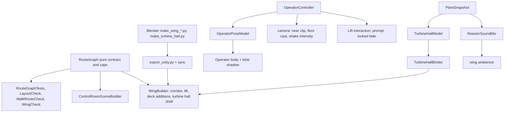

# Phase 2: Player and First Connected Buildings - Plan

## Goal Capsule

- **Objective:** the operator has a visible body and can walk from the control room to the reactor operating deck and to the turbine hall and back, finding their way and seeing equipment that reads the way the plant actually runs.
- **Means:** a pure route contract (KTD1) drives deterministic builders for one new connected wing; equipment binds to the existing snapshot through pure models (KTD5).
- **Authority:** Requirements own product behavior; KTDs own mechanism; units own files and sequencing. `ROADMAP.md` Phase 2 gate is the outer contract.
- **Stop conditions:** stop and report if a route change would alter the underwater window view or a Phase 1 control-room check, or if a measured count exceeds its U1 cap (R10).
- **Execution profile:** Linux for pure models, tests and Runner; Unity batchmode on the Windows build box, one editor at a time; the owner's walk-through is reported, never claimed.
- **Finishing:** the owner merges PRs and does the walk-through; agents implement, verify and open PRs.

---

## Product Contract

### Summary

Add a simple operator body, then open the control room into one connected wing: an east corridor, a lift to the reactor operating deck around the pool rim, and a turbine hall. The turbine rotor turns with the live plant; the generator, condenser and feed-pump group show live readings on their plates. Everything stays single-player and inside measured caps.

### Problem Frame

The control room is walkable but sealed: its only door is decorative and opens onto the pool. The operator is an invisible capsule that teleports between fixed stands, the camera clips into walls at contact, and the floor is assumed flat. The plant beyond the desk exists only as the underwater view and the wall schematic.

### Key Decisions

- **Simple operator body, no full animation system** (session-settled: user-directed — chosen over a fully rigged, animated character: the owner asked for a quick, simple physical character). Governs R4, R5.
- **Walking the plant is in scope now** (session-settled: user-directed — chosen over staying in the control room: the owner's stated next goal). Governs R1-R3.
- **The underwater observation window and its view are unchanged** (session-settled: user-directed — chosen over reworking the window for the new route: the owner chose the view from below and it shipped in v0.3.0). Governs R8.
- **New spaces follow the darker, cooler lighting with readability gates kept** (session-settled: user-directed — chosen over brighter warm industrial lighting: the owner's mood preference, shipped in v0.3.0). Governs R9.
- **Equipment shows only states the simulation models; missing readings show `N/M`** (session-settled: user-approved — chosen over decorative motion not tied to the snapshot: the trustworthy-plant principle from Phase 1). Governs R6, R7.

### Requirements

**Route**
- R1. A doorway in the control room's east wall leads to a corridor; the corridor reaches a lift lobby and the turbine hall, and returns to the control room by the same doorway.
- R2. The lift moves the operator between the corridor level and the reactor operating deck; the deck is a walkway with railings on the existing pool rim, from which the module is visible from above.
- R3. The whole route can be walked in both directions with no stuck spots, no camera clipping through walls, and no geometry blocking any control-room control.
- R11. The control-room doorway, the lift lobby and the turbine-hall entrance each carry a name plate in the existing plate style, readable from the approach.

**Operator**
- R4. The operator has a simple original body with hands and a blob shadow, visible when looking down, with seated and standing poses consistent with the existing seat/stand behavior.
- R5. Settings add a camera-shake intensity (0 to 1, where 0 is off); existing settings are unchanged.

**Equipment**
- R6. The turbine hall contains a correctly named turbine, generator, condenser and a feed-pump group; the turbine rotor turns with the simulated `TurbineRpm`, so a tripped turbine coasts down as the simulation does.
- R7. Each piece of equipment has a status plate using the Phase 1 readout rules (actual vs `% command`, `kW heat`, `N/M` for unmodeled readings); the feed pumps share one group plate, because the plant model has only aggregate feed readings. Local ambience follows the same snapshot values as the control-room mix.

**Preservation and budgets**
- R8. The underwater window view, relief plumes and every Phase 1 check are unchanged.
- R9. New spaces use the cool, dim lighting direction and pass the existing readability thresholds; control-room lighting is unchanged.
- R10. Each new space has numeric caps for triangles, renderers, lights and colliders set in U1; a measured count over its cap fails the check. The control room and reactor hall keep their existing caps.

### Acceptance Examples

- AE1. Covers R1-R3, R11. **Given** the operator seated at the desk, **when** they stand, walk out of the east door, take the lift to the deck, walk around the pool rim, return by lift, walk to the turbine hall and back to the desk, **then** they never stick, never see through a wall, can read each name plate on approach, and can operate every control afterwards.
- AE2. Covers R6, R7. **Given** a running plant, **when** the turbine trips, **then** the rotor slows frame by frame with the simulated rpm to a stop, its plate shows `TRIPPED` and `0 kW heat` turbine steam, and the hall ambience drops the turbine layer.
- AE3. Covers R7. **Given** any snapshot, **then** the feed-pump group plate shows delivered flow as `% rated` and pump demand as `% command`, and no plate is bound to a single pump.

### Scope Boundaries

- Saving player position, doors or equipment state is out of scope; the sandbox is not saved today. Persistent IDs are recorded for Phase 3.
- Entering containment, radiation, repairs and multiplayer belong to later phases.
- A full building campus is out; this slice is one wing.

### Deferred to Follow-Up Work

- Every operator action shown visibly in the reactor; plant hardware cameras (the owner wants both later).
- A stairwell alternative to the lift, and a moving lift car.
- A reach pose for control use, and a separate reduced-camera-motion setting.
- The body visible in reflective surfaces.

---

## Planning Contract

### Key Technical Decisions

- KTD1. **Pure route contract first.** A UnityEngine-free `RouteGraph` (rooms, doorways, lift landings, floor heights, clearances, stable IDs, per-space caps) is the single source for builders, checks and tests, following `HallDimensions` and `OperatorMath`. Serves R1-R3, R8, R10, R11.
- KTD2. **East-wall doorway and a lift into the existing hall deck.** The south side is pool water and the deck is about 16 m above the control-room floor (`HallDimensions.RoomFloorAbovePoolFloor` 6.05 m vs deck 22.15 m), so the corridor leaves through the east wall near y 2 m (clear of the board and the wall plate) and a lift handles the level change. The decorative south door stays, because the window and plant-wall placement key off it. The deck walkway is the existing `Hall_Deck` surface inside the `ReactorHall` root: the wing adds only colliders, railings and the lift landing on top of it, with no duplicate deck mesh. `RouteGraph` defines the single opening where the lift lands in the hall shell, on a wall away from the window side. Serves R1, R2, R8.
- KTD3. **Camera fixes before new spaces.** Lower the main camera near clip from 0.3 m to about 0.05 m, track floor height per frame from a downward cast (replacing the fixed `floorY`), face along the travel direction when entering a space instead of outward from `STAND_Center`, and scale camera shake by the new intensity setting. Serves R3, R5.
- KTD4. **One wing layer, one root per space.** `Wing_Corridor`, `Wing_Lift`, `Wing_Deck` and `Wing_TurbineHall` are added to `ControlRoomSceneBuilder`'s delete-and-rebuild list, all on one new Wing layer. The control-room lights' culling masks change from `~(1 << HallLayer)` to exclude the Wing layer too, and wing lights light only the Wing layer, so the room look and light count are unchanged. New Blender generators follow `make_*.py` plus `export_unity.py` and the sync scripts. Serves R1, R9, R10.
- KTD5. **Equipment binds through a pure model and its own binder.** A new `TurbineHallModel` takes rotor speed only from the snapshot (`PlantWallMapModel.RotorSpeed(true, s)`), adds no decay of its own, and builds plate text with the `ComponentReadout` rules; a `TurbineHallBinder` applies it. `ReactorAssetMotion` is not reused, because it requires exactly four rod banks. A new true-scale turbine-hall asset is authored; the legacy `PlantEquipment` boxes are a layout reference only. Serves R6, R7.
- KTD6. **The body is a static rig with two poses and a blob shadow.** A low-poly body and hands with standing and seated poses chosen by a pure `OperatorPoseModel`; the shadow is a soft projected quad parented to the body, because every room light is built without shadows and a shadow-casting light would break the light budget. Serves R4.
- KTD7. **The lift is a prompted interaction with a locked fade.** Facing the lift call point shows a prompt in the existing hint box; one activation key starts a short fade; movement and look are locked during the fade; the operator arrives on the other landing facing out of the car; activation is ignored while a transition runs. Serves R2, R3.

### High-Level Technical Design

### Sequencing

U1 (contract, caps and baseline) first. U2 (camera and body) and U3 (wing shell, lift, deck) next; U3 needs U1's contract and benefits from U2's camera fixes. U4 (turbine hall equipment) after U3's turbine-hall shell. U5 (budgets and the walk check in CI) last.

### Assumptions

- The lift's two landings are at the corridor floor and the existing deck height.
- The deck walkway at the pool rim is above the window's framed band, so it cannot appear in the window view.

---

## Implementation Units

### U1. Route contract, caps and baseline

- **Goal:** a tested route contract with per-space caps, and a measured performance baseline before anything is built (R1-R3, R8, R10, R11).
- **Files:** new `ReactorSim.Unity/Assets/Scripts/View3D/RouteGraph.cs` (pure, linked into `ReactorSim.Core.Tests/ReactorSim.Core.Tests.csproj`); new `ReactorSim.Core.Tests/RouteGraphTests.cs`; `docs/design/plant-and-assets.md` (coordinates, room graph, floor heights, IDs, caps, corridor length and turbine-hall footprint); `design/control-room/layout.json` (doorway and new operating points); `docs/PLAYTEST.md` (baseline numbers).
- **Approach:** KTD1, KTD2. Caps are sized from the existing room and hall caps. Record the baseline with `scripts/capture-playtest.sh` and `check-captures.sh` on the box so later `--baseline --room-budget` grading has a reference.
- **Test scenarios:**
  - Every room is reachable from the control room and back; the graph has no dead ends.
  - The east doorway is at least 1.0 m wide and 2.1 m high, clear of the board arc and the wall plate.
  - No wing geometry crosses the window's framed band from the stand and seat poses (reuse `HallSightline`); the lift opening in the hall shell is on a non-window wall.
  - Lift landing heights match the room floor and the existing deck height from `HallDimensions`.
  - Every room, doorway, lift landing and name plate has a unique stable ID; every space has all four caps.
- **Verification:** `bash scripts/ci.sh` passes; baseline captures recorded on the box.

### U2. Camera fixes and operator body

- **Goal:** a visible simple body with a blob shadow and a camera that works in corridors (R3-R5).
- **Files:** `ReactorSim.Unity/Assets/Scripts/View3D/OperatorController.cs`, `CameraShake.cs`, `OperatorMath.cs`; new `Scripts/View3D/OperatorPoseModel.cs` (pure, linked); `Scripts/UI/UserSettings.cs`, `UI/PauseMenu.cs`; new `Blender/scripts/make_operator_body.py` and its export; tests `ReactorSim.Core.Tests/OperatorMathTests.cs`, new `OperatorPoseModelTests.cs`.
- **Approach:** KTD3, KTD6.
- **Test scenarios:**
  - Shake intensity 0 gives zero offset and roll; values outside 0-1 clamp; a missing settings key reads the default (1).
  - Pose model: seated when seated, standing otherwise.
  - Floor height follows a step up to `StepOffset` and a lift floor change without the eye jumping.
- **Verification:** CI and Unity CI pass; captures of the seated and standing body and its shadow, looking down.

### U3. Wing shell, lift and reactor deck

- **Goal:** the walkable wing: corridor, lift lobby, lift, turbine-hall shell (floor, walls, entrance) and the deck additions (R1-R3, R8, R9, R11).
- **Files:** `ReactorSim.Unity/Assets/Editor/ControlRoomSceneBuilder.cs` (east doorway cut, `COL_Wall_East` split, new roots in the rebuild list, room-light culling masks); new `Editor/WingBuilder.cs`; new `Scripts/View3D/LiftInteraction.cs`; new `Blender/scripts/make_wing_corridor.py`, `make_wing_turbine_hall.py` (shell and lift lobby), `make_wing_deck_additions.py` (railings and lift landing only), plus entries in `export_unity.py` and the sync scripts; `Editor/AssetManifestCheck.cs`; new `Editor/WalkRouteCheck.cs` (modelled on `ReactorAssetPlayCheck`); `scripts/ci.sh`.
- **Approach:** KTD2, KTD4, KTD7. Name plates reuse the existing plate style.
- **Test scenarios:**
  - `WalkRouteCheck` drives the real `OperatorController` along every `RouteGraph` edge both ways and fails on a stall longer than 1 s or a camera inside a collider.
  - Triggering the lift twice in quick succession gives one clean transfer, arriving facing out of the car.
  - `LayoutCheck` still passes: every control readable and reachable.
  - `HallCheck`, `ReactorAssetCheck`, the window captures and the relief plume capture are unchanged; the control-room seat and stand captures are unchanged after the light-mask change.
  - The deck has no duplicate deck mesh; its colliders sit on `Hall_Deck`.
  - Rebuilding twice gives one root per space with identical counts.
- **Verification:** CI and Unity CI pass; captures of each new space and each name plate from its approach pass the readability thresholds at both sizes.

### U4. Turbine hall equipment

- **Goal:** recognizable equipment that reads from the live plant (R6, R7).
- **Files:** new `Blender/scripts/make_turbine_hall.py` (turbine with `ROTOR_Turbine_PIV` and rotor-axis marker, generator, condenser, feed-pump group, pipes); new pure `ReactorSim.Unity/Assets/Scripts/View3D/TurbineHallModel.cs` (linked); new `Scripts/View3D/TurbineHallBinder.cs`; wing ambience source in `Scripts/Audio/ReactorSoundscape.cs` or a new script; tests new `ReactorSim.Core.Tests/TurbineHallModelTests.cs`, extend `PresentationParityTests.cs`; `docs/design/plant-counterparts-inventory.md` (new rows).
- **Approach:** KTD5.
- **Test scenarios:**
  - Rotor speed equals `PlantWallMapModel.RotorSpeed(true, s)` for every snapshot; NaN gives 0; in a tripped scenario the rotor follows the snapshot rpm frame by frame to 0 with no added lag, and the plate rpm matches.
  - Plates use the Phase 1 rules: feed delivered `% rated`, pump demand `% command`, steam `kW heat`; no plate is bound to a single pump.
  - Parity: for every Phase 1 scenario, the turbine-hall model agrees with the wall and the sound mix on trip and steam state.
- **Verification:** CI and Unity CI pass; renders of the turbine hall running and tripped.

### U5. Caps and the walk check in CI

- **Goal:** caps enforced per space and the route checked on every run (R10).
- **Files:** `Scripts/Capture/CaptureMode.cs` (corridor, lift lobby, deck, turbine-hall and name-plate approach poses); `scripts/check-captures.sh` (`REQUIRED_POSES`, `ROOM_POSES`); `scripts/test-check-captures.sh`; new `Editor/WingCheck.cs` (per-space triangle, renderer, light and collider counts against the U1 caps); `ControlRoomSceneBuilder.MarkStaticBatching` (include the wing, exclude moving parts); `docs/PLAYTEST.md`.
- **Approach:** grade the new poses with the existing thresholds and `--baseline --room-budget` against the U1 baseline.
- **Test scenarios:**
  - New poses are required and graded at both sizes; a missing pose fails.
  - `WingCheck` fails when any measured count exceeds its cap (negative control with a deliberately low cap).
- **Verification:** CI and Unity CI pass; `check-captures.sh --baseline --room-budget` passes or the regression is reported with numbers.

---

## Verification Contract

| Gate | Command / check | Applies to |
|---|---|---|
| Linux CI | `bash scripts/ci.sh` | every unit |
| Core sync | `bash scripts/sync-core-to-unity.sh` after any `ReactorSim.Core` change | as needed |
| Unity CI | `UNITY_EXE=... bash scripts/ci.sh` on the Windows build box: scene drift guard, `LayoutCheck`, `InstrumentCheck`, `HallCheck`, `ReactorAssetCheck`, `RoundTripCheck`, `ControlMapCheck`, plus `WalkRouteCheck` and `WingCheck` once they land | U2-U5 |
| Play-mode checks | `ROOM_RENDER=1 UNITY_EXE=... bash scripts/ci.sh`; `PlantFeedbackPlayCapture.Run` | U3-U5 |
| Captures | `scripts/capture-playtest.sh` then `scripts/check-captures.sh` at 1600x900 and 1920x1080; `--baseline --room-budget` against the U1 baseline | U1-U5 |
| Owner walk-through | the AE1 route, recorded in `docs/PLAYTEST.md` | end of phase |

---

## Definition of Done

- Every R has a passing test, check or recorded owner pass; AE1-AE3 each covered by a named check.
- Linux CI and Unity CI pass at the merged head; no Phase 1 check or threshold was loosened.
- The underwater window view, relief plumes and control-room look are unchanged (captures match).
- Every new room, doorway, lift landing, name plate and equipment item has a stable ID listed in `docs/design/plant-and-assets.md` for Phase 3.
- No dead-end or experimental code from abandoned attempts remains.
- `ROADMAP.md` Phase 2 status and `docs/PLAYTEST.md` reflect the evidence.
