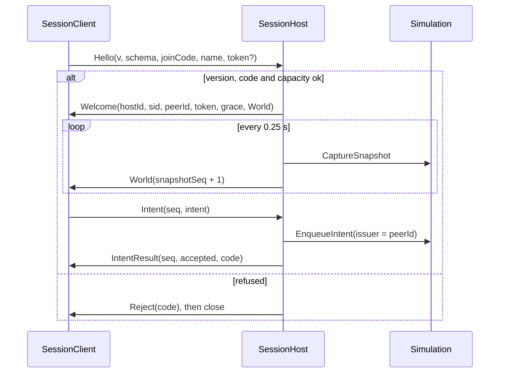
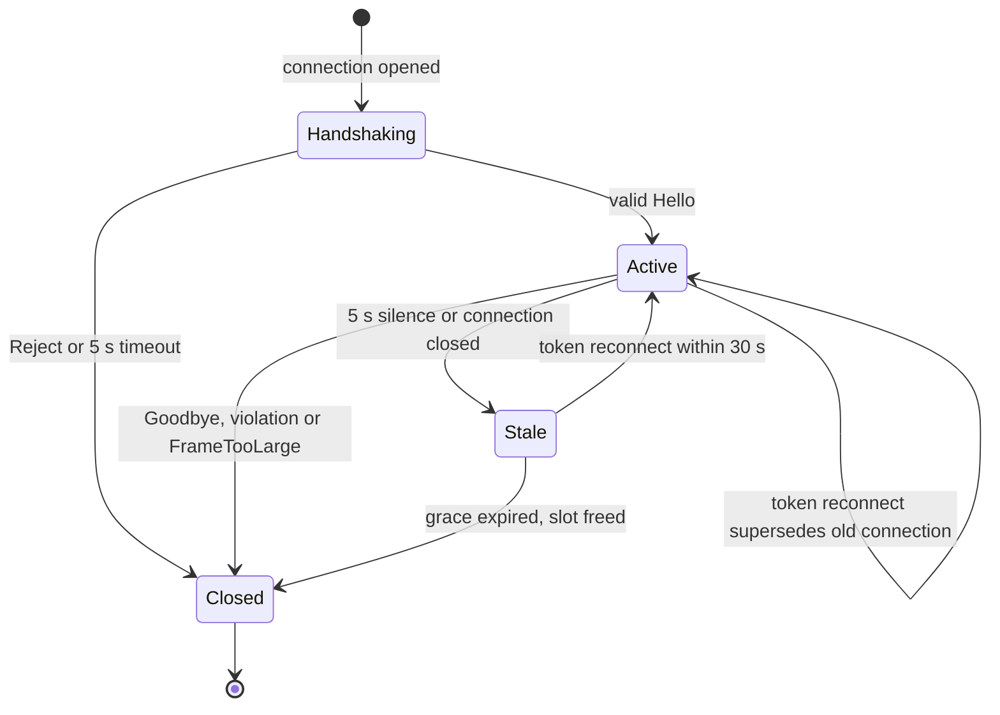
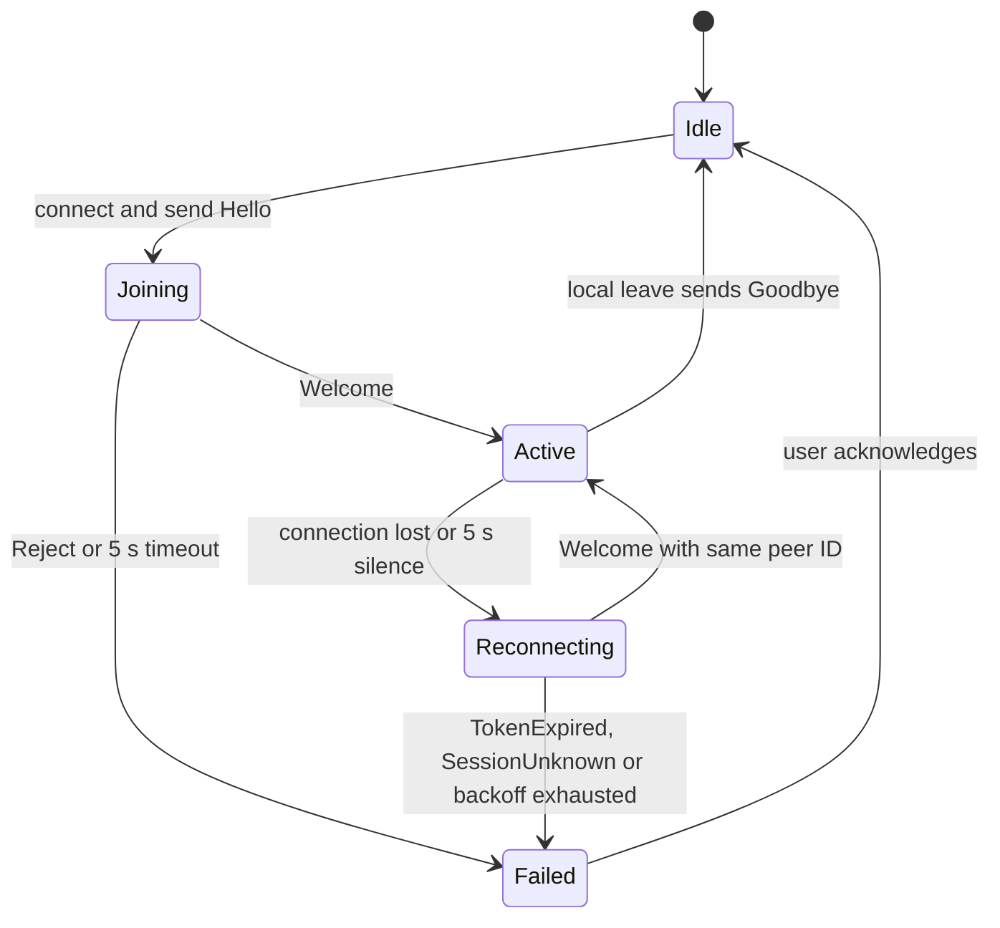

# Phase 3: Shared Plant and Visible Crew - Plan

## Goal Capsule

- **Objective:** two operators on separate machines on one LAN can join the same plant, see a clear reason whenever a join or action is refused, and rejoin with their place kept after a dropped connection; bad or hostile network input never crashes the host or changes the plant.
- **Means:** a transport-agnostic, host-authoritative session contract in `ReactorSim.Core` (KTD1) that the Unity transport later drives; this run builds and proves the contract with deterministic tests (KTD16).
- **Authority:** Requirements own product behavior; KTDs own mechanism; units own files and sequencing. The `ROADMAP.md` Phase 3 gate is the outer contract.
- **Stop conditions:** stop and report if the contract needs a Unity, socket or thread type inside `ReactorSim.Core`, if a change alters solo-play behavior or an existing test, or if the worst-case world snapshot exceeds 65536 bytes, a quarter of the state-frame limit (KTD4).
- **Execution profile:** `bash scripts/ci.sh` on any machine with .NET 8 proves this run; Unity compile, transport wiring and the two-machine playtest run on the Unity host later (KTD16).
- **Finishing:** the owner merges PRs and runs the two-machine playtest; agents implement, verify and open PRs.

---

## Product Contract

### Summary

Replace the trust-everything LAN link with a defined session contract. A client joins through a versioned handshake, gets a peer identity from the host, and receives the full plant and crew state first. The host admits only permitted player actions, records who sent them, limits frame size and rate, and answers every refusal with a typed reason. A dropped client can reconnect within a grace window and keep its identity and place. This run delivers the contract and its tests; Unity wiring, avatars, roles and internet transport follow in later slices.

### Problem Frame

`CoopSessionManager` exchanges `INTENT:` and `STATE:` lines over TCP with no handshake, version, peer identity, size limit, timeout or error reply. The host trusts the issuer name the client sends. A client applies any snapshot, even an older one. A peer can send an unbounded line and exhaust host memory. Late join means waiting for the next broadcast, and reconnect does not exist. The Fusion path is a stub. None of this shows that two people can reliably share a plant, which is the Phase 3 player outcome.

### Key Decisions

- **Trusted-LAN, two-player slice first.** Internet transport, accounts and more than two operators each need their own decision and load test. Governs R1, R10, R12.
- **Solo play stays first-class.** Session code runs only when a session is hosted or joined. Governs R9.
- **The host is the only simulation authority.** Clients request; the host decides. Governs R2, R5, R8.

### Requirements

**Joining**
- R1. A client joins only with a matching protocol version and the host's join code; any refusal names a typed reason the client can show.
- R5. A joining or rejoining client receives the full plant and crew state before any other session message.
- R12. A session holds the host plus one remote operator; a further joiner is refused with a "session full" reason.

**Authority and actions**
- R2. Remote clients can request only player-class plant actions; the host records the sending peer as the issuer, whatever the client claims.
- R3. Every refused action or frame gets a typed reason that identifies the refused message.
- R13. Clock actions (pause, resume, time scale, skip) from a remote client are refused unless the host allows them for the session.

**Robustness**
- R4. Malformed, oversized, duplicate, out-of-order or flooding input never crashes the host and never changes the plant; each case has one deterministic outcome.
- R8. A client never applies older plant or crew state over newer state, whatever the network delay.

**Reconnect and loss**
- R6. A client that drops can reconnect within a grace window and resume with the same peer identity and crew state; after the window it must join again as a new peer.
- R7. When the host is gone, the client reports it and stops retrying after a bounded time.

**Boundaries and docs**
- R9. Solo play behaves exactly as before; no existing test changes.
- R10. The LAN trust boundary is documented: the join code guards against mistakes, not attackers, and the session is not safe on the internet.
- R11. The protocol, versions, state ownership and limits are published as a design doc.

### Acceptance Examples

- AE1. **Covers R1.** **Given** a host on protocol 1, **when** a client sends a Hello with protocol 2, **then** the client gets `UnsupportedProtocol`, the connection closes, and the plant is unchanged.
- AE2. **Covers R2, R3.** **Given** an active client, **when** it sends a `RodBankTarget` intent claiming issuer `host`, **then** the queued intent carries the client's peer ID as issuer and the client gets an accepted result for that sequence number.
- AE3. **Covers R4.** **Given** an active client, **when** it sends a 4097-byte control frame, **then** it gets `FrameTooLarge` and is disconnected, and no intent is queued.
- AE4. **Covers R6.** **Given** a client that went stale, **when** it reconnects with its token 20 s later, **then** it gets a Welcome with its old peer ID and crew state; at 31 s it gets `TokenExpired`.
- AE5. **Covers R8.** **Given** a client that applied world snapshot 12, **when** snapshot 11 arrives late, **then** the client ignores it.

### Scope Boundaries

- This run delivers the pure contract: phase unit 1 and the pure parts of phase unit 2. No MonoBehaviour, scene, UI or transport code changes.
- `ReactorSim.Core` gains no socket, thread, Unity or netcode-library type.
- No change to `PlantSnapshot` fields, physics or intent kinds.

### Deferred to Follow-Up Work

- Wire `CoopSessionManager` and `PlantBridge` to `SessionHost`/`SessionClient` with real sockets and a cryptographic random source, feeding raw bytes through the Core frame reader (engine slice, needs the Unity host).
- Join UI: direct IP and join-code entry, connection status and typed error text (phase unit 2).
- Visible operators: avatar transform, pose and interaction sync with interpolation; doors and equipment state (phase unit 3).
- Crew roles and permissions UI, shared alarm acknowledgement and procedure state (phase unit 4).
- Internet transport, relay, identity and abuse controls (phase unit 5), only after the LAN gate.
- Recorded two-machine playtests: cold start, trip and recovery, late join and reconnect.
- Save slots (ROADMAP Phase 7) reuse the world snapshot from KTD11.

### Phase Roadmap

The outline's five phase units remain the Phase 3 roadmap:

1. Authoritative session contract: this run (U1-U7).
2. Two-client lifecycle: pure state machines and fault tests this run (U3, U5, U6); UI and transport later.
3. Visible operators and world: later; uses the crew state in KTD11.
4. Crew workflow and roles: later; extends the permission policy in KTD10.
5. Internet decision: later, after the LAN gate.

---

## Planning Contract

### Key Technical Decisions

- KTD1. **The contract lives in `ReactorSim.Core/Session/` as pure state machines.** It holds no socket, thread or library type, so the `docs/ARCHITECTURE.md` rule "no netcode types in Core" holds. The transport feeds it connection events and lines and sends what it returns. Core already ships to Unity as a DLL, so one implementation serves Unity and the tests.
- KTD2. **Time and randomness are injected.** Every entry point takes the caller's monotonic `nowSeconds`; a value earlier than the last one counts as no time passing. Session IDs, host IDs, join codes and reconnect tokens come from an injected entropy source; tests use a fixed byte sequence, and Unity will pass a cryptographic generator. Reason: `docs/TESTING.md` forbids wall clock, `Random` and `Guid` in Core and requires hermetic tests.
- KTD3. **Wire format: one UTF-8 JSON envelope per newline-delimited frame, read by a new strict, bounded parser.**
  - Envelope fields: `v` (protocol version), `t` (message type), `seq`, `sid` (session ID, absent on Hello) and `body`.
  - The parser rejects duplicate keys, depth above 8, trailing data and non-finite numbers, and it ignores unknown fields.
  - Numbers are written with invariant culture and round-trip precision.
  - The plant body reuses `PlantSnapshot.ToJson`/`FromJson`.

  Reason: Core has no JSON library, and the first-match `ExtractJson*` helpers in `Intents.cs` are unsafe on untrusted input.
- KTD4. **Frame limits are enforced while bytes arrive, before a line is complete.** State frames are Welcome and World; they go host-to-client only and are at most 262144 UTF-8 bytes. Every other frame is a control frame of at most 4096 bytes. The newline is not counted, and a frame of exactly the limit is accepted. A pure per-connection frame reader in Core buffers incoming bytes and reports `FrameTooLarge` as soon as limit + 1 bytes are buffered without a newline, so a transport never holds an unbounded line. The connection then closes, with no attempt to resynchronize. The worst-case world snapshot must stay under 65536 bytes, a quarter of the state limit, so the limit keeps headroom.
- KTD5. **Version rule.** The protocol version must match exactly (`ProtocolVersion = 1`); otherwise `UnsupportedProtocol`. The world schema version (`WorldSchemaVersion = 1`) must be at most the client's own; otherwise `UnsupportedSchema`. Older fields restore through tolerant defaults, as `PlantSnapshot.FromJson` does today.
- KTD6. **Identity.**
  - Each host process gets a fresh host ID and session ID from the entropy source.
  - Peer IDs (`p1`, `p2`, …) are assigned by the host and never reused within a session.
  - The reconnect token is 16 random bytes, separate from the join code. It is compared with a hand-written fixed-time loop, because netstandard2.1 has no fixed-time compare.
  - The join code is 6 digits. It prevents joining the wrong session; it is not authentication (R10).
  - A Hello with a wrong code gets `BadJoinCode` and the connection stays in Handshaking, so the client can retry. The fifth bad code on one connection closes it. There is no host-wide throttle, so no LAN peer can lock out a reconnecting operator.
  - Core holds only the entropy interface; the fixed test source lives in the test project, so production code cannot wire it by mistake.
- KTD7. **Capacity is one remote peer.** A stale peer keeps its slot until its grace window expires; a further joiner gets `SessionFull`.
- KTD8. **Timers**, all measured on the injected clock:

  | Timer | Value |
  |---|---|
  | Handshake timeout from connection open | 5 s |
  | Client heartbeat interval | 1 s |
  | Silence before a peer turns Stale | 5 s |
  | Grace window, measured from the Stale transition | 30 s |
  | Client reconnect backoff | 1, 2, 4, 8, 8 s, then Failed |

  Any received frame counts as liveness. The host sends no separate heartbeat, because World frames every 0.25 s already prove it is alive. Silence is measured from the last received frame, and the caller feeds all pending bytes before calling `Tick`, so a host stall does not mark a live peer Stale. The Welcome tells the client the grace window.

  Resource caps bound a flooding or stuck peer:
  - At most 2 connections may be in Handshaking at once; a further connection gets `TooManyConnections` and closes.
  - Each connection may send at most 50 frames per second of any type; above that it gets `RateLimited` and closes.
  - The outbox holds at most one unsent World per connection; a newer World replaces an older unsent one.
- KTD9. **Sequence numbers.** Each sender numbers its own frames from 1 as a 64-bit integer, strictly increasing. A peer's sequence survives reconnect, because the host keeps the last value per peer.
  - A repeated or lower number is a `Duplicate`; intents get a refusal result, and other frames are dropped.
  - Overflow is a `ProtocolViolation`.
  - Snapshot freshness uses the host-assigned `snapshotSeq` inside the world snapshot, not the envelope sequence.
- KTD10. **Intent admission on the host, in this order:**
  1. The peer is Active; otherwise `NotJoined`.
  2. The sequence number is fresh; otherwise `Duplicate`.
  3. The intent body decodes from the strict value tree to a defined `IntentKind` with bounded strings; otherwise `InvalidIntent`. `PlantIntent.FromJson` is not used, and `ClassOf` never sees an undefined kind.
  4. The rate limiter has a token: a bucket of 10 per second with a burst of 20, refill capped at the burst after a clock jump. Every checked intent spends a token, even one refused later. Otherwise `RateLimited`.
  5. The intent is player-class (`PlantIntent.ClassOf`); otherwise `NotPermitted`.
  6. A clock kind (`SimClock.IsClockKind`) passes only when `AllowRemoteClock` is set. Only the host sets it, per session, and it defaults to off. Otherwise `NotPermitted`.
  7. The host overwrites `Issuer` with the peer ID.
  8. `Simulation.EnqueueIntent` runs; `ArgumentException` maps to `NonFiniteValue`, and `IntentRejectedException` maps to `NotPermitted`.

  Each checked intent gets an `IntentResult` carrying its sequence number and a code. "Accepted" means queued by the host, not applied: an intent queued while the clock is halted waits, and an apply-time rejection shows in the next World, not as a result. The client keeps the first result per sequence number and ignores a later `Duplicate` for it. Intents from the host's own UI bypass the session. Conflicting intents apply in queue order, as today.

  Every player-class kind is open to the remote operator in this slice, including `SelectMission`, `AssistTier`, `OperatingMode` and `ResetScram`; the roles slice (phase unit 4) narrows this. Crew updates use their own bucket of 20 per second with a burst of 40.
- KTD11. **Crew state lives in a versioned world snapshot that wraps the plant snapshot.** The world snapshot holds:
  - `schema`, `sessionTick`, `snapshotSeq`, and clock pause and scale
  - `plant` (a `PlantSnapshot`)
  - `crew`: one entry per peer with peer ID, display name, location ID, position, yaw and pose

  Plant state stays on `Plant` and below; crew state is session state. The `docs/ARCHITECTURE.md` hard rule is amended to name the world snapshot as the sync and save boundary for crew state.

  Location IDs are opaque strings checked by an injected validator, so this branch does not depend on Phase 2's route contract. The default validator accepts 1-64 characters of `[a-z0-9._-]`. Crew-entry rules:
  - Position and yaw must be finite.
  - The pose is `standing` or `seated`.
  - The display name is 1-24 printable characters after trimming. Duplicate names are allowed, because identity is the peer ID.

  An update that breaks a rule is refused with `InvalidCrewState`, and the previous entry is kept.
- KTD12. **Typed codes.** `SessionErrorCode` is one enum with stable explicit integer values covering handshake, frame, sequence, intent, crew-update and lifecycle errors. The design doc lists each code once.
- KTD13. **Pure input and output surface.** Host and client take four inputs, each with the caller's `nowSeconds`: connection opened (connection ID), bytes received (connection ID, bytes), connection closed (connection ID), and `Tick`. Received bytes pass through the KTD4 frame reader. They return an outbox of (connection ID, frame, close-after) entries and a list of session events. Ordering rules:
  - A Welcome is queued before any World frame for that connection.
  - A reconnect with a valid token on a still-active peer supersedes the old connection, which closes with `Superseded`.
  - A `Goodbye` frees the slot at once, with no grace window.
- KTD14. **Client reconciliation.** The client applies a World only after its Welcome, and only when its `snapshotSeq` is newer than the last applied one. It restores the plant through `Simulation.RestoreSnapshot`, then sets the clock pause and scale and the session tick through new internal methods on `SimClock` and `Simulation` that only this path calls. The client is a mirror: it does not tick its `Simulation` between Worlds, so tick-derived displays such as trend history are out of scope for this slice. Its own crew entry comes from the host echo; local prediction belongs to the avatar slice (phase unit 3). The host keeps sending World frames every 0.25 s while paused. A malicious host is outside the LAN trust boundary (R10): the client decodes the envelope strictly but restores the plant body through the existing tolerant `PlantSnapshot.FromJson`.
- KTD15. **Migration from the line protocol.** `CoopSessionManager` keeps its current behavior until the engine slice replaces its protocol with the contract. Old `INTENT:`/`STATE:` lines decode to `ProtocolViolation`. Host and client ship together, so no compatibility shim is built. No save system exists yet, so `PlantSnapshot` gets no schema bump; the world snapshot starts at schema 1.
- KTD16. **Verified-first slices: Core and tests in this run; Unity wiring later** (session-settled: user-directed — chosen over keeping the Windows build box as the Unity host: it kept going offline; the Unity host is now a Mac with no Unity editor installed yet). Only `scripts/ci.sh` checks run in this slice. Unity compile, transport wiring and two-machine tests are owner-run later and never claimed here.
- KTD17. **No personal data in repo files** (session-settled: user-approved — chosen over naming the build machine: the personal-data rule and the clean-room scan). Tests, docs and the plan use placeholders and temporary directories only.

### High-Level Technical Design

Join and steady state:



Host view of one peer:



Client:



Host handling by connection state. This table is the test oracle for U3 and U4. A stale peer has no live connection, so a token Hello always arrives on a new connection in Handshaking.

| Message | Handshaking connection | Active peer |
|---|---|---|
| Hello, new peer, all checks pass | Welcome | `ProtocolViolation`, close |
| Hello with token of a Stale peer | Welcome, resume peer | `ProtocolViolation`, close |
| Hello with token of an Active peer | Welcome; old connection closes `Superseded` | `ProtocolViolation`, close |
| Hello with a wrong join code | Reject `BadJoinCode`, stay open; fifth closes | `ProtocolViolation`, close |
| Hello failing another check | Reject with the check's code, close | `ProtocolViolation`, close |
| Intent | Reject `NotJoined` | admission per KTD10 |
| CrewUpdate | Reject `NotJoined` | validation per KTD11 |
| Heartbeat | dropped | liveness only |
| Goodbye | close | close, free slot |
| Unknown type or bad JSON | `ProtocolViolation`, close | `ProtocolViolation`, close |
| Over-limit frame | `FrameTooLarge`, close | `FrameTooLarge`, close |
| More than 50 frames in a second | `RateLimited`, close | `RateLimited`, close |

### Output Structure

```text
ReactorSim.Core/Session/
  SessionProtocol.cs      constants, message types, SessionErrorCode
  SessionJson.cs          strict bounded reader and writer
  SessionFrameReader.cs   per-connection bounded byte-to-line assembler
  SessionEnvelope.cs      envelope and body encode/decode
  WorldSnapshot.cs        versioned world snapshot and crew state
  SessionEntropy.cs       entropy interface
  TokenBucket.cs          rate limiter on injected time
  SessionHost.cs          host state machine and intent admission
  SessionClient.cs        client state machine
ReactorSim.Core.Tests/Session/
  FixedEntropy.cs
  SessionJsonTests.cs
  SessionFrameReaderTests.cs
  SessionEnvelopeTests.cs
  WorldSnapshotTests.cs
  SessionHostJoinTests.cs
  SessionIntentAdmissionTests.cs
  SessionClientTests.cs
  SessionLoopbackTests.cs
docs/design/session-protocol.md
```

### Assumptions

- The limits and timers in KTD4, KTD6, KTD8 and KTD10 are original design choices for a two-player LAN game; playtest data may tune them later.
- Full world snapshots every 0.25 s fit a LAN; two players need no delta encoding.
- The Unity side can supply a monotonic clock and a cryptographic random source; both exist in the .NET standard library outside Core.
- The engine slice runs the session machines on Unity's main thread, so the contract is single-threaded and not thread-safe.

### Risks

| Risk | Mitigation |
|---|---|
| A hand-written JSON parser has holes | Strict grammar, depth limit, many malformed cases in U1, and no reuse of `ExtractJson*` |
| The world snapshot outgrows the state-frame limit | A U2 test asserts the worst case stays under 65536 bytes, a quarter of the limit |
| Core changes miss the Unity DLL sync | Each Core commit runs `scripts/sync-core-to-unity.sh`; `ci.sh` fails on a stale hash |
| The contract fits tests but not a real socket | U6 drives host and client through an in-memory transport with delay, duplication and truncation; the engine slice adds socket tests |

---

## Implementation Units

### U1. Protocol constants, error codes and strict JSON

- **Goal:** a bounded frame reader, a strict JSON parser and writer, the envelope codec, and the protocol constants every later unit uses.
- **Requirements:** R3, R4; KTD3, KTD4, KTD12.
- **Dependencies:** none.
- **Files:** `ReactorSim.Core/Session/SessionProtocol.cs`, `ReactorSim.Core/Session/SessionFrameReader.cs`, `ReactorSim.Core/Session/SessionJson.cs`, `ReactorSim.Core/Session/SessionEnvelope.cs`, `ReactorSim.Core.Tests/Session/SessionFrameReaderTests.cs`, `ReactorSim.Core.Tests/Session/SessionJsonTests.cs`, `ReactorSim.Core.Tests/Session/SessionEnvelopeTests.cs`.
- **Approach:**
  1. Define `ProtocolVersion`, `WorldSchemaVersion`, the frame limits, the timer, rate and resource caps, and the message-type names in one place.
  2. Define `SessionErrorCode` with explicit integer values (KTD12).
  3. Write the frame reader: feed bytes, get complete lines and their byte lengths, or `FrameTooLarge` once limit + 1 bytes are buffered (KTD4). The limit is a constructor argument, because a host reads control frames and a client reads state frames.
  4. Write a small recursive parser that yields a value tree (object, array, string, number, bool, null) and enforces KTD3.
  5. Write the envelope encode and decode, including the intent body decode from KTD10 step 3. Decode returns a typed result, an envelope or a `SessionErrorCode`, and never throws on bad input.
- **Execution note:** implement test-first; the malformed-input cases are the contract.
- **Patterns to follow:** `PlantSnapshot.ToJson` for invariant-culture numbers; `IntentTests.cs` for theory-based malformed-input tests.
- **Test scenarios:**
  - A valid envelope of each message type round-trips with equal fields.
  - A frame of exactly 4096 bytes is accepted; 4097 bytes gives `FrameTooLarge`; multi-byte UTF-8 counts in bytes.
  - The frame reader reports `FrameTooLarge` after 4097 bytes with no newline, without waiting for more bytes, and buffers no more than limit + 1 bytes.
  - Two frames in one byte chunk, and one frame split across three chunks (including a split multi-byte character), each yield the right lines.
  - An intent body with a numeric kind, an unknown kind name or a 10000-character target gives `InvalidIntent`.
  - Truncated JSON, a missing `v` or `t`, a non-object root and trailing garbage each give `ProtocolViolation`.
  - Duplicate keys, nesting depth 9 and `NaN`/`Infinity` literals each give `ProtocolViolation`.
  - Unknown fields are ignored, and the known fields still decode.
  - An old `INTENT:{...}` line gives `ProtocolViolation`.
  - Strings with quotes, backslashes, control characters and non-ASCII characters escape and round-trip.
  - Numbers round-trip exactly under a non-invariant current culture.
  - `SessionErrorCode` integer values match a pinned table, so a renumbering fails the test.
- **Verification:** every malformed input decodes to a typed error without an exception; `ci.sh` passes.

### U2. Versioned world snapshot and crew state

- **Goal:** one versioned snapshot that carries plant state, session tick, clock state and crew entries.
- **Requirements:** R5, R8; KTD5, KTD11, KTD14.
- **Dependencies:** U1.
- **Files:** `ReactorSim.Core/Session/WorldSnapshot.cs`, `ReactorSim.Core/SimClock.cs` (internal remote-state method), `ReactorSim.Core/Sim.cs` (internal session-tick method), `ReactorSim.Core.Tests/Session/WorldSnapshotTests.cs`.
- **Approach:** capture from a `Simulation` plus a crew list; restore into a `Simulation` and return the crew list. The plant body reuses `PlantSnapshot`. Crew validation follows KTD11 with the injected location validator. The new `SimClock` and `Simulation` methods are internal, called only by the restore path, and leave every solo path unchanged (KTD14).
- **Patterns to follow:** `SnapshotAndDeterminismTests.cs` for `ToJson` comparison; `PreBopSnapshot_RestoresWithBopDefaults` for tolerant restore.
- **Test scenarios:**
  - Capture, encode, decode and restore into a fresh `Simulation`; the plant `ToJson` and the crew list match.
  - Clock pause, time scale and session tick restore from the world snapshot.
  - Schema 1 with an extra unknown field restores; a schema above the client's own gives `UnsupportedSchema`.
  - A crew entry with an invalid location, a `NaN` position or an unknown pose is refused, and the previous entry is kept.
  - With an injected validator that rejects `room.x`, a crew entry at `room.x` is refused.
  - A worst-case snapshot (all plant arrays populated, 2 crew entries with 24-character names) encodes to under 65536 bytes.
- **Verification:** round-trip and validation tests pass; the size assertion holds.

### U3. Host join, identity, liveness and reconnect

- **Goal:** the host state machine from connection to Active, Stale and Closed, with tokens and the grace window.
- **Requirements:** R1, R5, R6, R10, R12; KTD2, KTD6, KTD7, KTD8, KTD13.
- **Dependencies:** U1, U2.
- **Files:** `ReactorSim.Core/Session/SessionEntropy.cs`, `ReactorSim.Core/Session/SessionHost.cs`, `ReactorSim.Core.Tests/Session/FixedEntropy.cs`, `ReactorSim.Core.Tests/Session/SessionHostJoinTests.cs`.
- **Approach:** the host owns a `Simulation`, an entropy source and an optional location validator. It processes the KTD13 inputs and queues frames and events; the host handling table is the oracle. `Tick` evaluates timers and sends World frames to Active peers every 0.25 s, coalescing unsent ones (KTD8).
- **Execution note:** write the table cases first, then the timers.
- **Test scenarios:**
  - A valid Hello gives a Welcome with peer ID `p1`, and the Welcome's World precedes any other frame.
  - A Hello with protocol 2 gives `UnsupportedProtocol` and closes. Covers AE1.
  - A wrong join code gives `BadJoinCode` and the connection stays open; a correct retry on it gets a Welcome; the fifth bad code closes it.
  - A second joiner while `p1` is Active or Stale gets `SessionFull`. After `p1`'s grace expires, a new joiner gets `p2`, not `p1`.
  - No Hello within 5 s of opening closes the connection with `HandshakeTimeout`.
  - 5 s of silence turns `p1` Stale. A token reconnect 20 s later resumes `p1` with its crew entry; one at 31 s gets `TokenExpired`. Covers AE4.
  - A wrong token gets `TokenInvalid`; a token from another session ID gets `SessionUnknown`.
  - A token reconnect while `p1` is Active closes the old connection with `Superseded`.
  - A Goodbye frees the slot at once.
  - A second Hello on an Active peer gives `ProtocolViolation`.
  - A `nowSeconds` earlier than the last value advances no timer.
  - A 7 s gap between Ticks, with a heartbeat fed before the Tick, keeps `p1` Active.
  - On a Handshaking connection: a heartbeat is dropped, a Goodbye closes, a CrewUpdate gets `NotJoined`, an unknown type or bad JSON gives `ProtocolViolation`, and an over-limit frame gives `FrameTooLarge`.
  - On an Active peer: a heartbeat only refreshes liveness, and an unknown type gives `ProtocolViolation`.
  - A third concurrent Handshaking connection gets `TooManyConnections`.
  - 51 frames in one second from one connection give `RateLimited` and close it.
  - A client that drains nothing for 10 s holds at most one World in its outbox.
  - The token compare accepts an equal token and refuses tokens that differ in the first or the last byte.
  - With a fixed entropy source, two runs give identical outbox bytes.
- **Verification:** each host-table cell for joining, lifecycle and resource caps has a test; `ci.sh` passes.

### U4. Intent admission, rate limit and crew updates on the host

- **Goal:** remote intents and crew updates pass the host's checks in a fixed order with typed results.
- **Requirements:** R2, R3, R4, R13; KTD9, KTD10, KTD11.
- **Dependencies:** U3.
- **Files:** `ReactorSim.Core/Session/TokenBucket.cs`, `ReactorSim.Core/Session/SessionHost.cs`, `ReactorSim.Core.Tests/Session/SessionIntentAdmissionTests.cs`.
- **Approach:** apply the KTD10 order and map `Simulation.EnqueueIntent` exceptions to codes. Crew updates use their own bucket: 20 per second with a burst of 40.
- **Patterns to follow:** `ApiSecurityTests.cs`: assert the reply code and that `DrainPendingIntents()` is empty after a refusal.
- **Test scenarios:**
  - A `RodBankTarget` intent claiming issuer `host` is queued with issuer `p1` and gets an accepted result. Covers AE2.
  - A `LoadPreset` (Dev-class) intent gets `NotPermitted`, and nothing is queued.
  - A `NaN` value gets `NonFiniteValue`, and nothing is queued.
  - A `PauseClock` intent gets `NotPermitted` by default and is accepted once the host sets `AllowRemoteClock`.
  - A repeated or lower sequence number gets `Duplicate`, and the intent is queued only once.
  - An intent with an undefined kind gets `InvalidIntent`, nothing is queued, and the host keeps running.
  - An accepted intent sent while the host clock is paused is queued, not applied, and its result says accepted.
  - 21 intents at one instant: 20 are accepted and the 21st gets `RateLimited`. After 0.1 s one more token exists; after a 1000 s jump the bucket holds 20, not more.
  - An intent on a Handshaking connection gets `NotJoined`.
  - A host UI intent and a `p1` intent in the same tick apply in queue order.
  - A valid crew update changes `p1`'s entry in the next World. An invalid one gets `InvalidCrewState`, and the entry is unchanged.
- **Verification:** each KTD10 step has a refusing test and an accepting test; `ci.sh` passes.

### U5. Client join, freshness and reconnect

- **Goal:** the client state machine from Idle to Active, Reconnecting and Failed.
- **Requirements:** R5, R6, R7, R8; KTD8, KTD9, KTD14.
- **Dependencies:** U1, U2.
- **Files:** `ReactorSim.Core/Session/SessionClient.cs`, `ReactorSim.Core.Tests/Session/SessionClientTests.cs`.
- **Approach:** the client owns a `Simulation`, numbers its own frames, keeps the token and peer ID from the Welcome, and applies World frames per KTD14. It raises events for the UI: joined, refused (with code), reconnecting, failed and intent result.
- **Test scenarios:**
  - Hello then Welcome gives Active and restores the plant from the Welcome's World.
  - A World before the Welcome is ignored.
  - World 12, then a late World 11: the client keeps 12. Covers AE5.
  - A Reject while Joining gives Failed with the code exposed.
  - After a lost connection, reconnect attempts go out at 1, 2, 4, 8 and 8 s. A Welcome resumes the same peer ID. `TokenExpired` or exhausted backoff gives Failed with a host-lost reason.
  - A local leave sends a Goodbye and returns to Idle.
  - The client sends a heartbeat each second and turns Reconnecting after 5 s of host silence.
  - A closed connection while Active turns Reconnecting at once.
  - No Welcome within 5 s of Joining gives Failed with `HandshakeTimeout`.
  - `SessionUnknown` while Reconnecting gives Failed.
  - Acknowledging Failed returns to Idle.
  - An accepted result followed by a `Duplicate` for the same sequence number leaves the result as accepted.
  - A state frame over 262144 bytes gives `FrameTooLarge` and closes.
- **Verification:** each client transition has a test; `ci.sh` passes.

### U6. Loopback integration and fault injection

- **Goal:** host and client run end to end through an in-memory transport that can delay, duplicate, reorder, truncate and drop frames.
- **Requirements:** R4, R5, R6, R7, R8, R9.
- **Dependencies:** U3, U4, U5.
- **Files:** `ReactorSim.Core.Tests/Session/SessionLoopbackTests.cs`.
- **Approach:** a test-only harness moves outbox frames between one `SessionHost` and one `SessionClient` on a shared fake clock, each with its own `Simulation`. Fault rules are per-frame functions, so each test names its fault. No sockets, threads or wall clock.
- **Test scenarios:**
  - **Late join:** the host runs a cold start for 60 s, then the client joins; after the Welcome, the client plant `ToJson` equals the host's.
  - **Trip:** the client sends `Scram`; the host trips, and the client's next World shows the trip.
  - **Delay:** 300 ms of delay with reordering never makes the client apply older state.
  - **Duplication:** every client frame duplicated still queues each intent once, and the client's final result for each is accepted.
  - **Truncation:** a truncated client frame closes that connection with `ProtocolViolation`; the host keeps ticking and the plant is unchanged by the bad frame.
  - **Reconnect:** a 10 s link drop resumes the client as `p1` with the same crew entry; a 40 s drop ends in Failed, and a fresh join gets `p2`.
  - **Host loss:** a stopped host drives the client to Failed with a host-lost reason within the backoff bound.
  - **Solo:** a `Simulation` with no session produces the same `ToJson` after N ticks as before the change (R9).
- **Verification:** loopback tests pass deterministically on repeated runs; `ci.sh` passes.

### U7. Protocol doc, architecture update and Unity DLL sync

- **Goal:** the protocol is published, and the shipped Core DLL matches the source.
- **Requirements:** R10, R11; KTD11, KTD15, KTD16.
- **Dependencies:** U1-U6.
- **Files:** `docs/design/session-protocol.md` (new), `docs/ARCHITECTURE.md`, `ROADMAP.md` (status line only), `ReactorSim.Unity/Assets/Plugins/ReactorSim/ReactorSim.Core.dll`, `ReactorSim.Unity/Assets/Plugins/ReactorSim/ReactorSim.Core.pdb`, `ReactorSim.Unity/Assets/Plugins/ReactorSim/core-source.sha256`.
- **Approach:**
  1. The design doc covers these, binding to the KTDs rather than restating rationale:
     - envelope and message types
     - host handling table
     - every error code with its integer value
     - limits and timers
     - version rule
     - state ownership
     - LAN trust boundary, including that tokens travel in cleartext and that a malicious host is out of scope
     - the transport's duty to feed raw bytes through the frame reader, never a pre-read line
  2. Rewrite the `docs/ARCHITECTURE.md` multiplayer section: replace the stale transport list with the contract, and amend the hard rule per KTD11.
  3. Run `scripts/sync-core-to-unity.sh` after the final Core change. Earlier Core commits also sync, so every commit passes `ci.sh`.
- **Test expectation:** none — docs and generated artifacts; `ci.sh` freshness and clean-room checks cover them.
- **Verification:** the doc lists every `SessionErrorCode` value; `ci.sh` passes; the clean-room scan finds no personal data.

---

## Verification Contract

| Gate | Command or check | Applies to |
|---|---|---|
| Full CI contract | `bash scripts/ci.sh`: clean-room scan, Core DLL freshness, Release build with warnings as errors, xUnit, `--scenario all`, `--verify` | every commit |
| Core DLL sync | `bash scripts/sync-core-to-unity.sh` after any `ReactorSim.Core` change, committing the plugin DLL, PDB and hash | U1-U5, U7 |
| Determinism | host and loopback tests run twice in one process give identical outbox bytes | U3, U6 |
| Unity compile | `UNITY_EXE=<path> bash scripts/ci.sh` on the Unity host | owner-run before merge, never claimed here (KTD16) |
| Two-machine playtest | ROADMAP Phase 3 gate | later engine slice |

---

## Definition of Done

- U1-U7 land on one branch, and `bash scripts/ci.sh` passes with more tests than before the run.
- The worst-case world snapshot encodes to under 65536 bytes.
- Every host-table cell and every client transition has a named test.
- `docs/design/session-protocol.md` lists every error code, limit and timer, and states the LAN trust boundary.
- `ReactorSim.Core/Session/` has no Unity, socket, thread or library type, and no wall-clock, `Random` or `Guid` call.
- No existing test changed, and solo behavior is unchanged.
- Abandoned attempts and debug code are removed from the diff.
- The PR states that Unity compile, transport wiring and the two-machine playtest are owner-run or later work.
