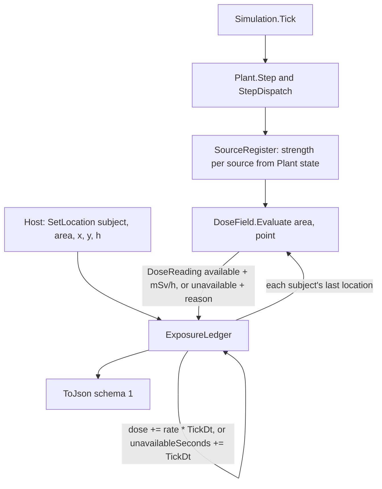
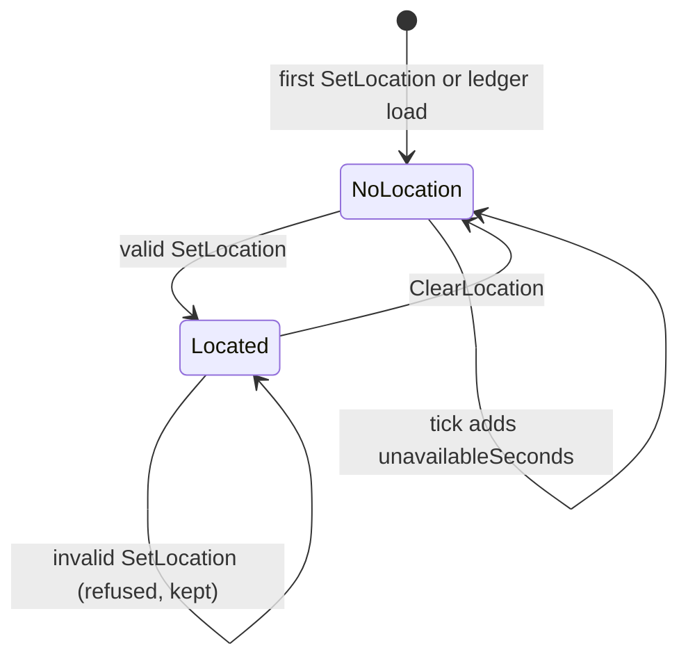

# Phase 4: Radiation and Controlled Access - Plan

## Goal Capsule

- **Objective:** later radiation readouts have one trustworthy source. Each place on the walkable route has a dose rate that follows the plant's state. Each operator's accumulated dose stays correct through pause and time warp, and saves and loads as its own document. A missing or broken input reads as unavailable, never as a safe zero. The player-visible Phase 4 outcome (survey, plan time, see exposure) stays open until U5 and U6, and save-file integration is later work.
- **Means:** a deterministic, engine-free radiation model in `ReactorSim.Core` (KTD1, KTD2) with a separate per-operator exposure ledger (KTD7); this run builds and proves it with tests only (KTD12). Instruments, the access task, gear, contamination and network carriage follow in later units.
- **Authority:** Requirements own product behavior; KTDs own mechanism; units own files and sequencing. The `ROADMAP.md` Phase 4 gate is the outer contract.
- **Stop conditions:** stop and report if the model needs a Unity, IO or wall-clock type inside `ReactorSim.Core`; if a change alters an existing solo-play result, a `PlantSnapshot` field or an existing test assertion; or if a physical value cannot be tied to a public source and is not labelled as a gameplay choice.
- **Execution profile:** `bash scripts/ci.sh` on any machine with .NET 8 proves this run. Unity compile and every visual or audible check are owner-run later (KTD12).
- **Finishing:** the owner merges PRs and tunes values in playtests; agents implement, verify and open PRs.

---

## Product Contract

### Summary

Add a radiation model to the simulation core. A register of a few game-scale sources sits at fixed points in the Phase 2 route frame. Each source's strength follows the live plant state. A dose rate at any point combines distance and shielding with those strengths. A per-operator ledger integrates dose on simulation time and saves to a versioned JSON document. This run delivers the model, the ledger and their tests. Readouts, access control, protective gear, contamination and network carriage are later units.

### Problem Frame

The plant shows blue glow and plays detector ticks, but neither is a measurement. `ReactorSoundMix.DetectorRate` is a function of power for atmosphere only, and the hall glow is decorative. Phase 4 needs field operators to survey an area, plan time and see their exposure. That is impossible until one authoritative model says what the dose rate is at a place and what an operator has received. A wrong zero is worse than no reading: it tells a player a place is safe when the model does not know.

### Key Decisions

- **Verified-first slice.** Core and tests only in this run; the engine work waits for the Unity host. Governs R12. (Carried from Phase 3 KTD16.)
- **Game model, not a radiation-protection tool.** Units and limits use real conventions so the numbers read sensibly, but source strengths are gameplay tuning, and the docs say so. Governs R3, R4.
- **No health consequences in this slice.** Dose is measured and recorded only. Alarms, access denial and any gameplay consequence are designed in later units against playtest evidence. Governs R10.

### Requirements

**Sources and dose rate**

- R1. The core holds a fixed register of radiation sources, each with a stable ID, a Phase 2 area ID, a position in the route frame and a strength rule.
- R2. Each source's strength follows the plant state each tick: operating sources fall after a trip, and residual sources follow decay heat.
- R3. The dose rate at a point is the sum over sources of strength, reduced by distance and by the shielding between the source's area and the point's area, plus a natural background.
- R4. Physical reference values cite a public source; every other value is labelled as a gameplay choice with a one-line reason.

**Availability**

- R5. A reading is unavailable, never zero, when the point's area is unknown, the subject has no location, the point is non-finite or outside the KTD10 bounds, or a plant input it needs is not finite.
- R6. An available reading is always at least the background rate, so an available reading never shows exact zero.

**Exposure**

- R7. Each operator has a ledger entry keyed by an opaque subject ID, holding accumulated dose, peak dose rate and time spent with no available reading.
- R8. Dose accumulates per simulation tick from the rate at the subject's last reported location; pause adds nothing and time warp adds dose in proportion to simulated time.
- R9. Ticks with an unavailable reading add no dose and add their duration to the subject's unavailable time.
- R10. The model classifies a dose rate against the posting thresholds, and classifies each area by the rate at that area's reference point in the register; it applies no consequence to the operator.

**State and determinism**

- R11. The ledger saves to and loads from a versioned JSON document; absent state loads as an empty ledger, and malformed or out-of-bounds state is refused with a reason.
- R12. The model is deterministic and engine-free: identical inputs give identical bytes, and solo play without registered subjects behaves exactly as before.

### Acceptance Examples

- AE1. **Covers R2, R3.** Given an operator on the reactor deck at rated power, when the plant trips, then within two ticks the deck dose rate falls by at least the operating share and keeps falling with decay heat.
- AE2. **Covers R5, R9.** Given an operator whose reported area ID is not in the register, when ten ticks run, then the reading is unavailable, the dose is unchanged and the unavailable time grows by ten ticks of simulated time.
- AE3. **Covers R8.** Given the same operator location and plant run, then 100 ticks at 1x and 100 ticks reached at 60x give identical dose, and a paused clock adds no dose.
- AE4. **Covers R11.** Given a saved ledger with two subjects, when it is loaded and saved again, then the bytes are identical; given a document with `schema` 2, then loading is refused with an unsupported-schema reason.

### Scope Boundaries

- Neutron dose, beta dose, skin and extremity dose, internal dose and contamination are out of this slice.
- Ray-traced geometry and buildup factors are out; shielding is an area-pair table (KTD5).
- Real plant dose maps are not reproduced; no public source gives them at power.

### Deferred to Follow-Up Work

- U5. Operator feedback: area monitors, survey meter, dosimeter, units on screen, alarm thresholds, audio tied to the modeled instrument, unavailable rendering as `N/M`. Any dose display shows unavailable time beside the dose, or shows the dose as "at least", because unavailable ticks add no dose (R9).
- U6. Controlled access and task: one posted service area outside containment, a short task, access indicators, safe exit, and protective gear with tested effects.
- U7. Contamination: separate state, surfaces, spread, survey and cleanup; only after the dose slice.
- U8. Session carriage: carry each peer's ledger entry in the Phase 3 world snapshot after PR #27 merges, and key subjects by peer ID.
- Replay and save-system integration: recording subject locations in the replay log and folding the ledger into a future save file.

---

## Planning Contract

### Key Technical Decisions

- KTD1. **New `ReactorSim.Core/Radiation/` folder, stateless sources.** Source strengths are pure functions of the current `Plant` state. Decay heat already decays inside `Plant.StepDecayHeat`, so the residual term needs no new state. N-16 has a 7.1 s half-life, which is comparable to the tick: real N-16 keeps about 60 % of its activity over one 5 s tick and decays away within about a minute of a trip. The operating term follows power and flow directly with no lag state. This is a gameplay simplification, labelled as such in `Physics.cs`: it drops the operating share at the first post-trip tick instead of over about a minute. Rejected: a first-order lag state, because it adds plant state for an effect shorter than a typical survey. No `Plant` or `PlantSnapshot` field changes. Covers R1, R2, R12.
- KTD2. **Three sources in this slice, as a recommendation the owner may veto.**
  - `rad.core`: the core under the pool, in `area.reactor_pool` (KTD6). Strength is an operating share proportional to `Power` plus a residual share proportional to `DecayHeatPower`.
  - `rad.primary_n16`: the primary loop in the reactor hall. Strength is proportional to `Power` times `PrimaryFlowFrac`.
  - `rad.corrosion`: activated corrosion products in the hall. Strength is constant, because Co-60 (5.27 y half-life) does not change over a play session.
  More sources wait until a later unit has a place to show them. Covers R1, R2.
- KTD3. **Units are mSv and mSv/h.** Real units make limits and postings readable, and 1 Gy is about 1 Sv for gamma. Source strengths are game-scale values set so the walkable route shows a readable range, from background in the control room to a posted high-radiation area at the deck rim at power. Rejected: abstract game units, because they make later dosimeter and posting text arbitrary. Covers R3, R4.
- KTD4. **Distance law with a softened core.** Each source contributes strength divided by the squared distance plus `r0` squared, with `r0` = 0.3 m. 0.3 m is the regulatory posting distance; using it as the softening length is a gameplay choice that removes the point-source singularity. Strength is the numerator `s` of that formula, so the unshielded rate at 1 m is `s` / 1.09. Tuning and threshold tests evaluate the full formula at the stated distance, never the nominal value. Covers R3.
- KTD5. **Shielding is an area-pair barrier table.** Each ordered pair of source area and subject area maps to a list of slabs, each a material and a thickness. Attenuation is 2 raised to minus thickness over the half-value layer (HVL). HVLs are broad-beam Co-60 values for concrete, steel and lead, plus a labelled estimate for water. The table lists every source-area and subject-area pair. An empty slab list is allowed for areas with no barrier, such as the same area or the open deck above the hall. A pair missing from the table is a register error caught by test, not a zero. Rejected: ray-traced geometry, because Core has no scene geometry and the area model is enough for readable gameplay. Covers R3, R5.
- KTD6. **Area IDs are Core string constants pinned to `RouteGraph`.** Core cannot reference `RouteGraph.cs`, a Unity-side file. Core declares the area IDs it uses. These are the `RouteGraph` room IDs, `space.reactor_hall` for hall equipment above the water, and one Core-only sub-area, `area.reactor_pool`, for the pool and core volume below the waterline. The sub-area exists so that pool water can sit as a slab between `rad.core` and every other area. A test linked with `RouteGraph.cs` checks three things:
  - Every Core area ID except `area.reactor_pool` exists in `RouteGraph.AllIds()`.
  - `area.reactor_pool` names `space.reactor_hall` as its parent, and that space exists.
  - Each source point lies inside its room's rectangle and height band when its area is a room.
  Covers R1, R5.
- KTD7. **Exposure lives in a separate `ExposureLedger`, owned by `Simulation`, not `Plant`.** The architecture rule puts synced and saved state on `Plant`, but dose belongs to an operator, not to the plant. Phase 3 carries crew state beside the plant for the same reason. The ledger has its own versioned JSON (KTD9), so it syncs and saves without touching `PlantSnapshot`. `docs/ARCHITECTURE.md` gains one sentence naming this exception. Rejected: storing it on `Plant`, because that adds player rows to every plant snapshot and its compatibility tests. Covers R7, R11, R12.
- KTD8. **Integration per tick on `TickDt`.** `Simulation.Tick` steps the ledger after `Plant.StepDispatch`, using the post-step plant and each subject's last reported location. Dose added equals the rate times `TickDt` in hours. Pause runs no tick, and warp runs more ticks of the same `TickDt`, so both are correct by construction. `SimSeconds` differences are never used, because restore and preset load reset it. The step guards its `dt` like `Plant.Step`. `LoadScenarioPreset` clears the ledger; `RestoreSnapshot` leaves it alone. Covers R8, R9.
- KTD9. **Strict versioned JSON.** The document is `{"schema":1,"subjects":[...]}`; each subject has `id`, `doseMSv`, `peakRateMSvPerH` and `unavailableSeconds`. Subjects are written sorted by ordinal ID. Numbers use the round-trip format the snapshot writer uses. The syntax parser is the strict `MiniJson` now private in `ProcedureLoader`, promoted to an internal shared class with three deltas:
  - A caller-supplied error prefix replaces the hard-coded `procedures.json` prefix.
  - A malformed `\u` escape fails as a parse error instead of escaping as a `FormatException`.
  - A nesting-depth cap of 16 fails as a parse error. It sits above the deepest shipped procedures document, which a test pins.
  The parser rejects duplicate keys, trailing text and bad syntax. `ExposureLedger.FromJson` does the rest: it catches parse failures and checks the schema, unknown keys, types, finiteness (including an exponent overflowing to infinity), negatives and the KTD10 bounds. It maps each failure to a typed reason. A null or empty input loads as an empty ledger, which is the explicit default for absent state. Rejected: the substring `ExtractJson*` helpers, because they cannot scope keys inside a subject array. Covers R11.
- KTD10. **Bounds on pathological input.** The limits are:
  - At most 16 subjects. A subject ID is 1-64 characters with no control characters.
  - Location coordinates must be finite and within 1000 m of the origin.
  - A dose rate is clamped to 1e5 mSv/h and a dose to 1e7 mSv.
  - A location update that breaks a bound is refused and leaves the previous location in place.
  Covers R5, R11.
- KTD11. **Sim-time dose under warp is accepted for this slice.** A player who stands in a field during 60x warp receives 60x dose per real second. That is the truthful model. Warning the player, or auto-slowing when a subject is in a posted area, belongs to U5. Rejected: real-time integration, because it would make the record depend on the time scale. Covers R8.
- KTD12. **Verified-first: Core and tests in this run; Unity later** (session-settled: user-directed — chosen over keeping the Windows build box as the Unity host: it kept going offline; the Unity host is a Mac with no Unity editor installed yet). Only `scripts/ci.sh` checks run in this slice. Unity compile and any visual or audible check are owner-run later and never claimed here.
- KTD13. **No personal data in repo files** (session-settled: user-approved — chosen over naming the build machine in plans and docs: personal-data rule). Plans, docs, tests and comments name no host, user, home path or email.

### High-Level Technical Design

Data flow inside one tick:

Reading shape, directional only: a `DoseReading` carries an availability flag, a rate in mSv/h that is meaningful only when available, and a reason code when unavailable. The reason codes are `UnknownArea`, `NoLocation`, `NonFiniteInput` and `OutOfBounds`. The rate is computed as background plus, for each source, strength times attenuation over (r² + r0²).

Subject state machine:

### Sources and Reference Values

All values below are approximate and must be re-checked against the linked page when they are written into `Physics.cs`.

| Value | Use | Source |
|---|---|---|
| 1 Sv = 100 rem; for gamma, 1 Gy is about 1 Sv | units (KTD3) | NRC glossary, https://www.nrc.gov/reading-rm/basic-ref/glossary/dose |
| Radiation area > 0.05 mSv/h at 30 cm; high radiation area > 1 mSv/h at 30 cm; very high radiation area > 5 Gy/h at 1 m | classification (R10), `r0` (KTD4) | 10 CFR 20.1003, https://www.ecfr.gov/current/title-10/chapter-I/part-20/subpart-A/section-20.1003 |
| Occupational limit 50 mSv/y (TEDE) | reference level for later units | 10 CFR 20.1201; NRC fact sheet, https://www.nrc.gov/reading-rm/doc-collections/fact-sheets/bio-effects-radiation |
| Natural background about 3.1 mSv/y, about 0.00035 mSv/h averaged | background (R6) | NRC fact sheet above |
| Broad-beam HVL at Co-60: concrete 6.6 cm, steel 2.1 cm, lead 1.2 cm | shielding (KTD5) | OSHA shielding examples, https://www.osha.gov/ionizing-radiation/introduction/shielding-layer-examples |
| Water HVL about 10 cm (estimate from the NIST mass attenuation coefficient at 1.25 MeV) | pool shielding (KTD5) | NIST XCOM, https://physics.nist.gov/PhysRefData/Xcom/html/xcom1.html; labelled as an estimate |
| N-16 half-life about 7.1 s; not a source after shutdown | operating term (KTD1, KTD2) | NRC documents, https://www.nrc.gov/docs/ML1034/ML103480436.pdf |
| Inverse square is valid only away from the source | `r0` softening (KTD4) | DOE-HDBK-1122-99 module 1.11, https://www.standards.doe.gov/standards-documents/1100/1122-bhdbk-1999-m1.11/@@images/file |

Source strengths, positions, `r0`, slab thicknesses and the operating and residual shares are gameplay choices. Each carries a one-line reason in `Physics.cs`.

### Assumptions

- The host supplies each operator's area ID and position, in the `RouteGraph` frame, in metres. Core never infers position.
- Source positions are derived from `RouteGraph` rooms and the hall layout during U1. Where the hall layout lives only on the Unity side, the implementer copies the numbers into `Physics.cs` and pins them with the linked cross-check test, as Phase 2 pinned layout constants.
- One solo subject uses an ID chosen by the host. Phase 3 peer IDs replace it in U8.
- The host calls `SetLocation` and `Tick` on the same thread, as Unity's main thread does. The ledger is not thread-safe, and `HttpApiServer` does not touch it in this slice.
- The instant drop of the N-16 term after a trip (KTD1) is acceptable at both the interactive tick (`TickDt` = 1 s) and the default tick (5 s); AE1 holds by construction at either.
- `Plant.AssertFinite` runs inside `Tick` and throws on a non-finite plant, so `NonFiniteInput` is reachable only through direct `DoseField` calls and tests, not a live tick.

### Risks

| Risk | Mitigation |
|---|---|
| Game-scale strengths read as real plant data | Every strength is labelled a gameplay choice in `Physics.cs`; `docs/design/plant-and-assets.md` states the approximations |
| Pool water attenuation (the `area.reactor_pool` slab, KTD6) makes the deck reading round to background at any strength | U1 tests pin a readable range: background in the control room, a posted radiation area on the deck at power; strengths are tuned to meet it |
| A missing barrier-table pair silently gives zero shielding | A register validation test enumerates every source-area and subject-area pair and fails on a gap (KTD5) |
| Ledger stepping changes existing determinism tests | With no subjects registered the step is a no-op; the existing determinism and `--verify` checks run unchanged |
| Promoting `MiniJson` changes procedure loading | The move is byte-identical code with internal visibility; existing `ProcedureLoader` tests stay green |

---

## Implementation Units

### U1. Reference values, source register and dose field

- **Goal:** compute an available or unavailable dose rate at any area and point from the live plant.
- **Requirements:** R1-R6, R10, R12.
- **Dependencies:** none.
- **Files:**
  - `ReactorSim.Core/Physics.cs`: a new radiation section with cited constants and labelled gameplay values (KTD3-KTD5).
  - New `ReactorSim.Core/Radiation/RadiationAreas.cs`: area IDs and the barrier table (KTD5, KTD6).
  - New `ReactorSim.Core/Radiation/SourceRegister.cs` (KTD1, KTD2).
  - New `ReactorSim.Core/Radiation/DoseField.cs`: the `DoseReading` shape and the area classification (R10).
  - Tests: new `ReactorSim.Core.Tests/RadiationModelTests.cs` and new `ReactorSim.Core.Tests/RadiationAreaRouteTests.cs`, which is linked with `RouteGraph.cs`.
- **Approach:**
  1. Add the constants with inline citations in the style of `Physics.cs`'s existing sections.
  2. Build the register and the barrier table as static read-only data with a `Validate` method returning a list of problems, mirroring `RouteGraph`'s self-check.
  3. Evaluate the dose rate from a `Plant`: check each input is finite first, then sum the contributions, add background and clamp (KTD10).
- **Patterns to follow:** `Physics.TrySaturationPressureBar` for the try-and-unavailable form; the `RouteGraph` validation list; `PlantWallMapModel` for the unavailable vocabulary.
- **Test scenarios:**
  - The control room at rated power reads at least background and below the radiation-area threshold.
  - The deck rim at rated power reads at or above the radiation-area threshold.
  - A point 2 m from a source reads more than the same point at 4 m, all else equal, and the ratio approaches 4 as `r0` becomes negligible.
  - A point at the source position gives a finite rate equal to strength over `r0` squared.
  - Adding one HVL of concrete between two areas halves that source's contribution.
  - `rad.core` reaches the deck only through the pool-water slab: removing that slab from a test-built table raises the deck reading.
  - Each area's classification equals the classification of the rate at its reference point.
  - After a trip, the `rad.primary_n16` contribution is zero and `rad.core` follows `DecayHeatPower`.
  - A cold, shut-down plant still reads above background in the hall because of `rad.corrosion`.
  - An unknown area ID gives unavailable with `UnknownArea`.
  - A NaN in `Power` or `PrimaryFlowFrac` gives unavailable with `NonFiniteInput`.
  - A non-finite or out-of-range point gives unavailable with `OutOfBounds`.
  - Every available reading is at least the background rate.
  - Classification at exactly each threshold matches the 10 CFR 20.1003 "greater than" wording.
  - Register validation finds no problems, and a test-built register with a missing barrier pair reports that pair.
  - Every Core area ID is in `RouteGraph.AllIds()`, and each room-area source point is inside its room.
  - Two identical evaluations give bit-identical doubles.
- **Verification:** the new tests pass; `bash scripts/ci.sh` passes; the Unity DLL is resynced.

### U2. Exposure ledger and tick integration

- **Goal:** accumulate each operator's dose on simulation time.
- **Requirements:** R7-R9, R12.
- **Dependencies:** U1.
- **Files:**
  - New `ReactorSim.Core/Radiation/ExposureLedger.cs`.
  - `ReactorSim.Core/Sim.cs`: own the ledger, step it in `Tick` after `StepDispatch`, and clear it in `LoadScenarioPreset` (KTD7, KTD8).
  - Tests: new `ReactorSim.Core.Tests/ExposureLedgerTests.cs` and new `ReactorSim.Core.Tests/ExposureClockTests.cs`.
- **Approach:**
  1. The ledger keeps subjects in a list sorted by ordinal ID, never in a dictionary iteration order.
  2. The host reaches the ledger through a `Simulation` property. `SetLocation` validates against KTD10 and refuses without side effects.
  3. `Step(plant, dt)` rejects a bad `dt` like `Plant.Step`. Then, for each subject, it evaluates the field at the last location and either adds dose and updates the peak, or adds unavailable time.
- **Patterns to follow:** `Plant.StepDispatch` and `ResetDispatch` pairing; `SimClockTests` for driving `Advance` at different scales.
- **Test scenarios:**
  - Covers AE3. The same location and plant give identical dose after 100 ticks at 1x and after the same ticks reached at 60x.
  - Covers AE3. `Advance` while paused adds no dose and no unavailable time.
  - Covers AE1. A subject on the deck sees its per-tick dose fall after a trip.
  - Covers AE2. An unknown area adds unavailable time each tick and no dose.
  - A subject with no location adds unavailable time.
  - An invalid `SetLocation` keeps the previous location and returns a refusal reason.
  - A 17th subject is refused.
  - The peak rate is the maximum seen, and is unchanged by lower later rates.
  - `LoadScenarioPreset` empties the ledger.
  - `RestoreSnapshot` leaves the ledger unchanged.
  - A simulation with no subjects produces the same `CaptureState().ToJson()` bytes and telemetry as before this unit.
  - Two identical runs give identical ledger state.
- **Verification:** the new tests pass; every existing determinism test is unchanged and green; `bash scripts/ci.sh` passes; the DLL is resynced.

### U3. Versioned ledger JSON

- **Goal:** save and load the ledger strictly, with an explicit default for absent state.
- **Requirements:** R11, R12.
- **Dependencies:** U2.
- **Files:**
  - New `ReactorSim.Core/Json/MiniJson.cs`: `MiniJson` promoted with internal visibility and the three KTD9 deltas.
  - `ReactorSim.Core/Procedures/ProcedureLoader.cs`: use the promoted parser.
  - `ReactorSim.Core/Radiation/ExposureLedger.cs`: `ToJson` and `FromJson`.
  - Tests: new `ReactorSim.Core.Tests/ExposureJsonTests.cs`.
- **Approach:**
  1. Move the parser, adding only the three KTD9 deltas.
  2. Write the document in sorted subject order.
  3. Load in stages: absent first, then structure, then each value against KTD10.
  4. Return a typed failure reason instead of throwing to callers.
  5. `Simulation` gains one method that replaces its ledger with a loaded one; a refused load leaves the current ledger untouched.
- **Execution note:** run the existing `ProcedureLoader` tests before and after the parser move; they must not change.
- **Patterns to follow:** `Tuning.ScanFlatObject` strictness; `SnapshotAndDeterminismTests` round-trip style.
- **Test scenarios:**
  - Covers AE4. Two subjects round-trip to identical bytes.
  - Covers AE4. `schema` 2 is refused as unsupported.
  - Null and empty input load as an empty ledger.
  - A missing `schema` is refused.
  - A duplicate key is refused.
  - An unknown key is refused.
  - A duplicate subject ID is refused.
  - A negative dose is refused.
  - NaN written as a string, or an exponent overflowing to infinity, is refused.
  - A dose above 1e7 mSv is refused.
  - 17 subjects are refused.
  - An ID of 65 characters, or one containing a control character, is refused.
  - Trailing text after the document is refused.
  - A document nested 10000 levels deep is refused with a parse reason, without a crash.
  - A malformed `\u` escape is refused with a parse reason.
  - The deepest shipped procedures document stays under the depth cap.
  - A refused load through `Simulation` leaves the previous ledger in place.
  - Locations are not saved: a loaded subject starts in `NoLocation`.
  - Existing procedure-loading tests pass unchanged.
- **Verification:** the new tests pass; `ProcedureLoader` tests unchanged; `bash scripts/ci.sh` passes; the DLL is resynced.

### U4. Verification checks, docs and DLL sync

- **Goal:** make the model part of the standing verification and the design record.
- **Requirements:** R4, R12.
- **Dependencies:** U1-U3.
- **Files:**
  - `ReactorSim.Runner/Verification.cs`: add `RAD-01`, dose rate is finite and at least background on every area at rated power, after a trip and when cold. Add `RAD-02`, ledger dose is invariant to time scale over a scripted run.
  - `docs/ARCHITECTURE.md`: the radiation component and the KTD7 exception.
  - `docs/design/plant-and-assets.md`: radiation section with area IDs, sources, approximations and the gameplay-choice list.
  - `docs/TESTING.md`.
  - `docs/testing/simulation-verification.md`: the new checks.
  - `ROADMAP.md`: Phase 4 status to "In progress (dose model)".
  - `ReactorSim.Unity/Assets/Plugins/ReactorSim/` DLL, PDB and hash via `scripts/sync-core-to-unity.sh`.
- **Approach:** checks return null on success and a message otherwise, as existing `Add(...)` entries do.
- **Test scenarios:**
  - `--verify` lists `RAD-01` and `RAD-02` as passing.
  - Forcing a NaN into a test register makes `RAD-01` fail with a message, as a test of the check itself.
  - Covers R4. A test reads the radiation section of `Physics.cs` and fails on any constant whose comment carries neither a source citation nor the words "gameplay choice".
- **Verification:** `bash scripts/ci.sh` passes with more checks and tests than before; docs name every gameplay choice.

---

## Verification Contract

| Gate | Command or check | Applies to |
|---|---|---|
| Full CI contract | `bash scripts/ci.sh`: clean-room scan, Core DLL freshness, Release build with warnings as errors, xUnit, `--scenario all`, `--verify` | every commit |
| Core DLL sync | `bash scripts/sync-core-to-unity.sh` after any `ReactorSim.Core` change, committing the plugin DLL, PDB and hash in the same commit | U1-U4 |
| Determinism | two identical runs give identical ledger JSON and unchanged `CaptureState().ToJson()` bytes | U2, U3 |
| Unity compile | `UNITY_EXE=<path> bash scripts/ci.sh` on the Unity host | owner-run before merge, never claimed here (KTD12) |
| Playtest tuning | owner walks the route and judges the readable range | later, with U5 |

---

## Definition of Done

- U1-U4 land on one branch, and `bash scripts/ci.sh` passes with more tests and verify checks than before the run.
- Every requirement R1-R12 has at least one named test, and AE1-AE4 each have a test marked `Covers`.
- `ReactorSim.Core/Radiation/` has no Unity, IO, wall-clock, `Random` or `Guid` use.
- Every radiation constant in `Physics.cs` either cites a public source or is labelled as a gameplay choice with a reason.
- No `PlantSnapshot` field, existing test assertion or solo-play result changes.
- Abandoned attempts and debug code are removed from the diff.
- The PR states that Unity compile, instruments, access, gear, contamination and session carriage are owner-run or later work.

---

## Open Questions

- Deferred to U5: whether the ledger should trigger auto-slow when a subject enters a posted area during warp (KTD11).
- Deferred to U6: the gameplay consequence of reaching a dose reference level, chosen from playtest evidence.
- Deferred to save-system work: restoring an older plant snapshot keeps the ledger's later dose, so a save file must store the plant and the ledger together.
